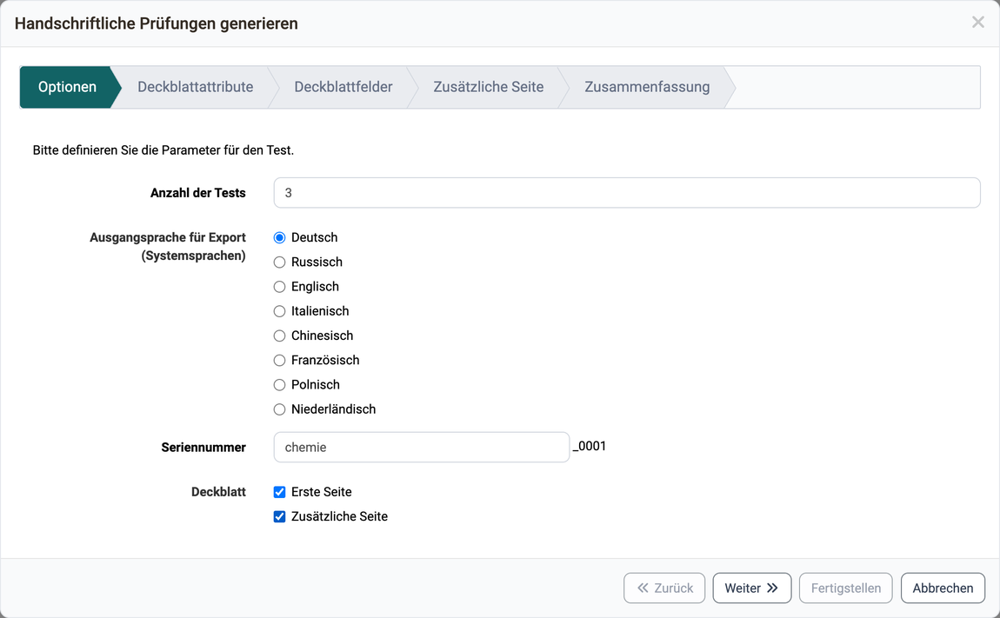
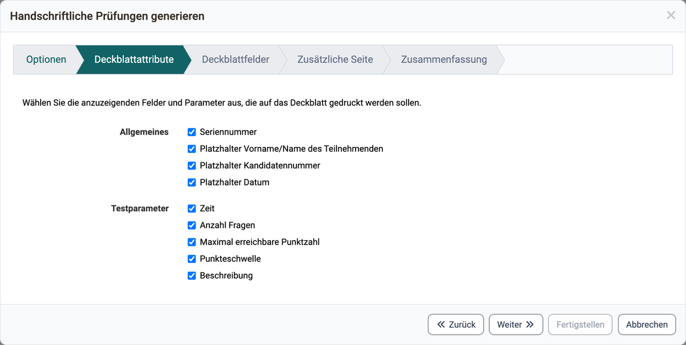
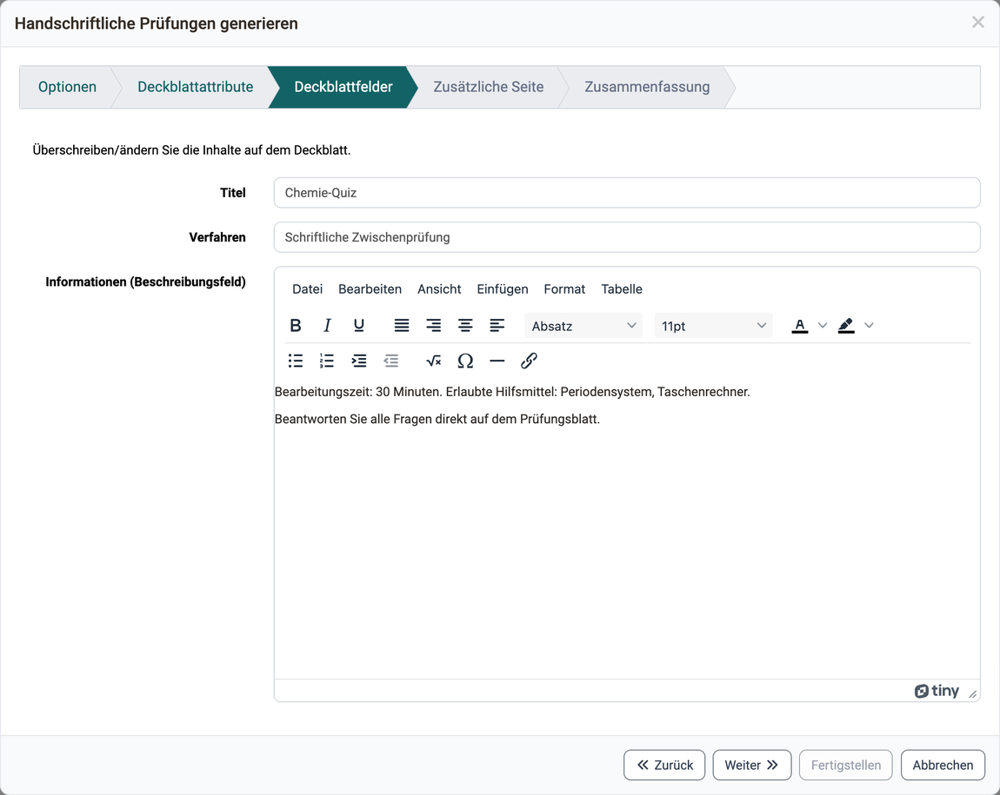
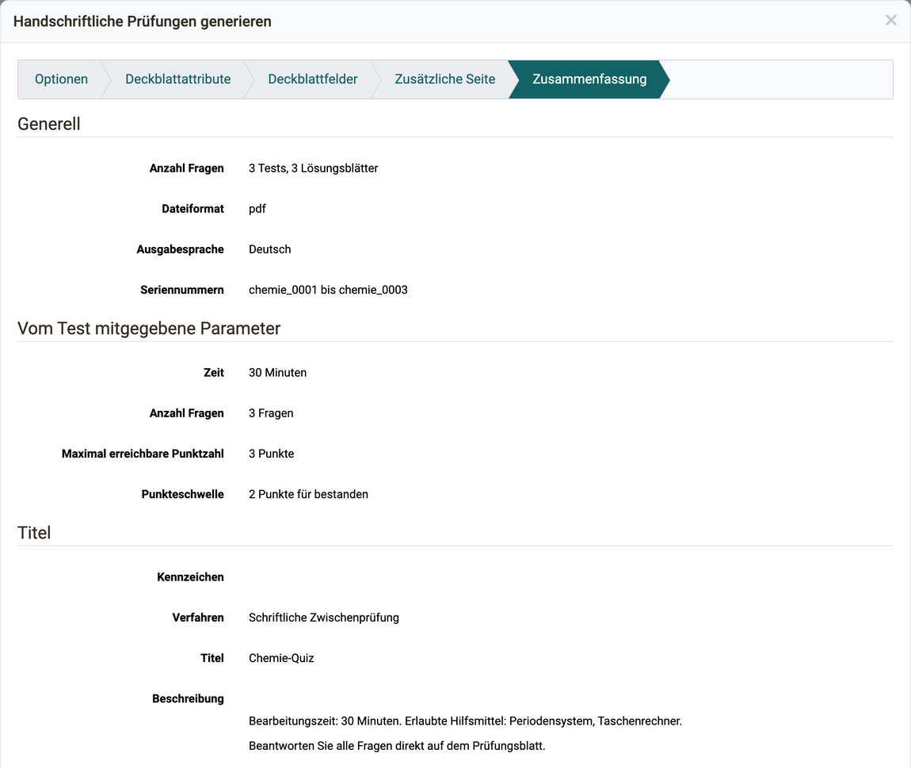

# Test: Handschriftliche Prüfungen generieren [:octicons-tag-16:{ title="ab Release 16.1 (OO-5648)" }](https://track.frentix.com/issue/OO-5648) {: #create_paper_pencil}

Wenn Sie offline eine Prüfung durchführen wollen, können Sie mit diesem Assistenten ein Deckblatt und verschiedene Versionen von Ihrer Testressource mit zufällig gewählten Antworten generieren lassen.

Den Assistenten öffnen Sie unter `Test > Administration > Handschriftliche Prüfungen generieren`. Den Eintrag sehen Besitzer:innen der Lernressource, Lernressourcenverwalter:innen und Administrator:innen. Er erscheint nur, wenn der PDF Generator eingeschaltet ist. Sie finden ihn in der System-Administration unter: `Administration > Externe Werkzeuge > PDF Generator`. Die übrigen Einträge des Menüs beschreibt die Seite [Test: Administration](Test_administration/index.de.md).

1. In den Optionen wählen Sie die Sprache und die Anzahl der Tests sowie im Feld "Seriennummer" ein Präfix für die Dateinamen aus. Sie können auch bestimmen, ob Sie ein Deckblatt oder auch eine zusätzliche Seite mitgenerieren wollen.

    { class="shadow lightbox" title="Schritt Optionen des Assistenten Handschriftliche Prüfungen generieren · 2026.09.28" }

2. Im zweiten Schritt wählen Sie die Attribute, die auf das Deckblatt kopiert werden sollen. Manche Attribute, wie die Beschreibung der Testressource, sind noch anpassbar.

    { class="shadow lightbox" title="Schritt Deckblattattribute des Assistenten · 2026.09.28" }

3. Hier ist die Möglichkeit, bestimmte Felder zu markieren und zu überschreiben. Das Beschreibungsfeld wird von der Testressource herüberkopiert und lässt sich hier nochmals anpassen.

    { class="shadow lightbox" title="Schritt Deckblattfelder des Assistenten · 2026.09.28" }

4. Haben Sie im Schritt "Optionen" die Option "Zusätzliche Seite" aktiviert, erscheint hier der Schritt "Zusätzliche Seite". Den Inhalt der zusätzlichen Seite legt die System-Administration fest, siehe [e-Assessment Administration: Test](../../manual_admin/administration/e-Assessment_Test.de.md#tab_tests_export).

5. Die Zusammenfassung beinhaltet eine Übersicht aller getätigten Einstellungen sowie eine Vorschau der zu generierenden Tests. Bitte beachten Sie, dass eine grössere Anzahl von Generierungen etwas dauern kann und der Browser möglicherweise nicht immer reagiert.

    { class="shadow lightbox" title="Schritt Zusammenfassung des Assistenten · 2026.09.28" }

[Zum Seitenanfang ^](#create_paper_pencil)

---

## Weiterführende Informationen {: #further_information}

**Auf dieser Seite erwähnt** 
[Test: Administration >](Test_administration/index.de.md) 
[e-Assessment Administration: Test >](../../manual_admin/administration/e-Assessment_Test.de.md)

**Weiterführend** 
[Testeditor >](Test_editor_QTI_2.1/index.de.md) 
[Tests exportieren >](Test_export.de.md)

[Zum Seitenanfang ^](#create_paper_pencil)
