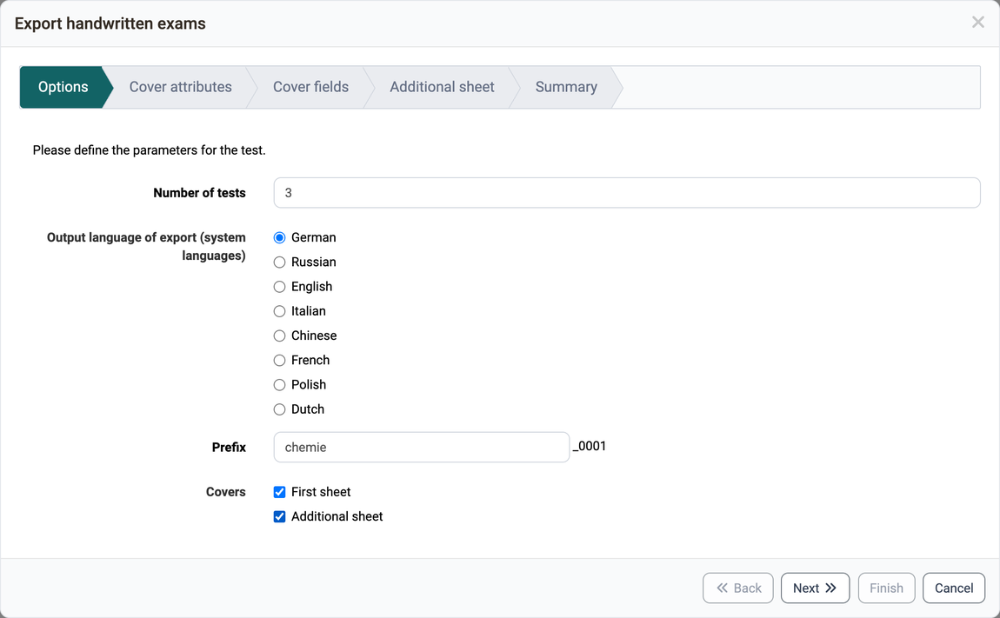
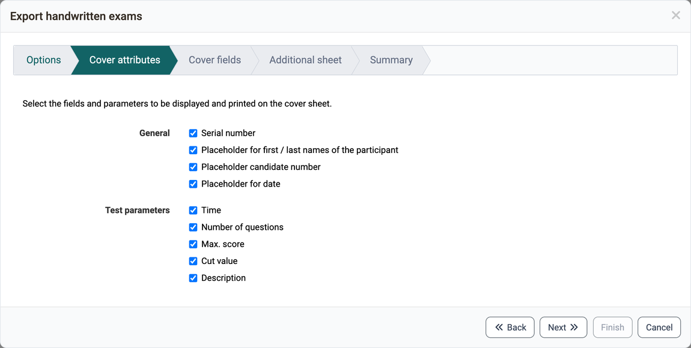
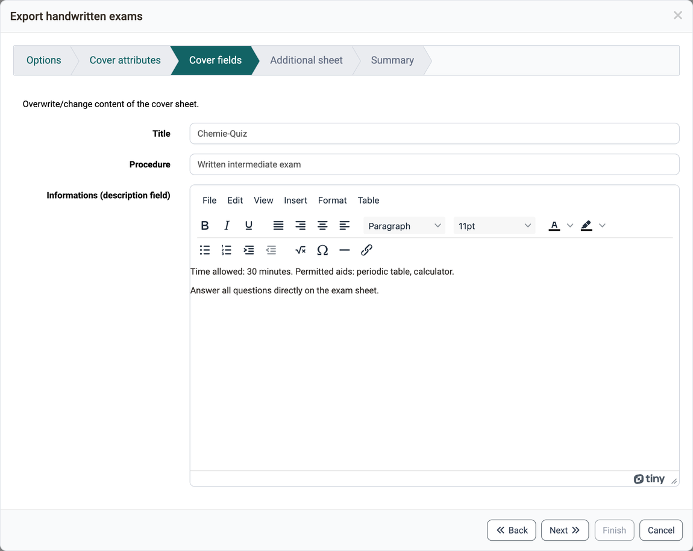

# Test: Export handwritten exams [:octicons-tag-16:{ title="from Release 16.1 (OO-5648)" }](https://track.frentix.com/issue/OO-5648) {: #create_paper_pencil}

If you want to run a test offline, you can use this wizard to generate a cover sheet and different versions of your test resource with randomly selected answers.

You open the wizard under `Test > Administration > Export handwritten exams`. Owners of the learning resource, learning resource managers and administrators see the entry. It only appears if the PDF generator is switched on. You find it in the system administration under: `Administration > External tools > PDF generator`. The other entries of the menu are described on the page [Test: Administration](Test_administration/index.md).

1. In the options you select the language and the number of tests, as well as a prefix for the file names in the field "Prefix". You can also specify whether you want to generate a cover sheet or an additional sheet.

    { class="shadow lightbox" title="Options step of the wizard Export handwritten exams · 2026.09.28" }

2. In the second step you choose the attributes that should be copied to the cover sheet. Some attributes, like the description of the test resource, are still customizable.

    { class="shadow lightbox" title="Cover attributes step of the wizard · 2026.09.28" }

3. Here you have the possibility to select and overwrite certain fields. The description field is copied over from the test resource and can be customized again here.

    { class="shadow lightbox" title="Cover fields step of the wizard · 2026.09.28" }

4. If you activated the "Additional sheet" option in the "Options" step, the "Additional sheet" step appears here. The content of the additional sheet is defined in the system administration, see [e-Assessment Administration: Test](../../manual_admin/administration/e-Assessment_Test.md#tab_tests_export).

5. The summary contains an overview of all settings made and a preview of the tests to be generated. Please note that a large number of generations may take some time and the browser may not always respond.

    { class="shadow lightbox" title="Summary step of the wizard · 2026.09.28" }

[To the top of the page ^](#create_paper_pencil)

---

## Further information {: #further_information}

**Mentioned on this page** 
[Test: Administration >](Test_administration/index.md) 
[e-Assessment Administration: Test >](../../manual_admin/administration/e-Assessment_Test.md)

**Further reading** 
[Test editor >](Test_editor_QTI_2.1/index.md) 
[Export tests >](Test_export.md)

[To the top of the page ^](#create_paper_pencil)
