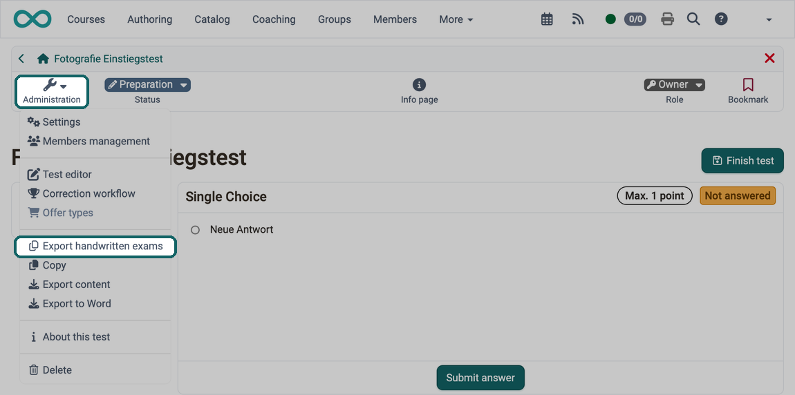
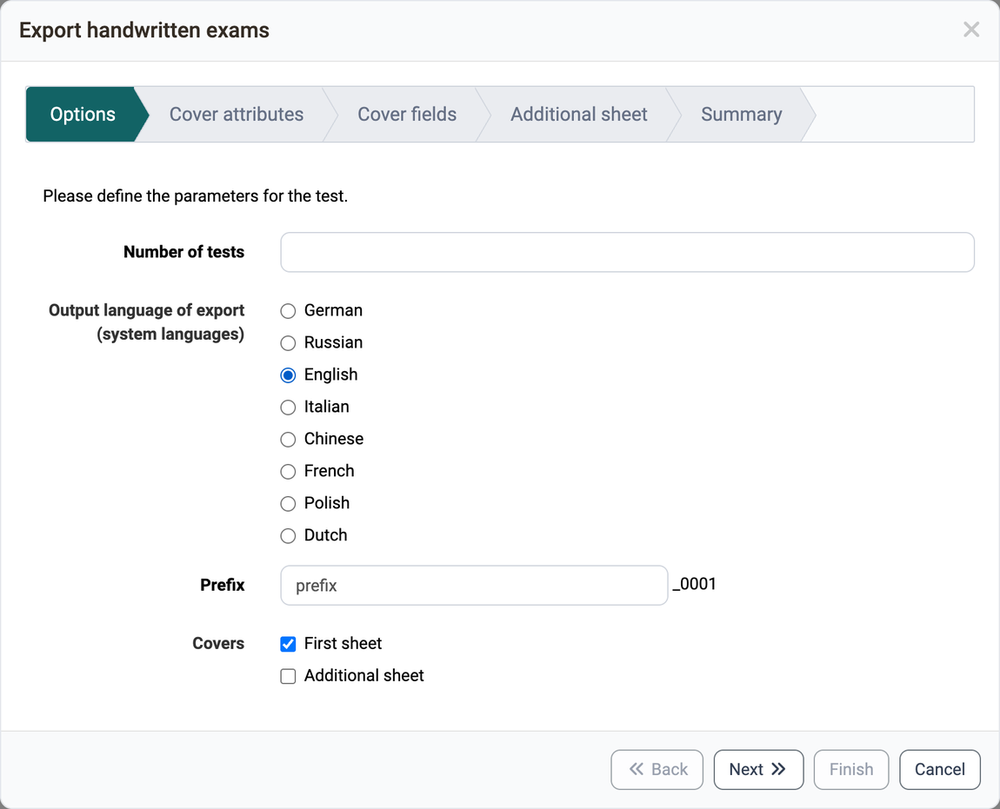
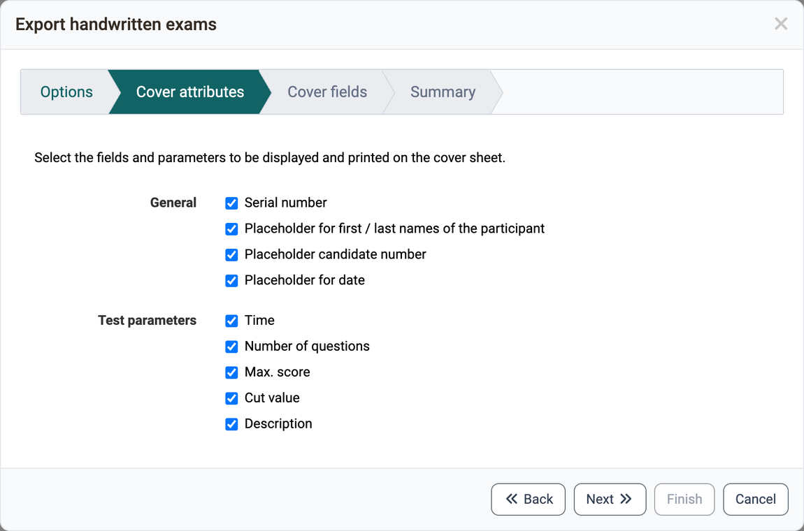
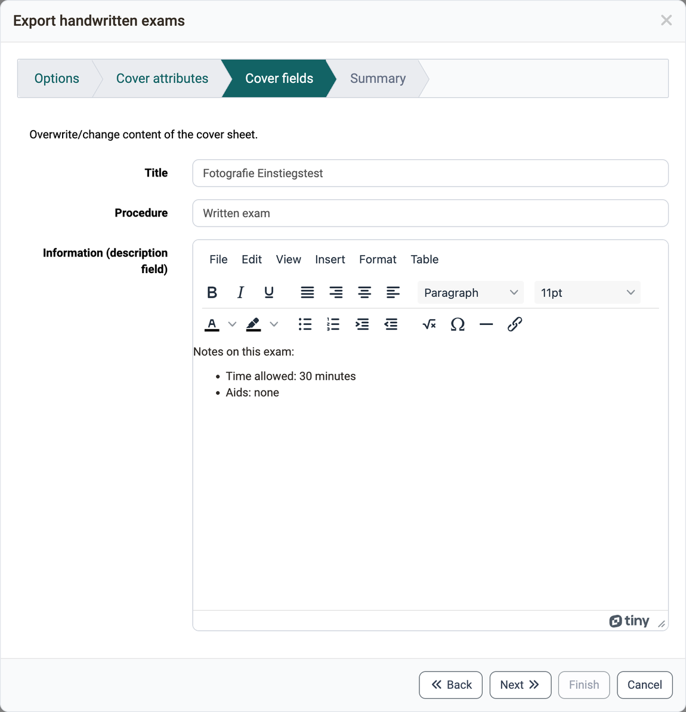
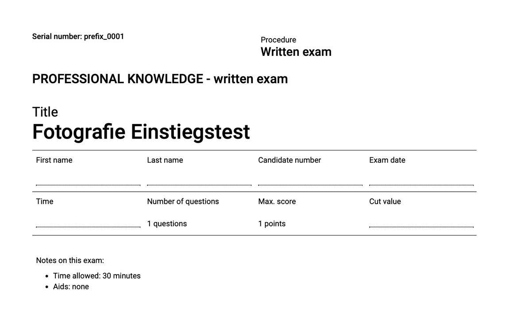
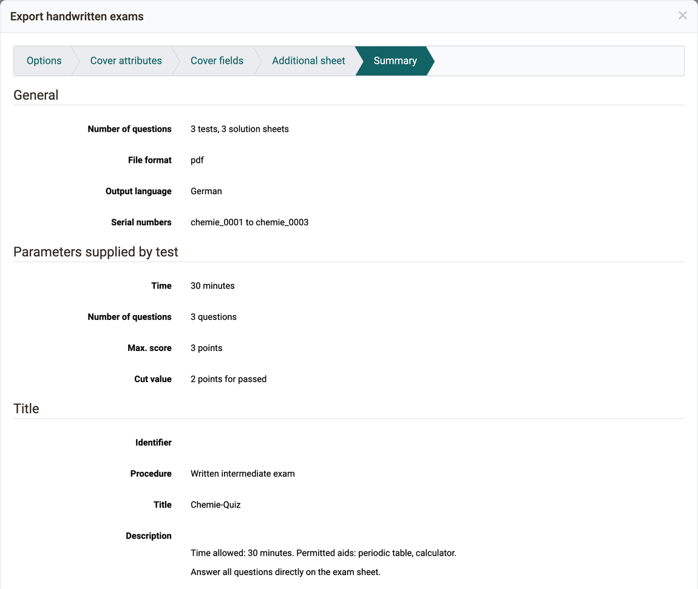

# Test: Export handwritten exams [:octicons-tag-16:{ title="from Release 16.1 (OO-5648)" }](https://track.frentix.com/issue/OO-5648) {: #create_paper_pencil}

Whoever conducts a test on paper receives print-ready exam sheets with the wizard "Export handwritten exams": a zip file with one PDF file per exam and the matching solution sheet. Each exam is given its own serial number and, if desired, a cover sheet. This way, every sheet completed by hand can be clearly assigned after the exam.

OpenOlat compiles each exam in the same way as a new test attempt online. If a section shows only a selection of its questions or the questions in random order, the exams differ from each other. How to set this up is described under [Configure tests](Configure_tests.md#section).

## Open the wizard {: #open_wizard}

You open the wizard in the administration of the test learning resource under: `Test > Administration > Export handwritten exams`

The menu item is available to owners of the test learning resource, learning resource managers and administrators. It appears if the [PDF Service](../../manual_admin/administration/External_Tools_-_Administration.md#pdf_generator) is enabled in the system administration: `Administration > External tools > PDF generator`. The other entries of the menu are described on the page [Test: Administration](Test_administration/index.md).

{ class="shadow lightbox" title="Administration menu of a test learning resource · 2026.10.01" }

[To the top of the page ^](#create_paper_pencil)

---

## Steps of the wizard {: #wizard_steps}

The wizard leads you to the zip file in up to five steps. Which steps appear, you determine in the first step under "Covers".

### Options {: #options}

"Number of tests" and "Prefix" are mandatory. OpenOlat generates as many exams as you specify and appends a sequential number to the prefix: "prefix" becomes "prefix_0001". The serial number is also the name of the PDF file. You choose the language of the exam sheets under "Output language of export (system languages)". Under "Covers" you determine whether each exam receives a cover sheet with "First sheet" and a further page with "Additional sheet".

{ class="shadow lightbox" title="Step Options in the dialog Export handwritten exams · 2026.10.01" }

### Cover attributes {: #cover_attributes}

This step appears when "First sheet" is selected. You select which details and placeholders the cover sheet carries.

{ class="shadow lightbox" title="Step Cover attributes in the dialog Export handwritten exams · 2026.10.01" }

### Cover fields {: #cover_fields}

This step also appears when "First sheet" is selected. You adjust "Title" and "Procedure" and write a note for the participants under "Information (description field)". The field takes over the description of the test learning resource, and you can change it here for the cover sheet.

{ class="shadow lightbox" title="Step Cover fields in the dialog Export handwritten exams · 2026.10.01" }

This is what a generated cover sheet with all details looks like:

{ class="shadow lightbox" title="Generated cover sheet of a handwritten exam · 2026.10.01" }

### Additional sheet {: #additional_sheet}

This step appears when "Additional sheet" is selected. The text editor contains the text that the system administration has stored for the additional sheet: `Administration > e-Assessment > Test > Tab "Tests export"`, see [e-Assessment Administration: Test](../../manual_admin/administration/e-Assessment_Test.md#tab_tests_export). You can adjust the text here for these exams.

### Summary {: #summary}

The summary shows all settings: the number of tests and solution sheets, the file format, the output language, the serial numbers, the parameters supplied by the test and the details for the cover sheet. With "Preview" and "Preview with solutions" you open a sample as a PDF file.

{ class="shadow lightbox" title="Step Summary in the dialog Export handwritten exams · 2026.09.28" }

After "Finish" the download of the zip file starts. Depending on the number, it takes several minutes or hours, and the browser may not respond during this time. The zip file contains one PDF file per exam named after the serial number in the folder "tests" and the matching solution sheet in the folder "solutions".

[To the top of the page ^](#create_paper_pencil)

---

## Further information {: #further_information}

**Mentioned on this page** 
[Configure tests >](Configure_tests.md) 
[External Tools: Overview >](../../manual_admin/administration/External_Tools_-_Administration.md) 
[Test: Administration >](Test_administration/index.md) 
[e-Assessment Administration: Test >](../../manual_admin/administration/e-Assessment_Test.md)

**Further reading** 
[Test editor >](Test_editor_QTI_2.1/index.md) 
[Export tests >](Test_export.md)

[To the top of the page ^](#create_paper_pencil)
