# Test Fragetypen {: #question_types}

Für jede Testfrage wählen Sie den Fragetyp, der zu Ihrer Prüfungsform passt. Geschlossene Fragen bewertet OpenOlat automatisch, offene Antworten wie Aufsätze, Dateien und Zeichnungen bewerten Sie selbst. Diese Seite zeigt je Fragetyp, wie Sie die Frage im Testeditor erfassen und wie die Teilnehmenden sie im Test sehen.

Den Testeditor öffnen Besitzer:innen des Tests, Administrator:innen und Lernressourcenverwalter:innen unter `Test > Administration > Testeditor`. Fragetypen mit einem * bewerten Sie manuell. Die Tabs "Punkte" und "Feedback", die bei allen Fragetypen vorkommen, beschreibt die Seite [Testfragen konfigurieren](Configure_test_questions.de.md).

!!! tip "Import von Fragen"

    Neben dem direkten Erstellen können Sie Fragen auch aus dem [Fragenpool](../area_modules/Question_Bank/index.de.md) oder über den [Excelimport](../area_modules/Question_Bank_Import_Questions.de.md#excelimport) aus einer Tabelle in Excel importieren. Fragen aus dem Fragenpool kommen als Kopie in den Test, siehe [Fragen aus dem Fragenpool verwenden](Test_editor_QTI_2.1/index.de.md#questions_from_pool).

## :o_icon_o_mi_qtisc: Single Choice {: #sc}

Mit einer Single-Choice-Frage prüfen Sie, ob die Teilnehmenden unter mehreren Antworten die eine richtige erkennen. Die Frage hat mehrere Antworten, genau eine davon ist richtig, und die Teilnehmenden wählen genau eine aus.

Geben Sie zuerst unter "Titel" einen kurzen Titel und unter "Frage" die Frage ein.

Legen Sie danach fest, ob die Antworten in zufälliger Reihenfolge erscheinen ("Zufällige Reihenfolge"), ob sie vertikal oder horizontal angeordnet sind ("Ausrichtung der Antworten") und ob die Auswahlfelder links oder rechts stehen ("Check-box Ausrichtung").

Erfassen Sie dann die Antworttexte. Mit der Schaltfläche :o_icon_o_icon_add: fügen Sie eine Antwort hinzu, mit der Schaltfläche :o_icon_o_icon_delete: entfernen Sie eine.

Markieren Sie in der Spalte "Korrekt" die richtige Antwort. Mit den Pfeilen ändern Sie die Reihenfolge der Antworten.

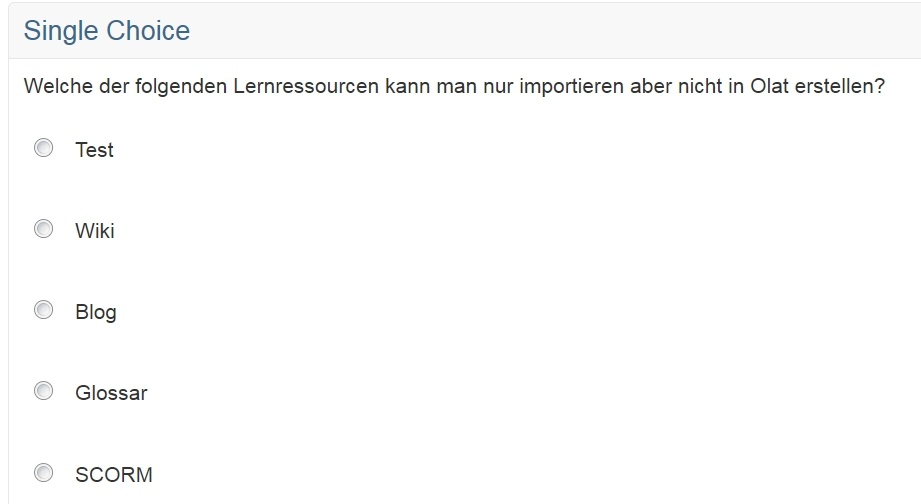{ class="shadow lightbox" title="Single Choice aus Sicht der Teilnehmenden" }

---

## :o_icon_o_mi_qtimc: Multiple Choice {: #mc}

Mit einer Multiple-Choice-Frage prüfen Sie, ob die Teilnehmenden alle zutreffenden Antworten erkennen. Die Frage hat mindestens zwei Antworten, mehrere davon können richtig sein, und die Teilnehmenden wählen mehrere Antworten aus.

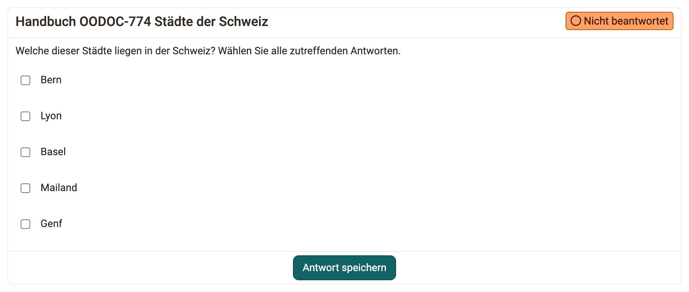{ class="shadow lightbox" title="Multiple Choice aus Sicht der Teilnehmenden · 2026.11.10" }

**Tab "Auswahl"** 
Geben Sie im Tab "Auswahl" zuerst unter "Titel" einen kurzen Titel und unter "Frage" die Frage ein.

Legen Sie danach fest, ob die Antworten in zufälliger Reihenfolge erscheinen ("Zufällige Reihenfolge"), ob sie vertikal oder horizontal angeordnet sind ("Ausrichtung der Antworten") und ob die Auswahlfelder links oder rechts stehen ("Check-box Ausrichtung").

Erfassen Sie dann die Antworttexte. Mit der Schaltfläche :o_icon_o_icon_add: fügen Sie eine Antwort hinzu, mit der Schaltfläche :o_icon_o_icon_delete: entfernen Sie eine.

Markieren Sie in der Spalte "Korrekt" alle richtigen Antworten. Mit den Pfeilen ändern Sie die Reihenfolge der Antworten.

**Tab "Punkte"** 
Unter "Bewertungsmethode" stehen für Multiple-Choice-Fragen drei Methoden zur Wahl:

* **Alle korrekten Antworten** 
Die Teilnehmenden erhalten die volle Punktzahl nur, wenn sie alle richtigen und keine falsche Antwort auswählen. Fehlt eine richtige Antwort oder ist eine falsche ausgewählt, beträgt die Punktzahl 0.

* **Punkte pro Antwort** 
Sie vergeben für jede Antwortoption einzeln positive oder negative Punkte.

* **Teilpunkte** 
OpenOlat addiert für jede richtig ausgewählte Antwort eine gewichtete Punktzahl und zieht für jede falsch ausgewählte Antwort eine gewichtete Punktzahl ab. Die Formel lautet: 
Punktzahl = maximale Punktzahl * (Anzahl der richtig markierten Antworten / Anzahl der richtigen Antworten) - maximale Punktzahl * (Anzahl der falsch markierten Antworten / Anzahl der falschen Antworten)

Mit "Min. Anzahl möglicher Antworten" und "Max. Anzahl möglicher Antworten" legen Sie im selben Tab fest, wie viele Antworten die Teilnehmenden mindestens und höchstens auswählen.

---

## :o_icon_o_mi_qtikprim: Kprim {: #kprim}

Mit einer Kprim-Frage prüfen Sie, ob die Teilnehmenden vier Aussagen zu einem Thema richtig einschätzen. Die Frage hat immer genau vier Antworten. Die Teilnehmenden entscheiden bei jeder Antwort, ob sie zutrifft. 0 bis 4 Antworten können richtig sein.

Geben Sie zuerst unter "Titel" einen kurzen Titel und unter "Frage" die Frage ein.

Legen Sie danach fest, ob die Antworten in zufälliger Reihenfolge erscheinen ("Zufällige Reihenfolge") und ob die Auswahlfelder links oder rechts stehen ("Check-box Ausrichtung").

Erfassen Sie dann die vier Antworttexte. Mit den Pfeilen ändern Sie die Reihenfolge der Antworten. Die Zahl der Antworten ist fest auf vier gesetzt. Wählen Sie für jede Antwort "Richtig" oder "Falsch".

Das Punkteschema ist bei Kprim-Fragen fest vorgegeben:

Alle Antworten korrekt = 100% der Punktzahl 
3 korrekte Antworten = 50% der Punktzahl 
2, 1 oder 0 korrekte Antworten = 0% der Punktzahl

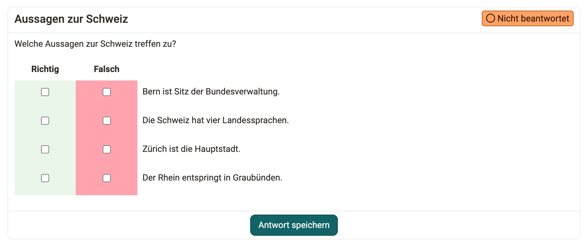{ class="shadow lightbox" title="Kprim aus Sicht der Teilnehmenden, Vorschau im Testeditor · 2026.11.10" }

---

## :o_icon_o_mi_qtimatch: Matrix [:octicons-tag-16:{ title="ab Release 11.2 (OO-2343)" }](https://track.frentix.com/issue/OO-2343) {: #matrix}

Mit einer Matrix-Frage prüfen Sie mehrere Zuordnungen auf einmal in einer Tabelle. Die Teilnehmenden kreuzen je Zeile an, welche Spalte zutrifft, als Single Choice oder als Multiple Choice pro Zeile.

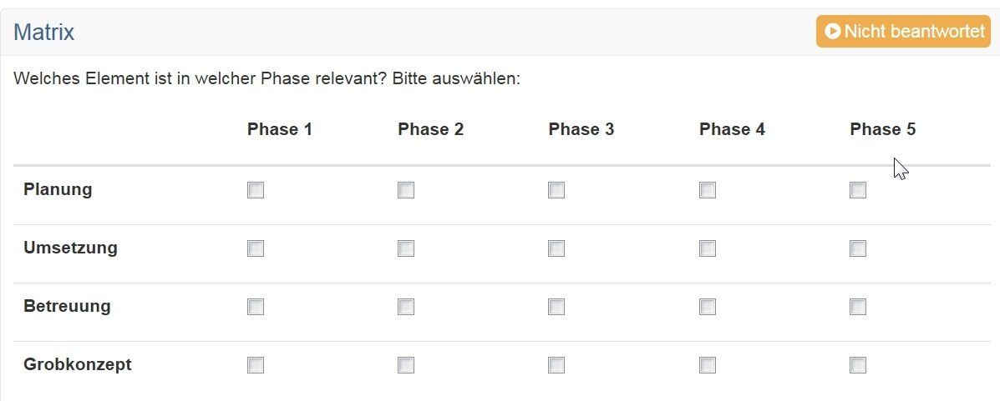{ class="shadow lightbox" title="Matrix aus Sicht der Teilnehmenden" }

**Tab "Matrix"** 
Geben Sie auch hier zuerst unter "Titel" den Titel und unter "Frage" die Frage ein.

Legen Sie danach unter "Zufällige Reihenfolge" fest, ob die Antworten in zufälliger Reihenfolge erscheinen. Unter "Typ" wählen Sie, ob pro Zeile Single Choice oder Multiple Choice gilt.

Tragen Sie dann die Werte in die Spalten und in die Zeilen ein. Weitere Spalten und Zeilen ergänzen Sie mit "Kolonne hinzufügen" und "Zeile hinzufügen". Wählen Sie zum Schluss pro Zeile die korrekten Antworten: bei Single Choice eine Antwort pro Zeile, bei Multiple Choice eine oder mehrere.

**Tab "Punkte"** 
Unter "Bewertungsmethode" stehen für diesen Fragetyp drei Methoden zur Wahl:

* **Alle korrekten Antworten** 
Die Teilnehmenden erhalten die volle Punktzahl nur, wenn sie alle richtigen und keine falsche Antwort auswählen. Fehlt eine richtige Antwort oder ist eine falsche ausgewählt, beträgt die Punktzahl 0.

* **Punkte pro Antwort** 
Sie vergeben für jede Antwortoption einzeln positive oder negative Punkte.

* **Teilpunkte** 
OpenOlat addiert für jede richtig ausgewählte Antwort eine gewichtete Punktzahl und zieht für jede falsch ausgewählte Antwort eine gewichtete Punktzahl ab. Die Formel lautet: 
Punktzahl = maximale Punktzahl * (Anzahl der richtig markierten Antworten / Anzahl der richtigen Antworten) - maximale Punktzahl * (Anzahl der falsch markierten Antworten / Anzahl der falschen Antworten)

---

## :o_icon_o_mi_qtimatch_draganddrop: Drag and Drop [:octicons-tag-16:{ title="ab Release 11.5 (OO-2732)" }](https://track.frentix.com/issue/OO-2732) {: #drag_drop}

Mit einer Drag-and-Drop-Frage prüfen Sie Zuordnungen wie mit einer Matrix-Frage. Die Teilnehmenden kreuzen dabei keine Kästchen an, sondern ziehen die Begriffe in die passenden Kategorien.

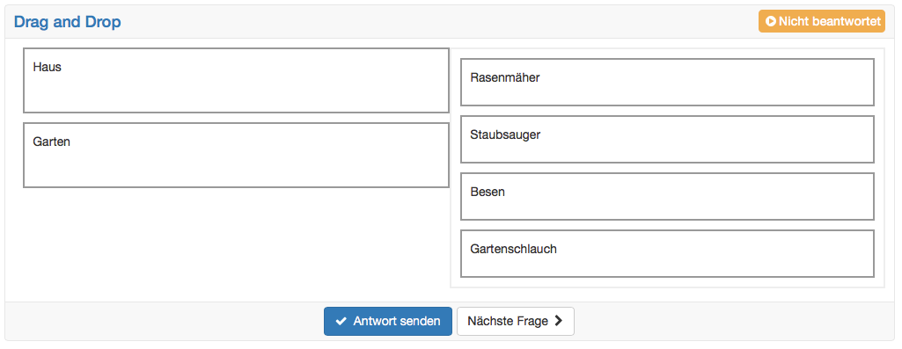{ class="shadow lightbox" title="Drag and Drop aus Sicht der Teilnehmenden" }

**Tab "Drag and drop"** 
Geben Sie zuerst unter "Titel" den Titel und unter "Frage" die Frage ein.

Unter "Zufällige Reihenfolge" legen Sie fest, ob Begriffe und Kategorien in zufälliger Reihenfolge erscheinen.

Unter "Typ" wählen Sie Single Choice oder Multiple Choice. Bei Single Choice ordnen die Teilnehmenden jeden Begriff genau einmal zu. Bei Multiple Choice ordnen sie jeden Begriff jeder Kategorie höchstens einmal zu.

Unter "Ausrichtung der Antworten" legen Sie fest, wo die zuzuordnenden Begriffe im Verhältnis zu den Kategorien stehen: links, oben, rechts oder unten.

Erfassen Sie dann in den Spalten ("Drop-Kategorien") die Kategorien. Das sind die festen Felder, in welche die Teilnehmenden die Begriffe ziehen. In den Zeilen ("Begriffe") erfassen Sie die Begriffe. Kreuzen Sie zum Schluss in der Tabelle an, welcher Begriff in welche Kategorie gehört.

**Tab "Punkte"** 
Unter "Bewertungsmethode" stehen für diesen Fragetyp drei Methoden zur Wahl:

* **Alle korrekten Antworten** 
Die Teilnehmenden erhalten die volle Punktzahl nur, wenn sie alle Begriffe richtig und keinen falsch zuordnen. Fehlt eine richtige Zuordnung oder ist eine falsche gesetzt, beträgt die Punktzahl 0.

* **Punkte pro Antwort** 
Sie vergeben für jede Antwortoption einzeln positive oder negative Punkte.

* **Teilpunkte** 
OpenOlat addiert für jede richtig ausgewählte Antwort eine gewichtete Punktzahl und zieht für jede falsch ausgewählte Antwort eine gewichtete Punktzahl ab. Die Formel lautet: 
Punktzahl = maximale Punktzahl * (Anzahl der richtig markierten Antworten / Anzahl der richtigen Antworten) - maximale Punktzahl * (Anzahl der falsch markierten Antworten / Anzahl der falschen Antworten)

!!! info "Hinweis: Einschränkung auf mobile Geräte"

    Die Teilnehmenden bedienen diesen Fragetyp, indem sie die Antwortelemente ziehen. Für die Touch-Bedienung ist er nicht optimiert. Er eignet sich am besten für Tests, welche die Teilnehmenden an einem Desktop-Gerät oder Laptop bearbeiten.

---

## :o_icon_o_mi_qtimatch_truefalse: True/false [:octicons-tag-16:{ title="ab Release 12.4 (OO-3220)" }](https://track.frentix.com/issue/OO-3220) {: #true_false}

Mit einer True/false-Frage lassen Sie die Teilnehmenden beliebig viele Aussagen als richtig oder falsch beurteilen. Der Fragetyp ähnelt Kprim, hat aber beliebig viele Zeilen. In jeder Zeile beurteilen die Teilnehmenden eine Aussage.

Die Teilnehmenden wählen je Zeile eine von drei Antwortoptionen: "Unbeantwortet", "Richtig" oder "Falsch". Zu Beginn ist immer "Unbeantwortet" ausgewählt. Die drei Spalten sind fest, weitere Zeilen ergänzen Sie mit "Zeile hinzufügen".

Anders als bei Kprim legen Sie die Punkte frei fest. Auch für die Antwortoption "Unbeantwortet" vergeben Sie bei Bedarf Punkte.

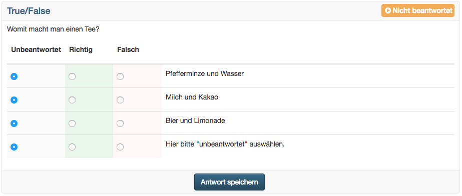{ class="shadow lightbox" title="True/false aus Sicht der Teilnehmenden" }

---

## :o_icon_o_mi_qtifib: Lückentext {: #gap}

Mit einer Lückentext-Frage prüfen Sie, ob die Teilnehmenden fehlende Begriffe in einem Text selbst eintippen. Der Text enthält Lücken, in welche die Teilnehmenden ihre Antwort schreiben.

Lücken fügen Sie im Editor der Frage mit dem Icon mit den drei Punkten ("Lückentext") ein. Mit einem Klick auf eine Lücke bearbeiten Sie sie. Der Dialog "Lücke erstellen" bzw. "Lücke bearbeiten" zeigt oben unter "Eingabemethode" die Art der Lücke und unter "Vorschau", wie die Lücke im Test erscheint.

Für jede Lücke legen Sie folgende Einstellungen fest:

* "Lösung": Tragen Sie hier die richtige Lösung ein.
* "Alternative Antworten": Mit diesem Schalter erfassen Sie weitere akzeptierte Lösungen als Varianten. "Antwort hinzufügen" ergänzt je ein Feld. "Mehrfach hinzufügen" erfasst mehrere Varianten auf einmal, getrennt durch ein wählbares "Trennzeichen".
* "Anzeige":
    * "Platzhalter": Hier tragen Sie bei Bedarf einen Text ein, den die Teilnehmenden in der leeren Lücke sehen.
    * "Lückenlänge": Hier tragen Sie eine Länge für das Lückenfeld ein, zum Beispiel zur Formatierung. Die Länge der Eingabe begrenzt sie nicht.
    * "Vorschau": Zeigt an einem Beispielsatz direkt im Dialog, wie die Lücke mit Platzhalter und Lückenlänge erscheint.
* "Optionen": Mit den Kontrollkästchen unter "Korrektur" legen Sie fest, wie streng OpenOlat die Antworten automatisch korrigiert:
    * "Gross- und Kleinschreibung beachten": Ist die Option gewählt, zählt die Gross- und Kleinschreibung. Sonst spielt sie für die Korrektur keine Rolle.
    * "Leerzeichen ignorieren": Zusätzliche Leerzeichen, Tabulatoren und Zeilenumbrüche in der Antwort führen nicht zu Punktabzug. Bei der Lösung "log in" gilt so auch eine Eingabe mit doppeltem Leerzeichen als richtig. [:octicons-tag-16:{ title="ab Release 21.0 (OO-9560)" }](https://track.frentix.com/issue/OO-9560)
    * "Wildcard (*)": Das Zeichen * steht in der Lösung für "etwas oder nichts" und funktioniert auch in den Varianten. So deckt die Lösung "col*r" die Schreibweisen "color", "colour" und "colr" ab. Tippen die Teilnehmenden selbst ein * ein, zählt es als normales Zeichen. Eine Lösung, die nur aus Wildcards besteht, nimmt OpenOlat beim Speichern nicht an. [:octicons-tag-16:{ title="ab Release 21.0 (OO-9384)" }](https://track.frentix.com/issue/OO-9384)

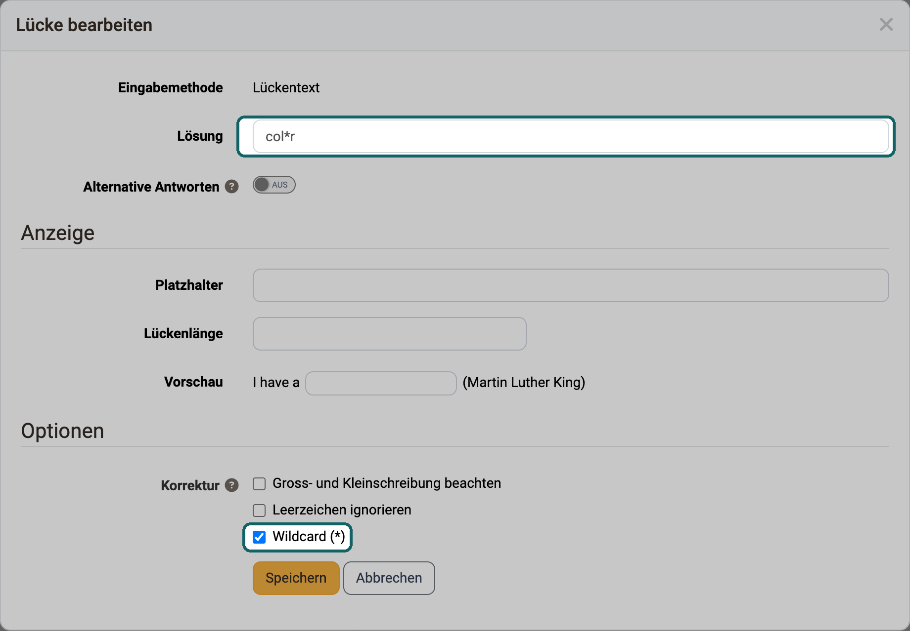{ class="shadow lightbox" title="Dialog Lücke bearbeiten bei Lückentext · 2026.11.10" }

Die Punkte legen Sie frei fest. Auch für Varianten vergeben Sie bei Bedarf Punkte.

Enthalten mindestens zwei Lücken eine identische Antwortmöglichkeit, steht im Tab "Punkte" die Option "Doppelte Eingaben erlauben" zur Wahl. Damit lassen Sie zu oder verhindern, dass die Teilnehmenden dieselbe Antwort in mehrere Lücken eintragen.

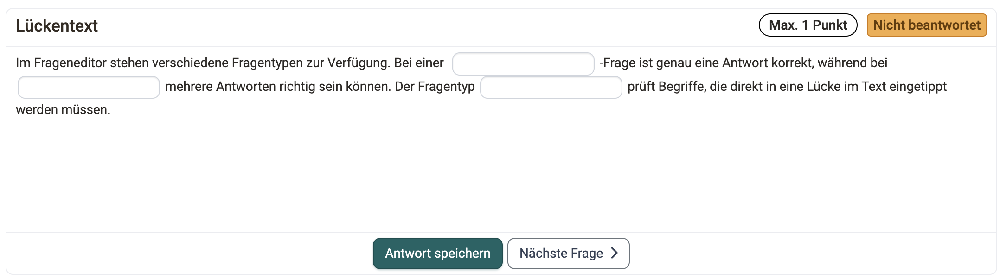{ class="shadow lightbox" title="Lückentext aus Sicht der Teilnehmenden" }

---

## :o_icon_o_mi_qtiinlinechoice: Lückentext mit Dropdown [:octicons-tag-16:{ title="ab Release 17.0.0 (OO-6270)" }](https://track.frentix.com/issue/OO-6270) {: #gap_dropdown}

Mit einem Lückentext mit Dropdown prüfen Sie Begriffe im Zusammenhang eines Textes, und die Teilnehmenden wählen die Antwort aus einer Liste, statt sie einzutippen. Der Fragetyp verbindet Lückentext und Single Choice.

Wie beim Lückentext bauen Sie Lücken in einen Fliesstext ein, hier mit dem Icon mit dem Dreieck ("Lückentext mit Dropdown"). Jeder Lücke ordnen Sie unter "Antwortmöglichkeiten" mehrere Antworten zu. Weitere Antworten ergänzen Sie mit "Antwort hinzufügen". Die richtige Antwort markieren Sie unter "Lösung".

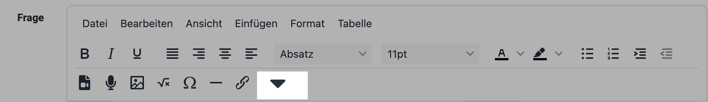{ class="shadow lightbox" title="Lückentext mit Dropdown, Werkzeugleiste im Testeditor" }

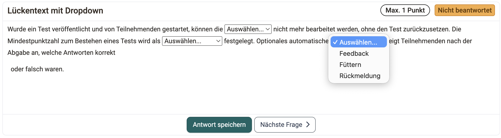{ class="shadow lightbox" title="Lückentext mit Dropdown aus Sicht der Teilnehmenden" }

Unter "Anzeige" legen Sie mit "Reihenfolge der Antwortoptionen" fest, ob die Teilnehmenden die Antworten in zufälliger Reihenfolge ("Zufällige Reihenfolge") oder in der von Ihnen erfassten Reihenfolge ("Vorgegebene Reihenfolge") sehen.

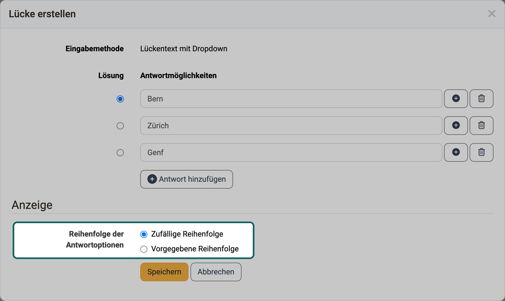{ class="shadow lightbox" title="Dialog Lücke erstellen bei Lückentext mit Dropdown · 2026.11.10" }

Für alle Lücken einer Frage verwenden Sie bei Bedarf globale Antwortmöglichkeiten. Schalten Sie dazu "Globale Antwortmöglichkeiten für 'Lückentext mit Dropdown'" ein. Erfassen Sie die Antworten dann einmal pro Frage. Weitere globale Antworten ergänzen Sie mit der Schaltfläche :o_icon_o_icon_add: ("Globale Antwort hinzufügen"). OpenOlat zeigt die globalen Antworten in jeder Lücke der Frage, und die Teilnehmenden wählen die Antwort, die zur jeweiligen Lücke passt.

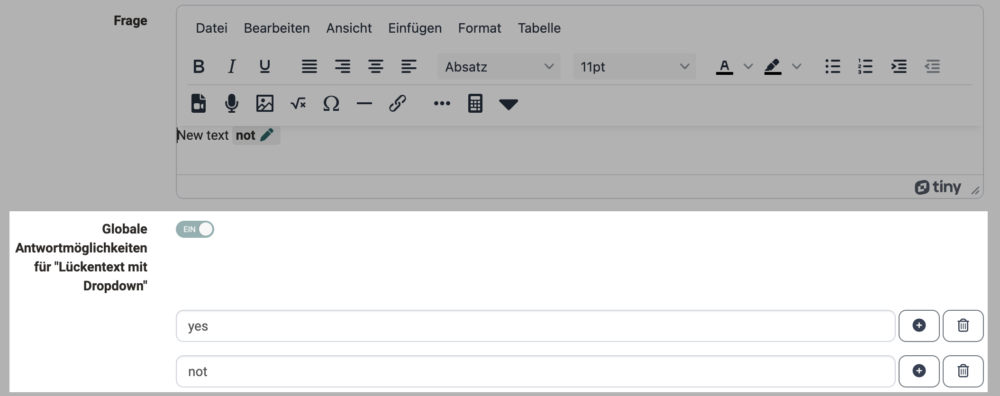{ class="shadow lightbox" title="Globale Antwortmöglichkeiten im Testeditor" }

Die Punkte vergeben Sie pauschal für alle Lücken oder einzeln für jede Antwort einer Lücke.

---

## :o_icon_o_mi_qtinumerical: Lückentext numerisch {: #numeric_input}

Mit einem Lückentext numerisch prüfen Sie Rechenergebnisse und andere Zahlen in einem Text. Er funktioniert wie der Lückentext, als Lösung tragen Sie aber Zahlen ein. Lücken fügen Sie mit dem Icon mit dem Taschenrechner ("Lückentext numerisch") ein.

Für jede Lücke legen Sie folgende Einstellungen fest:

* "Lösung": Tragen Sie hier die richtige Zahl ein.
* "Toleranz": Ist der Schalter ausgeschaltet, muss die Antwort genau der Lösung entsprechen. Ist er eingeschaltet, akzeptiert die Lücke Antworten zwischen einer unteren und einer oberen Grenze. Dafür wählen Sie unter "Toleranz" einen von zwei Modi:
    * "Absolut": Sie tragen "Untere Grenze" und "Obere Grenze" als absolute Zahlen ein.

		_Beispiel:_ Lösung 20, untere Grenze 18, obere Grenze 20,8 → Alle Lösungen zwischen 18 und 20,8 sind korrekt.

    * "Relativ": Sie tragen "Untere Grenze" und "Obere Grenze" als relative Zahlen in Prozent ein.

		_Beispiel:_ Lösung 20, untere Grenze 10, obere Grenze 10 → Alle Lösungen zwischen 18 und 22 sind gültig, denn die untere Grenze bedeutet minus 10% (20-2) und die obere Grenze plus 10% (20+2).

* "Anzeige":
    * "Platzhalter": Hier tragen Sie bei Bedarf einen Text ein, den die Teilnehmenden in der leeren Lücke sehen.
    * "Lückenlänge": Hier tragen Sie eine Länge für das Lückenfeld ein, zum Beispiel zur Formatierung. Die Länge der Eingabe begrenzt sie nicht.
    * "Vorschau": Zeigt an einem Beispielsatz direkt im Dialog, wie die Lücke erscheint.

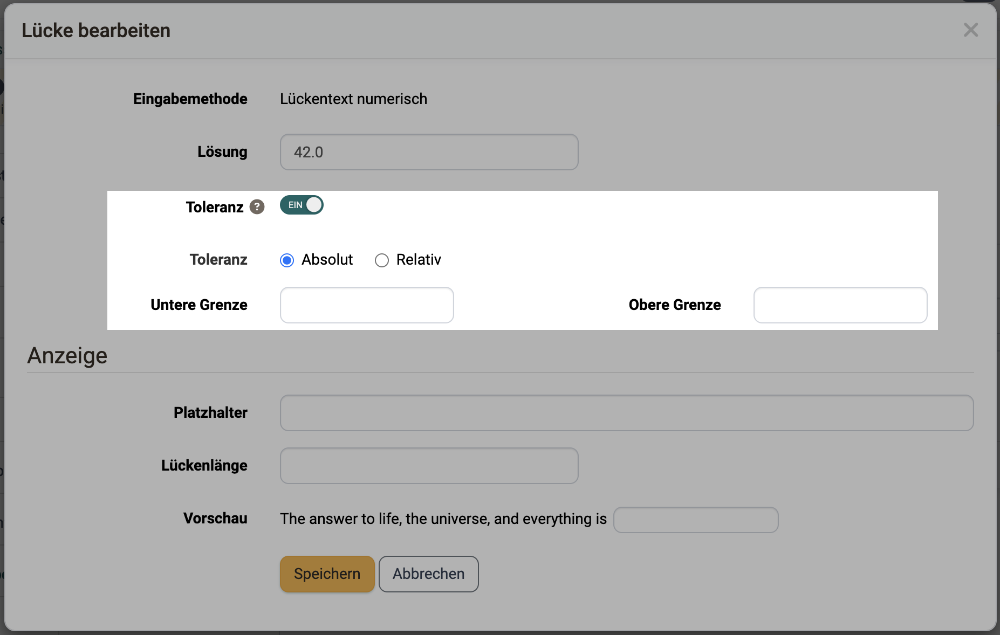{ class="shadow lightbox" title="Dialog Lücke bearbeiten bei Lückentext numerisch" }

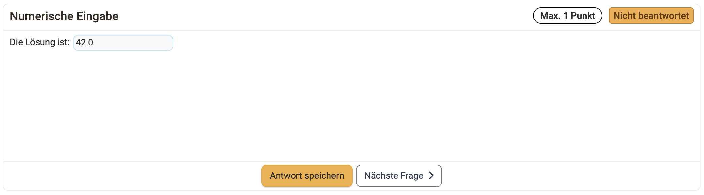{ class="shadow lightbox" title="Lückentext numerisch aus Sicht der Teilnehmenden" }

---

## :o_icon_o_mi_qtigapmixed: Lückentext gemischt [:octicons-tag-16:{ title="ab Release 21.0 (OO-9385)" }](https://track.frentix.com/issue/OO-9385) {: #gap_mixed}

Mit einem Lückentext gemischt prüfen Sie Text, Zahlen und Auswahl in einer einzigen Frage. Text-Lücken, numerische Lücken und Lücken mit Dropdown stehen gemeinsam im selben Fliesstext. So bilden Sie zum Beispiel eine Rechenaufgabe samt Begründung in einer Frage ab, statt mehrere Einzelfragen zu erstellen.

Beim Einfügen einer Lücke wählen Sie die Eingabemethode mit dem passenden Icon in der Werkzeugleiste: drei Punkte für "Lückentext", Taschenrechner für "Lückentext numerisch", Dreieck für "Lückentext mit Dropdown". Jede Lücke konfigurieren Sie anschliessend im gleichen Dialog wie beim jeweiligen einzelnen Fragetyp. Oben im Dialog steht unter "Eingabemethode" die Art der Lücke.

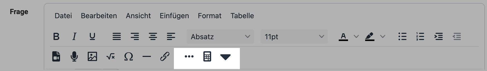{ class="shadow lightbox" title="Lückentext gemischt, Werkzeugleiste im Testeditor" }

Enthält die Frage Lücken mit Dropdown, definieren Sie zusätzlich bei Bedarf globale Antwortmöglichkeiten (siehe [Lückentext mit Dropdown](#gap_dropdown)).

Bestehende Fragen der Typen Lückentext und Lückentext numerisch, die Text- und numerische Lücken enthalten, zeigen im Testeditor einen Hinweis. Mit der Aktion "Zu 'Lückentext gemischt' konvertieren" wandeln Sie eine solche Frage in den Fragetyp Lückentext gemischt um.

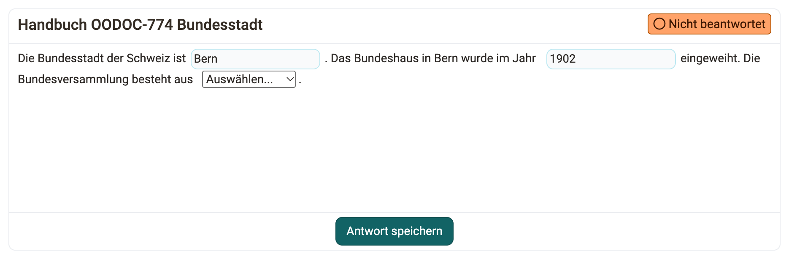{ class="shadow lightbox" title="Lückentext gemischt aus Sicht der Teilnehmenden · 2026.11.10" }

---

## :o_icon_o_mi_qtihottext: Hottext [:octicons-tag-16:{ title="ab Release 11.4 (OO-2610)" }](https://track.frentix.com/issue/OO-2610) {: #hottext}

Mit einer Hottext-Frage prüfen Sie, ob die Teilnehmenden die passenden Begriffe in einem Text erkennen. Sie markieren im Fliesstext Begriffe, welche die Teilnehmenden anschliessend auswählen. Die Frage ähnelt einem Lückentext.

Geben Sie zuerst unter "Titel" einen kurzen Titel ein.

Schreiben Sie danach unter "Frage" den Text. Markieren Sie darin die Auswahlbegriffe mit dem Icon "Hottext" als Hottext. Kreuzen Sie zum Schluss bei den korrekten Antworten das Kästchen an.

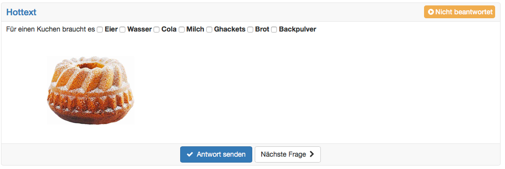{ class="shadow lightbox" title="Hottext aus Sicht der Teilnehmenden" }

---

## :o_icon_o_mi_qtihotspot: Hotspot {: #hotspot}

Mit einer Hotspot-Frage prüfen Sie, ob die Teilnehmenden auf einem Bild die richtigen Stellen erkennen. Auf dem Bild liegen Bereiche, die Hotspots, und die Teilnehmenden wählen die richtigen aus. Die Hotspots sind für die Teilnehmenden sichtbar. Unter "Typ" legen Sie fest, ob die Frage als Single Choice oder Multiple Choice funktioniert. Die Form der Hotspots, ihre Farbe ("Hotspot Farbe"), die Bildgrösse und die "Erweiterte Bearbeitung" passen die Darstellung an.

### Vorgehen

* Geben Sie zuerst unter "Titel" einen kurzen Titel und unter "Frage" die Frage ein.
* Laden Sie danach unter "Hintergrund" das Bild hoch.
* Platzieren Sie dann mit "Kreis" oder "Viereck" Hotspots auf dem Bild. Über "Erweiterte Bearbeitung" duplizieren Sie Hotspots auch.
* Wählen Sie zum Schluss unter "Korrekte Spots" die richtigen Antworten.

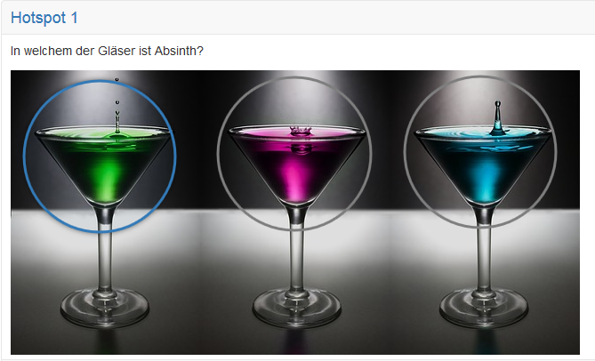{ class="shadow lightbox" title="Hotspot aus Sicht der Teilnehmenden" }

---

## :o_icon_o_mi_qtiorder: Reihenfolge [:octicons-tag-16:{ title="ab Release 15.0 (OO-4456)" }](https://track.frentix.com/issue/OO-4456) {: #order}

Mit einer Reihenfolge-Frage prüfen Sie, ob die Teilnehmenden Abläufe oder Rangfolgen kennen. Die Teilnehmenden bringen Elemente (Texte oder Bilder) in die richtige Reihenfolge. Die Bedienung ähnelt einer Drag-and-Drop-Frage.

Geben Sie zuerst unter "Titel" den Titel und unter "Frage" die Frage ein.

Erfassen Sie dann die Antworten in der richtigen Reihenfolge. Unter "Ausrichtung der Antworten" legen Sie fest, ob sie vertikal oder horizontal erscheinen.

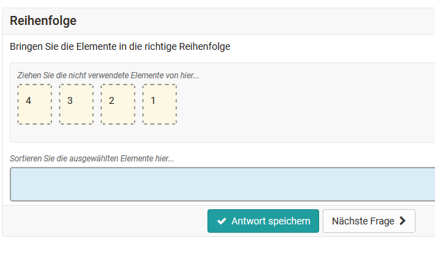{ class="shadow lightbox" title="Reihenfolge aus Sicht der Teilnehmenden" }

!!! info "Hinweis: Einschränkung auf mobile Geräte"

    Die Teilnehmenden bedienen diesen Fragetyp, indem sie die Antwortelemente ziehen. Für die Touch-Bedienung ist er nicht optimiert. Er eignet sich am besten für Tests, welche die Teilnehmenden an einem Desktop-Gerät oder Laptop bearbeiten.

---

## :o_icon_o_mi_qtiessay: Freitext* {: #essay}

Mit einer Freitext-Frage lassen Sie die Teilnehmenden eine Antwort frei formulieren, etwa einen Aufsatz. Die Teilnehmenden schreiben ihre Antwort in ein Textfeld beliebiger Grösse. Freitext-Fragen bewerten Sie im Test gesondert und manuell.

Geben Sie zuerst unter "Titel" einen kurzen Titel und unter "Frage" die Frage ein.

Danach stehen folgende Optionen zur Wahl:

* "Modus": Mit "Standard" schreiben die Teilnehmenden in ein einfaches Textfeld. Mit "Rich Text Formatierung" schreiben sie in einem Editor mit Textformatierung, der auch mathematische Formeln unterstützt. [:octicons-tag-16:{ title="ab Release 16.2 (OO-6071)" }](https://track.frentix.com/issue/OO-6071)
* "Platzhalter": Hier tragen Sie bei Bedarf einen Text ein, den die Teilnehmenden im leeren Textfeld sehen.
* "Höhe (Anzahl Zeilen)": Hier legen Sie die Höhe des Textfelds fest. Die Zeilenzahl begrenzt die Antwort nicht: Das Feld scrollt weiter, wenn die Teilnehmenden mehr Zeilen schreiben.
* "Min Anzahl Wörter": So viele Wörter müssen die Teilnehmenden mindestens schreiben, damit sie die Antwort abgeben können.
* "Max Anzahl Wörter": So viele Wörter dürfen die Teilnehmenden höchstens schreiben, damit sie die Antwort abgeben können. Damit begrenzen Sie die Länge der Antwort.
* "Copy/paste erlauben": Hier legen Sie fest, ob die Teilnehmenden Inhalte per Copy and Paste oder per Drag and Drop aus einer externen Quelle einfügen dürfen. Text innerhalb desselben Felds verschieben sie in jedem Fall. [:octicons-tag-16:{ title="ab Release 20.3.2 (OO-9472)" }](https://track.frentix.com/issue/OO-9472)

Das Antwortfeld verwendet eine Schrift mit fester Zeichenbreite und unterstützt die Tabulatortaste. So formatieren die Teilnehmenden ihre Antworten übersichtlich und bilden zum Beispiel Spalten ab.

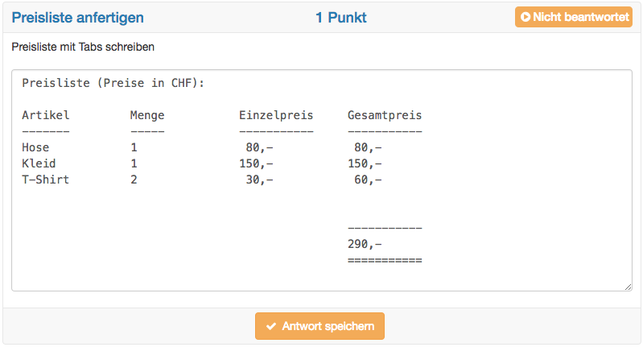{ class="shadow lightbox" title="Freitext aus Sicht der Teilnehmenden" }

!!! info "Autosave"

    Mit dem Fragetyp Freitext schreiben die Teilnehmenden oft Aufsätze. Deshalb speichert eine Autosave-Funktion den geschriebenen Text jede Minute. Wie Sie Aufsätze konfigurieren, beschreibt der folgende Exkurs "Aufsatz schreiben".

??? abstract "Exkurs: Aufsatz schreiben"

    Mit der Lernressource Test und dem Fragetyp Freitext schreiben die Teilnehmenden in OpenOlat Aufsätze. Damit dabei kein Text verloren geht, beachten Sie folgende Punkte:

    * Die Autosave-Funktion speichert den geschriebenen Text jede Minute. Nach der ersten Speicherung steht links unter dem Antwortfeld "Zuletzt gespeichert um:" mit der Uhrzeit. So bleibt der Text auch erhalten, wenn beispielsweise die Internetverbindung abbricht oder ein Session Timeout eintritt. Haben die Teilnehmenden die Antwort nicht mit "Antwort speichern" abgegeben, zeigt OpenOlat bei der Korrektur den per Autosave gespeicherten Inhalt mit einem entsprechenden Hinweis an.
    * Nach einem Unterbruch sollen die Teilnehmenden den Test erneut starten können. Dafür braucht es folgende Einstellungen:
        * Die Anzahl Versuche für den gesamten Test ist unbeschränkt ("Max. Anzahl Versuche"). Damit die Teilnehmenden den Test nach dem Beenden nicht nochmals starten, führen Sie ihn im Safe Exam Browser durch oder beschränken die Sichtbarkeit auf den Prüfungsmodus.
        * Die Option "Unterbrechen erlauben" ist eingeschaltet. So kehren die Teilnehmenden nach einem Unterbruch an die Stelle zurück, an der sie den Test verlassen mussten. OpenOlat hat den Text bis zur letzten Speicherung gesichert, kleine Textverluste sind also möglich.
        * Die Anzahl Versuche für die Freitext-Frage ist unbeschränkt ("Anzahl Versuche einschränken"). So schicken die Teilnehmenden den geschriebenen Text immer wieder ab und schreiben danach weiter. Das regelmässige Abschicken gibt ihnen Sicherheit.
    * Hat der Test eine Zeitbeschränkung, bleibt beim Ablauf der Zeit der Stand der letzten automatischen Speicherung erhalten. Text, den die Teilnehmenden danach schreiben, geht verloren, wenn sie die Antwort nicht vor Ablauf der Zeit mit "Antwort speichern" abgeben. Erinnern Sie die Teilnehmenden kurz vor Schluss daran, die Antwort nochmals abzugeben und danach nichts mehr zu schreiben.

---

## :o_icon_o_mi_qtiupload: Datei hochladen* [:octicons-tag-16:{ title="ab Release 11.2 (OO-2344)" }](https://track.frentix.com/issue/OO-2344) {: #file_upload}

Mit einer Frage vom Typ Datei hochladen lassen Sie die Teilnehmenden eine Arbeit als Datei abgeben. Die Teilnehmenden laden als Antwort eine oder mehrere Dateien hoch.

Geben Sie unter "Titel" einen kurzen Titel und unter "Frage" die Frage ein. Unter "Anzahl Upload Felder" legen Sie fest, wie viele Dateien die Teilnehmenden höchstens hochladen. Zur Wahl stehen 1 bis 10 Upload-Felder.

Eine korrekte Antwort markieren Sie bei diesem Fragetyp nicht, denn Sie bewerten ihn ausschliesslich manuell.

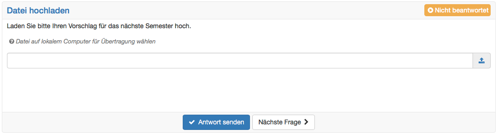{ class="shadow lightbox" title="Datei hochladen aus Sicht der Teilnehmenden" }

---

## :o_icon_o_mi_qtidrawing: Zeichnen* {: #draw}

Mit dem Fragetyp Zeichnen lassen Sie die Teilnehmenden ein vorgegebenes Bild mit Zeichenwerkzeugen bearbeiten, etwa um etwas einzuzeichnen oder zu beschriften. Die Antwort ist die bearbeitete Zeichnung, deshalb bewerten Sie diesen Fragetyp manuell.

Geben Sie zuerst unter "Titel" einen kurzen Titel und unter "Frage" die Frage oder die Bearbeitungsanweisung ein. Laden Sie danach unter "Hintergrund" das Bild hoch, das die Teilnehmenden bearbeiten. Titel und Hintergrund sind Pflichtfelder. Eine richtige Antwort legen Sie nicht fest.

Die Teilnehmenden können mit dem Werkzeug "Text" auch Text in die Zeichnung schreiben. Mit dem Regler "Pinselgrösse" bestimmen sie die Strichbreite und die Textgrösse, mit dem Regler "Deckkraft" die Transparenz. Mit "Zeichnung zurücksetzen" entfernen sie alles Gezeichnete und beginnen neu.

!!! info "Hinweis: Einschränkung auf mobile Geräte"

    Die Teilnehmenden bedienen diesen Fragetyp, indem sie freihändig zeichnen. Für die Touch-Bedienung ist er nicht optimiert. Er eignet sich am besten für Tests, welche die Teilnehmenden an einem Desktop-Gerät oder Laptop bearbeiten.

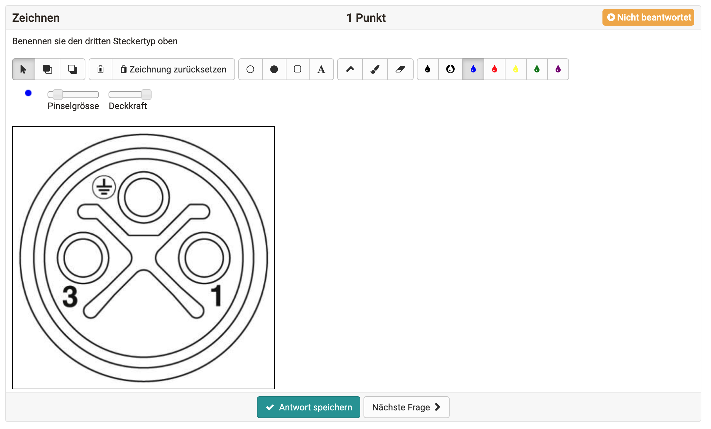{ class="shadow lightbox" title="Zeichnen aus Sicht der Teilnehmenden" }

## Weiterführende Informationen {: #further_information}

[Testfragen konfigurieren >](Configure_test_questions.de.md) 
[Fragenpool: Übersicht >](../area_modules/Question_Bank/index.de.md) 
[Fragenpool: Fragen importieren >](../area_modules/Question_Bank_Import_Questions.de.md) 
[Testeditor >](Test_editor_QTI_2.1/index.de.md) 
[Fragenpool: Fragen erstellen >](../area_modules/Question_Bank_Create_Questions.de.md) 
[Test konfigurieren >](Configure_tests.de.md)

[Zum Seitenanfang ^](#question_types)