# Test question types {: #question_types}

For each test question, you choose the question type that suits your form of assessment. OpenOlat scores closed questions automatically; open answers such as essays, files and drawings you assess yourself. This page shows for each question type how you set up the question in the test editor and how the participants see it in the test.

Owners of the test, administrators and learning resource managers open the test editor under `Test > Administration > Test editor`. You assess question types marked with an * manually. The page [Configure test questions](Configure_test_questions.md) describes the "Score" and "Feedback" tabs, which all question types have.

!!! tip "Import questions"

    Besides creating questions directly, you can also import questions from the [question bank](../area_modules/Question_Bank/index.md) or via the [Excel import](../area_modules/Question_Bank_Import_Questions.md#excelimport) from a table in Excel. Questions from the question bank come into the test as a copy, see [Using questions from the question bank](Test_editor_QTI_2.1/index.md#questions_from_pool).

## :o_icon_o_mi_qtisc: Single choice {: #sc}

With a single-choice question you check whether the participants recognise the one correct answer among several. The question has several answers, exactly one of them is correct, and the participants select exactly one.

First enter a short title under "Title" and the question under "Question".

Then define whether the answers appear in random order ("Shuffle answers"), whether they are arranged vertically or horizontally ("Alignment of answers") and whether the selection fields are on the left or on the right ("Check-box alignment").

Then enter the answer texts. With the button :o_icon_o_icon_add: you add an answer, with the button :o_icon_o_icon_delete: you remove one.

Mark the correct answer in the "Correct" column. Use the arrows to change the order of the answers.

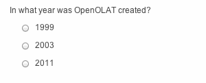{ class="shadow lightbox" title="Single choice as seen by participants" }

---

## :o_icon_o_mi_qtimc: Multiple choice {: #mc}

With a multiple-choice question you check whether the participants recognise all applicable answers. The question has at least two answers, several of them can be correct, and the participants select several answers.

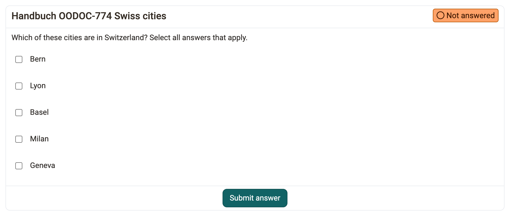{ class="shadow lightbox" title="Multiple choice as seen by participants · 2026.11.10" }

**Tab "Choice"** 
In the "Choice" tab, first enter a short title under "Title" and the question under "Question".

Then define whether the answers appear in random order ("Shuffle answers"), whether they are arranged vertically or horizontally ("Alignment of answers") and whether the selection fields are on the left or on the right ("Check-box alignment").

Then enter the answer texts. With the button :o_icon_o_icon_add: you add an answer, with the button :o_icon_o_icon_delete: you remove one.

Mark all correct answers in the "Correct" column. Use the arrows to change the order of the answers.

**Tab "Score"** 
Under "Method of assessment", three methods are available for multiple-choice questions:

* **All correct answers** 
The participants receive the full score only if they select all correct answers and no incorrect one. If a correct answer is missing or an incorrect one is selected, the score is 0.

* **Score per answer** 
You award positive or negative points for each answer option individually.

* **Partial score** 
OpenOlat adds a weighted score for each correctly selected answer and subtracts a weighted score for each incorrectly selected answer. The formula is: 
Score = maximum score * (number of correctly marked answers / number of correct answers) - maximum score * (number of incorrectly marked answers / number of incorrect answers)

With "Min. number of possible answers" and "Max. number of possible answers" you define in the same tab how many answers the participants select at least and at most.

---

## :o_icon_o_mi_qtikprim: Kprim {: #kprim}

With a Kprim question you check whether the participants assess four statements on a topic correctly. The question always has exactly four answers. For each answer, the participants decide whether it applies. 0 to 4 answers can be correct.

First enter a short title under "Title" and the question under "Question".

Then define whether the answers appear in random order ("Shuffle answers") and whether the selection fields are on the left or on the right ("Check-box alignment").

Then enter the four answer texts. Use the arrows to change the order of the answers. The number of answers is fixed at four. For each answer, select "True" or "False".

The scoring scheme for Kprim questions is fixed:

All correct answers = 100% score 
3 correct answers = 50% score 
2, 1 or 0 correct answers = 0% score

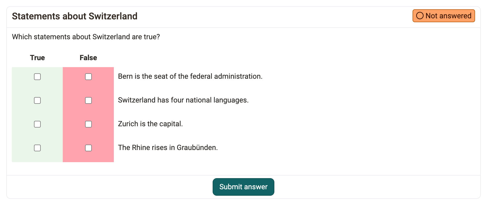{ class="shadow lightbox" title="Kprim as seen by participants, preview in the test editor · 2026.11.10" }

---

## :o_icon_o_mi_qtimatch: Match [:octicons-tag-16:{ title="from Release 11.2 (OO-2343)" }](https://track.frentix.com/issue/OO-2343) {: #matrix}

With a match question you check several assignments at once in a table. Per row, the participants tick which column applies, either as single choice or as multiple choice per row.

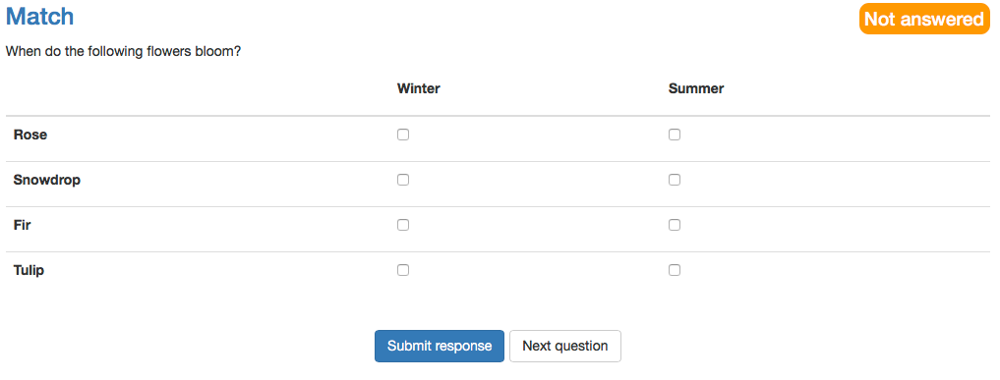{ class="shadow lightbox" title="Match as seen by participants" }

**Tab "Match"** 
Here, too, first enter the title under "Title" and the question under "Question".

Then define under "Shuffle answers" whether the answers appear in random order. Under "Type" you choose whether single choice or multiple choice applies per row.

Then enter the values in the columns and in the rows. You add further columns and rows with "Add column" and "Add row". Finally, select the correct answers per row: one answer per row for single choice, one or more for multiple choice.

**Tab "Score"** 
Under "Method of assessment", three methods are available for this question type:

* **All correct answers** 
The participants receive the full score only if they select all correct answers and no incorrect one. If a correct answer is missing or an incorrect one is selected, the score is 0.

* **Score per answer** 
You award positive or negative points for each answer option individually.

* **Partial score** 
OpenOlat adds a weighted score for each correctly selected answer and subtracts a weighted score for each incorrectly selected answer. The formula is: 
Score = maximum score * (number of correctly marked answers / number of correct answers) - maximum score * (number of incorrectly marked answers / number of incorrect answers)

---

## :o_icon_o_mi_qtimatch_draganddrop: Drag and Drop [:octicons-tag-16:{ title="from Release 11.5 (OO-2732)" }](https://track.frentix.com/issue/OO-2732) {: #drag_drop}

With a drag and drop question you check assignments as with a match question. The participants do not tick boxes but drag the items into the matching categories.

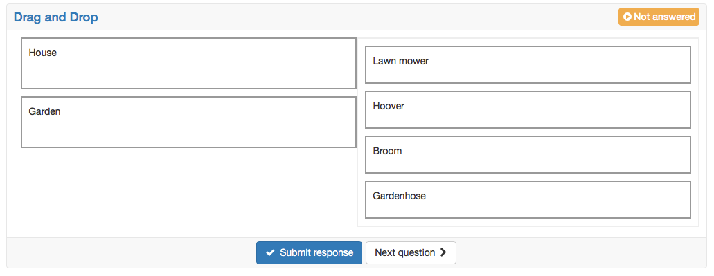{ class="shadow lightbox" title="Drag and Drop as seen by participants" }

**Tab "Drag and drop"** 
First enter the title under "Title" and the question under "Question".

Under "Shuffle answers" you define whether items and categories appear in random order.

Under "Type" you choose single choice or multiple choice. With single choice, the participants assign each item exactly once. With multiple choice, they assign each item to each category at most once.

Under "Alignment of answers" you define where the items to be assigned are placed in relation to the categories: left, top, right or bottom.

Then enter the categories in the columns ("Drop-Categories"). These are the fixed fields into which the participants drag the items. In the rows ("Items") you enter the items. Finally, tick in the table which item belongs to which category.

**Tab "Score"** 
Under "Method of assessment", three methods are available for this question type:

* **All correct answers** 
The participants receive the full score only if they assign all items correctly and none incorrectly. If a correct assignment is missing or an incorrect one is set, the score is 0.

* **Score per answer** 
You award positive or negative points for each answer option individually.

* **Partial score** 
OpenOlat adds a weighted score for each correctly selected answer and subtracts a weighted score for each incorrectly selected answer. The formula is: 
Score = maximum score * (number of correctly marked answers / number of correct answers) - maximum score * (number of incorrectly marked answers / number of incorrect answers)

!!! info "Note: Restriction to mobile devices"

    The participants operate this question type by dragging the answer elements. It is not optimized for touch operation. It is best suited for tests that the participants work on at a desktop computer or laptop.

---

## :o_icon_o_mi_qtimatch_truefalse: True/false [:octicons-tag-16:{ title="from Release 12.4 (OO-3220)" }](https://track.frentix.com/issue/OO-3220) {: #true_false}

With a true/false question, the participants assess any number of statements as right or wrong. The question type is similar to Kprim but has any number of rows. In each row, the participants assess one statement.

Per row, the participants choose one of three answer options: "Unanswered", "Right" or "Wrong". At the start, "Unanswered" is always selected. The three columns are fixed; you add further rows with "Add row".

Unlike Kprim, you define the points freely. You can also award points for the answer option "Unanswered".

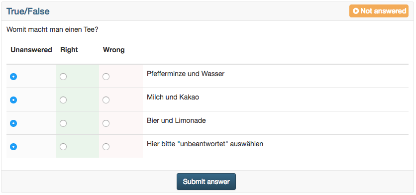{ class="shadow lightbox" title="True/false as seen by participants" }

---

## :o_icon_o_mi_qtifib: Gap FIB text {: #gap}

With a gap text question you check whether the participants type in missing terms in a text themselves. The text contains gaps into which the participants write their answer.

You insert gaps in the editor of the question with the icon with the three dots ("Gap FIB text"). Click a gap to edit it. The "Create gap" or "Edit gap" dialog shows the type of the gap at the top under "Input method" and under "Preview" how the gap appears in the test.

For each gap you define the following settings:

* "Solution": Enter the correct solution here.
* "Alternative answers": With this toggle you enter further accepted solutions as alternatives. "Add answer" adds one field at a time. "Add multiple" enters several alternatives at once, separated by a selectable "Delimiter".
* "Display":
    * "Placeholder": Here you enter, if needed, a text that the participants see in the empty gap.
    * "Gap size": Here you enter a length for the gap field, for example for formatting. It does not limit the length of the entry.
    * "Preview": Shows directly in the dialog, using an example sentence, how the gap appears with placeholder and gap size.
* "Options": With the checkboxes under "Correction" you define how strictly OpenOlat corrects the answers automatically:
    * "Consider upper/lower case": If the option is selected, upper and lower case counts. Otherwise it plays no role in the correction.
    * "Ignore spaces": Additional spaces, tabs and line breaks in the answer do not lead to a deduction. With the solution "log in", an entry with a double space thus also counts as correct. [:octicons-tag-16:{ title="from Release 21.0 (OO-9560)" }](https://track.frentix.com/issue/OO-9560)
    * "Wildcard (*)": The character * stands for "something or nothing" in the solution and also works in the alternatives. The solution "col*r" thus covers the spellings "color", "colour" and "colr". If the participants type a * themselves, it counts as a normal character. OpenOlat does not accept a solution that consists only of wildcards when saving. [:octicons-tag-16:{ title="from Release 21.0 (OO-9384)" }](https://track.frentix.com/issue/OO-9384)

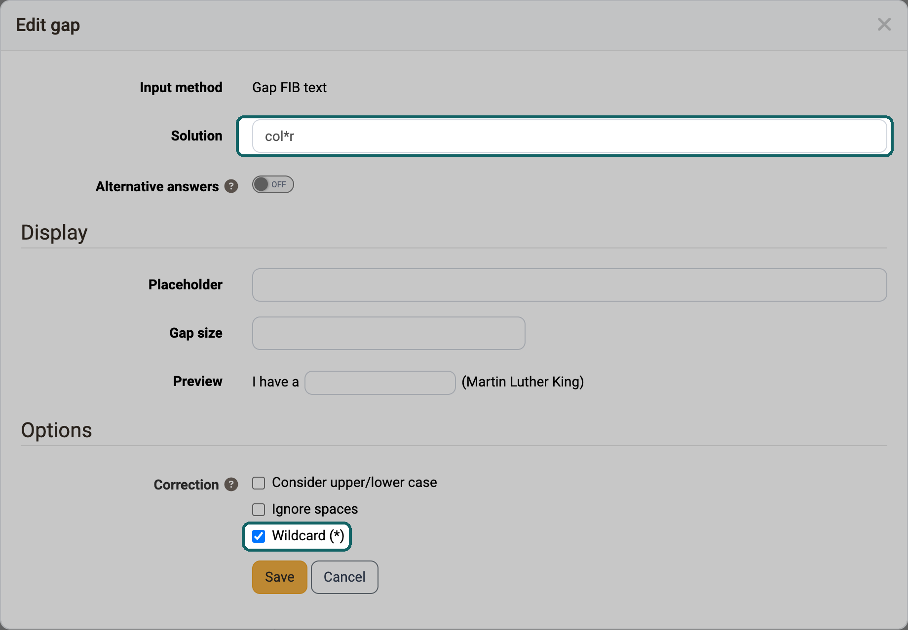{ class="shadow lightbox" title="Dialog Edit gap in gap FIB text · 2026.11.10" }

You define the points freely. You can also award points for alternatives.

If at least two gaps contain an identical answer option, the option "Allow twice the same input" is available in the "Score" tab. With it you allow or prevent the participants from entering the same answer in several gaps.

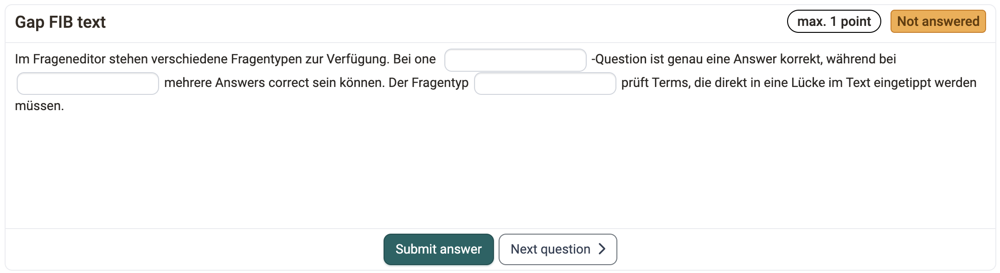{ class="shadow lightbox" title="Gap FIB text as seen by participants" }

---

## :o_icon_o_mi_qtiinlinechoice: Gap with dropdown [:octicons-tag-16:{ title="from Release 17.0.0 (OO-6270)" }](https://track.frentix.com/issue/OO-6270) {: #gap_dropdown}

With a gap with dropdown you check terms in the context of a text, and the participants select the answer from a list instead of typing it. The question type combines gap text and single choice.

As with the gap text, you build gaps into a running text, here with the icon with the triangle ("Gap with dropdown"). To each gap you assign several answers under "Answer options". You add further answers with "Add answer". You mark the correct answer under "Solution".

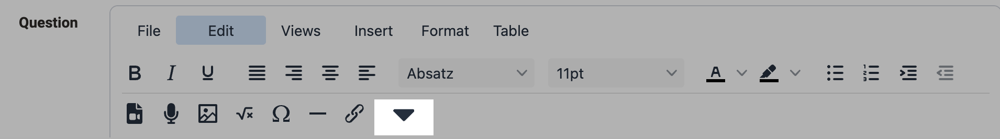{ class="shadow lightbox" title="Gap with dropdown, toolbar in the test editor" }

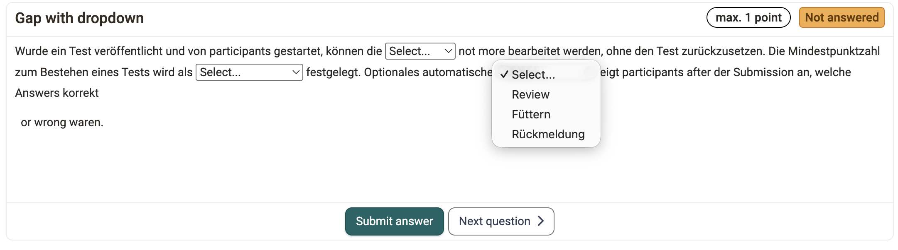{ class="shadow lightbox" title="Gap with dropdown as seen by participants" }

Under "Display", you define with "Order of answers options" whether the participants see the answers in random order ("Shuffle") or in the order you entered ("Preset order").

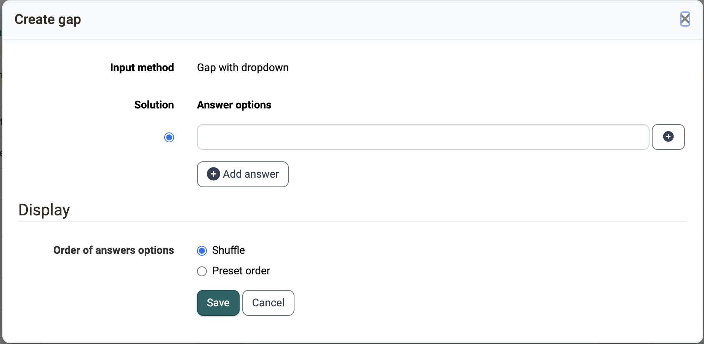{ class="shadow lightbox" title="Dialog Create gap in gap with dropdown" }

For all gaps of a question you can use global answer options. To do so, switch on "Global answers for 'Gap with Dropdown'". Then enter the answers once per question. You add further global answers with the button :o_icon_o_icon_add: ("Add global answer"). OpenOlat shows the global answers in each gap of the question, and the participants select the answer that fits the respective gap.

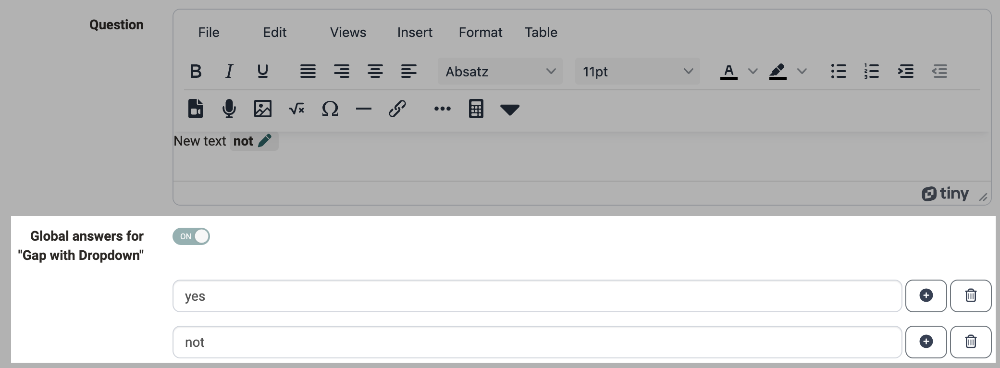{ class="shadow lightbox" title="Global answers in the test editor" }

You award the points either as a whole for all gaps or individually for each answer of a gap.

---

## :o_icon_o_mi_qtinumerical: Gap FIB numerical {: #numeric_input}

With a gap FIB numerical you check calculation results and other numbers in a text. It works like the gap text, but you enter numbers as the solution. You insert gaps with the icon with the calculator ("Gap FIB numerical").

For each gap you define the following settings:

* "Solution": Enter the correct number here.
* "Tolerance": If the toggle is switched off, the answer must exactly match the solution. If it is switched on, the gap accepts answers between a lower and an upper bound. For this you choose one of two modes under "Tolerance mode":
    * "Absolute": You enter "Lower bound" and "Upper bound" as absolute numbers.

		_Example:_ Solution 20, lower bound 18, upper bound 20.8 → all solutions between 18 and 20.8 are correct.

    * "Relative": You enter "Lower bound" and "Upper bound" as relative numbers in percent.

		_Example:_ Solution 20, lower bound 10, upper bound 10 → all solutions between 18 and 22 are correct, as the lower bound means minus 10% (20-2) and the upper bound plus 10% (20+2).

* "Display":
    * "Placeholder": Here you enter, if needed, a text that the participants see in the empty gap.
    * "Gap size": Here you enter a length for the gap field, for example for formatting. It does not limit the length of the entry.
    * "Preview": Shows directly in the dialog, using an example sentence, how the gap appears.

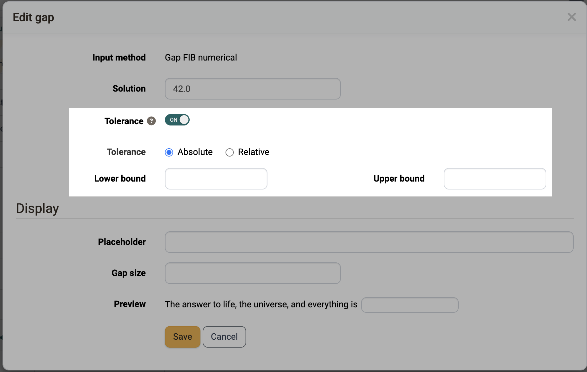{ class="shadow lightbox" title="Dialog Edit gap in gap FIB numerical" }

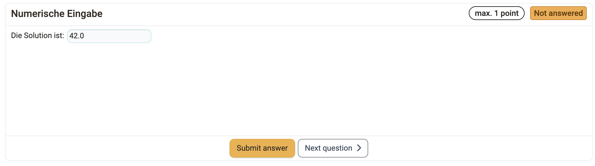{ class="shadow lightbox" title="Gap FIB numerical as seen by participants" }

---

## :o_icon_o_mi_qtigapmixed: Gap mixed [:octicons-tag-16:{ title="from Release 21.0 (OO-9385)" }](https://track.frentix.com/issue/OO-9385) {: #gap_mixed}

With a gap mixed question you check text, numbers and selection in a single question. Text gaps, numerical gaps and gaps with dropdown stand together in the same running text. For example, you map a calculation task including its reasoning in one question instead of creating several individual questions.

When inserting a gap, you choose the input method with the matching icon in the toolbar: three dots for "Gap FIB text", calculator for "Gap FIB numerical", triangle for "Gap with dropdown". You then configure each gap in the same dialog as for the respective individual question type. At the top of the dialog, "Input method" shows the type of the gap.

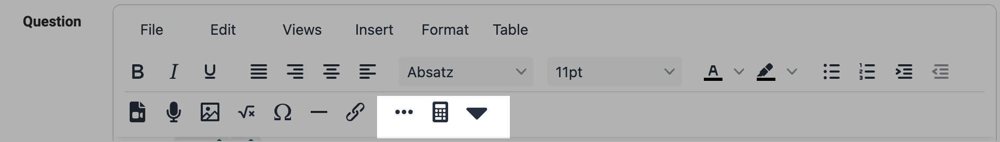{ class="shadow lightbox" title="Gap mixed, toolbar in the test editor" }

If the question contains gaps with dropdown, you can also define global answer options (see [Gap with dropdown](#gap_dropdown)).

Existing questions of the types Gap FIB text and Gap FIB numerical that contain text and numerical gaps show a message in the test editor. With the action "Convert to 'Gap mixed'" you convert such a question into the question type Gap mixed.

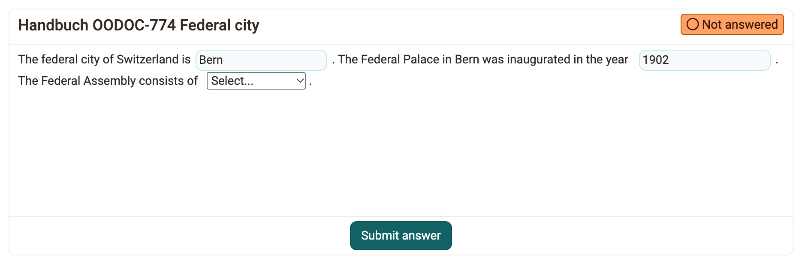{ class="shadow lightbox" title="Gap mixed as seen by participants · 2026.11.10" }

---

## :o_icon_o_mi_qtihottext: Hottext [:octicons-tag-16:{ title="from Release 11.4 (OO-2610)" }](https://track.frentix.com/issue/OO-2610) {: #hottext}

With a hottext question you check whether the participants recognise the matching terms in a text. You mark terms in the running text, which the participants then select. The question is similar to a gap text.

First enter a short title under "Title".

Then write the text under "Question". Mark the selectable terms in it as hottext with the "Hottext" icon. Finally, tick the box of the correct answers.

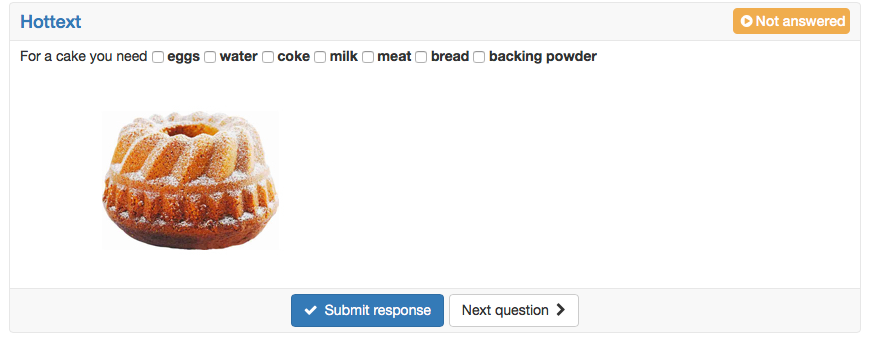{ class="shadow lightbox" title="Hottext as seen by participants" }

---

## :o_icon_o_mi_qtihotspot: Hotspot {: #hotspot}

With a hotspot question you check whether the participants recognise the right places on a picture. Areas, the hotspots, lie on the picture, and the participants select the correct ones. The hotspots are visible for the participants. Under "Type" you define whether the question works as single choice or multiple choice. The shape of the hotspots, their colour ("Layout"), the image size and the "Advanced edit" adjust the display.

### Approach

* First enter a short title under "Title" and the question under "Question".
* Then upload the picture under "Background".
* Then place hotspots on the picture with "Circle" or "Rectangle". Via "Advanced edit" you can also duplicate hotspots.
* Finally, select the correct answers under "Correct spots".

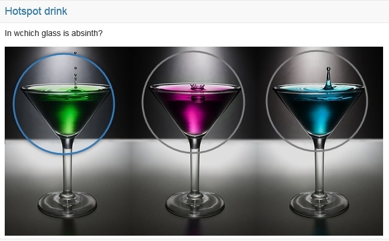{ class="shadow lightbox" title="Hotspot as seen by participants" }

---

## :o_icon_o_mi_qtiorder: Order [:octicons-tag-16:{ title="from Release 15.0 (OO-4456)" }](https://track.frentix.com/issue/OO-4456) {: #order}

With an order question you check whether the participants know sequences or rankings. The participants put elements (text or images) in the correct order. The operation is similar to a drag and drop question.

First enter the title under "Title" and the question under "Question".

Then enter the answers in the correct order. Under "Alignment of answers" you define whether they appear vertically or horizontally.

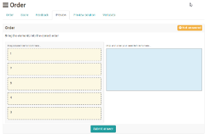{ class="shadow lightbox" title="Order as seen by participants" }

!!! info "Note: Restriction to mobile devices"

    The participants operate this question type by dragging the answer elements. It is not optimized for touch operation. It is best suited for tests that the participants work on at a desktop computer or laptop.

---

## :o_icon_o_mi_qtiessay: Essay* {: #essay}

With an essay question you let the participants formulate an answer freely, for example an essay. The participants write their answer into a text field of any size. You assess essay questions in the test separately and manually.

First enter a short title under "Title" and the question under "Question".

Then the following options are available:

* "Mode": With "Standard", the participants write into a simple text field. With "Rich text formating", they write in an editor with text formatting that also supports mathematical formulas. [:octicons-tag-16:{ title="from Release 16.2 (OO-6071)" }](https://track.frentix.com/issue/OO-6071)
* "Placeholder": Here you enter, if needed, a text that the participants see in the empty text field.
* "Height (number of lines)": Here you define the height of the text field. The number of lines does not limit the answer: the field scrolls further if the participants write more lines.
* "Min. words": The participants must write at least this number of words to be able to submit the answer.
* "Max. words": The participants may write at most this number of words to be able to submit the answer. With it you limit the length of the answer.
* "Allow copy/paste": Here you define whether the participants may insert content via copy and paste or via drag and drop from an external source. They can move text within the same field in any case. [:octicons-tag-16:{ title="from Release 20.3.2 (OO-9472)" }](https://track.frentix.com/issue/OO-9472)

The answer field uses a font with fixed character width and supports the tab key. The participants can thus format their answers clearly and, for example, display columns.

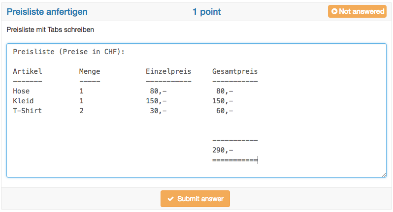{ class="shadow lightbox" title="Essay as seen by participants" }

!!! info "Autosave"

    With the essay question type, participants often write essays. An autosave feature therefore saves the written text every minute. The following digression "Writing essays" describes how you configure essays.

??? abstract "Digression: Writing essays"

    With the learning resource test and the question type essay, the participants write essays in OpenOlat. So that no text is lost, consider the following points:

    * The autosave feature saves the written text every minute. After the first save, "Last saved at:" with the time is shown on the left below the answer field. The text is thus kept even if, for example, the internet connection breaks or a session timeout occurs. If the participants have not submitted the answer with "Submit answer", OpenOlat shows the content saved via autosave during the correction, with a note to this effect.
    * After an interruption, the participants should be able to start the test again. This requires the following settings:
        * The number of attempts for the whole test is unlimited ("Max. number of attempts"). So that the participants do not start the test again after finishing it, carry it out in the Safe Exam Browser or restrict the visibility to the assessment mode.
        * The option "Allow to suspend" is switched on. After an interruption, the participants thus return to the point where they had to leave the test. OpenOlat has saved the text up to the last save, so small text losses are possible.
        * The number of attempts for the essay question is unlimited ("Limit number of attempts"). The participants thus submit the written text again and again and continue writing afterwards. The regular submitting gives them security.
    * If the test has a time limit, the state of the last automatic save is kept when the time runs out. Text that the participants write after that is lost if they do not submit the answer with "Submit answer" before the time runs out. Remind the participants shortly before the end to submit the answer once more and not to write anything afterwards.

---

## :o_icon_o_mi_qtiupload: Upload file* [:octicons-tag-16:{ title="from Release 11.2 (OO-2344)" }](https://track.frentix.com/issue/OO-2344) {: #file_upload}

With an upload file question you let the participants hand in a piece of work as a file. The participants upload one or more files as their answer.

Enter a short title under "Title" and the question under "Question". Under "Number of upload fields" you define how many files the participants upload at most. You can choose from 1 to 10 upload fields.

You do not mark a correct answer for this question type, because you assess it exclusively manually.

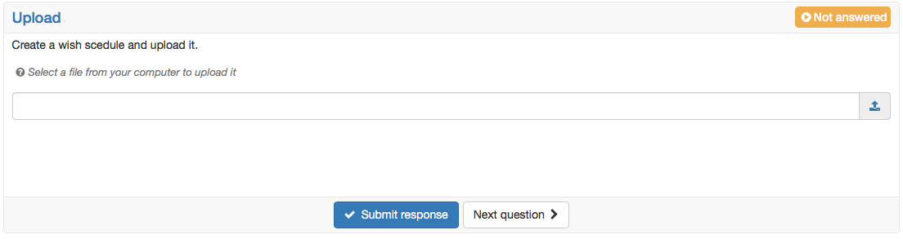{ class="shadow lightbox" title="Upload file as seen by participants" }

---

## :o_icon_o_mi_qtidrawing: Drawing* {: #draw}

With the question type Drawing you let the participants edit a given picture with drawing tools, for example to draw something in or to label it. The answer is the edited drawing, therefore you assess this question type manually.

First enter a short title under "Title" and the question or the editing instruction under "Question". Then upload the picture that the participants edit under "Background". Title and background are mandatory fields. You do not define a correct answer.

With the tool "Text", the participants can also write text into the drawing. With the slider "Brush size" they set the line width and the text size, with the slider "Opacity" the transparency. With "Reset drawing" they remove everything drawn and start again.

!!! info "Note: Restriction to mobile devices"

    The participants operate this question type by drawing freehand. It is not optimized for touch operation. It is best suited for tests that the participants work on at a desktop computer or laptop.

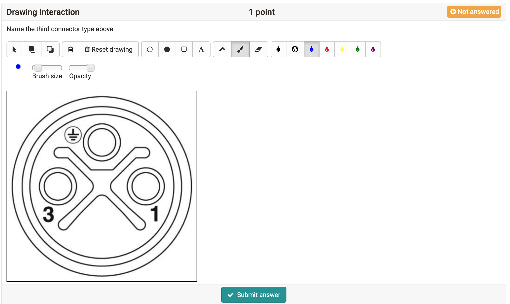{ class="shadow lightbox" title="Drawing as seen by participants" }

## Further information {: #further_information}

[Configure test questions >](Configure_test_questions.md) 
[Question Bank: Overview >](../area_modules/Question_Bank/index.md) 
[Question Bank: Import Questions >](../area_modules/Question_Bank_Import_Questions.md) 
[Test editor >](Test_editor_QTI_2.1/index.md) 
[Question Bank: Create Questions >](../area_modules/Question_Bank_Create_Questions.md) 
[Configure tests >](Configure_tests.md)

[To the top of the page ^](#question_types)