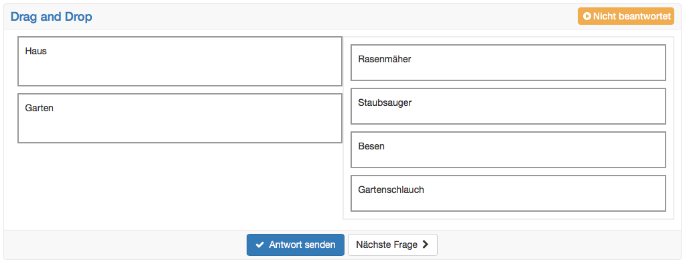

# :o_icon_o_mi_qtimatch_draganddrop: Drag and Drop [:octicons-tag-16:{ title="ab Release 11.5 (OO-2732)" }](https://track.frentix.com/issue/OO-2732) {: #drag_drop}

Mit einer Drag-and-Drop-Frage prüfen Sie Zuordnungen wie mit einer [Matrix-Frage](Match.de.md). Die Teilnehmenden kreuzen dabei keine Kästchen an, sondern ziehen die Begriffe in die passenden Kategorien.

Im Testeditor fügen Besitzer:innen des Tests, Administrator:innen und Lernressourcenverwalter:innen die Frage unter `Test > Administration > Testeditor > Elemente hinzufügen > Drag and Drop` hinzu. Im [Fragenpool](../../area_modules/Question_Bank_Create_Questions.de.md) wählen Sie den Typ unter `Fragenpool > Meine Fragen > Frage erstellen` im Feld "Fragetyp".

{ class="shadow lightbox" title="Drag and Drop aus Sicht der Teilnehmenden" }

**Tab "Drag and drop"** 
Geben Sie zuerst unter "Titel" den Titel und unter "Frage" die Frage ein.

Unter "Zufällige Reihenfolge" legen Sie fest, ob Begriffe und Kategorien in zufälliger Reihenfolge erscheinen.

Unter "Typ" wählen Sie Single Choice oder Multiple Choice. Bei Single Choice ordnen die Teilnehmenden jeden Begriff genau einmal zu. Bei Multiple Choice ordnen sie jeden Begriff jeder Kategorie höchstens einmal zu.

Unter "Ausrichtung der Antworten" legen Sie fest, wo die zuzuordnenden Begriffe im Verhältnis zu den Kategorien stehen: links, oben, rechts oder unten.

Erfassen Sie dann in den Spalten ("Drop-Kategorien") die Kategorien. Das sind die festen Felder, in welche die Teilnehmenden die Begriffe ziehen. In den Zeilen ("Begriffe") erfassen Sie die Begriffe. Kreuzen Sie zum Schluss in der Tabelle an, welcher Begriff in welche Kategorie gehört.

**Tab "Punkte"** 
Unter "Bewertungsmethode" stehen für diesen Fragetyp drei Methoden zur Wahl:

* **Alle korrekten Antworten** 
Die Teilnehmenden erhalten die volle Punktzahl nur, wenn sie alle Begriffe richtig und keinen falsch zuordnen. Fehlt eine richtige Zuordnung oder ist eine falsche gesetzt, beträgt die Punktzahl 0.

* **Punkte pro Antwort** 
Sie vergeben für jede Antwortoption einzeln positive oder negative Punkte.

* **Teilpunkte** 
OpenOlat addiert für jede richtig ausgewählte Antwort eine gewichtete Punktzahl und zieht für jede falsch ausgewählte Antwort eine gewichtete Punktzahl ab. Die Formel lautet: 
Punktzahl = maximale Punktzahl * (Anzahl der richtig markierten Antworten / Anzahl der richtigen Antworten) - maximale Punktzahl * (Anzahl der falsch markierten Antworten / Anzahl der falschen Antworten)

!!! info "Hinweis: Einschränkung auf mobile Geräte"

    Die Teilnehmenden bedienen diesen Fragetyp, indem sie die Antwortelemente ziehen. Für die Touch-Bedienung ist er nicht optimiert. Er eignet sich am besten für Tests, welche die Teilnehmenden an einem Desktop-Gerät oder Laptop bearbeiten.

## Weiterführende Informationen {: #further_information}

[Matrix >](Match.de.md) 
[Fragenpool: Fragen erstellen >](../../area_modules/Question_Bank_Create_Questions.de.md) 
[Fragetypen >](index.de.md) 
[Testfragen konfigurieren >](../Configure_test_questions.de.md) 
[Testeditor >](../Test_editor_QTI_2.1/index.de.md)

[Zum Seitenanfang ^](#drag_drop)
