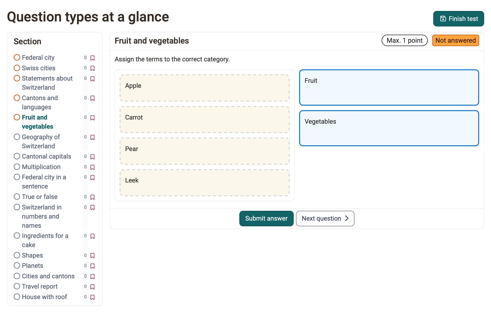

# :o_icon_o_mi_qtimatch_draganddrop: Drag and Drop [:octicons-tag-16:{ title="from Release 11.5 (OO-2732)" }](https://track.frentix.com/issue/OO-2732) {: #drag_drop}

With a drag and drop question you check assignments as with a [match question](Match.md). The participants do not tick boxes but drag the items into the matching categories.

In the test editor, owners of the test, administrators and learning resource managers add the question under `Test > Administration > Test editor > Add elements > Drag and Drop`. In the [question bank](../../area_modules/Question_Bank_Create_Questions.md) you choose the type under `Question bank > My questions > Create question` in the "Type" field.

{ class="shadow lightbox" title="Drag and Drop as seen by participants · 2026.11.23" }

**Tab "Drag and drop"** 
First enter the title under "Title" and the question under "Question".

Under "Shuffle answers" you define whether items and categories appear in random order.

Under "Type" you choose single choice or multiple choice. With single choice, the participants assign each item exactly once. With multiple choice, they assign each item to each category at most once.

Under "Alignment of answers" you define where the items to be assigned are placed in relation to the categories: left, top, right or bottom.

Then enter the categories in the columns ("Drop-Categories"). These are the fixed fields into which the participants drag the items. In the rows ("Items") you enter the items. Finally, tick in the table which item belongs to which category.

**Tab "Score"** 
Under "Method of assessment", three methods are available for this question type:

* **All correct answers** 
The participants receive the full score only if they assign all items correctly and none incorrectly. If a correct assignment is missing or an incorrect one is set, the score is 0.

* **Score per answer** 
You award positive or negative points for each answer option individually.

* **Partial score** 
OpenOlat adds a weighted score for each correctly selected answer and subtracts a weighted score for each incorrectly selected answer. The formula is: 
Score = maximum score * (number of correctly marked answers / number of correct answers) - maximum score * (number of incorrectly marked answers / number of incorrect answers)

!!! info "Note: Restriction to mobile devices"

    The participants operate this question type by dragging the answer elements. It is not optimized for touch operation. It is best suited for tests that the participants work on at a desktop computer or laptop.

## Further information {: #further_information}

[Match >](Match.md) 
[Question Bank: Create Questions >](../../area_modules/Question_Bank_Create_Questions.md) 
[Question types >](index.md) 
[Configure test questions >](../Configure_test_questions.md) 
[Test editor >](../Test_editor_QTI_2.1/index.md)

[To the top of the page ^](#drag_drop)
