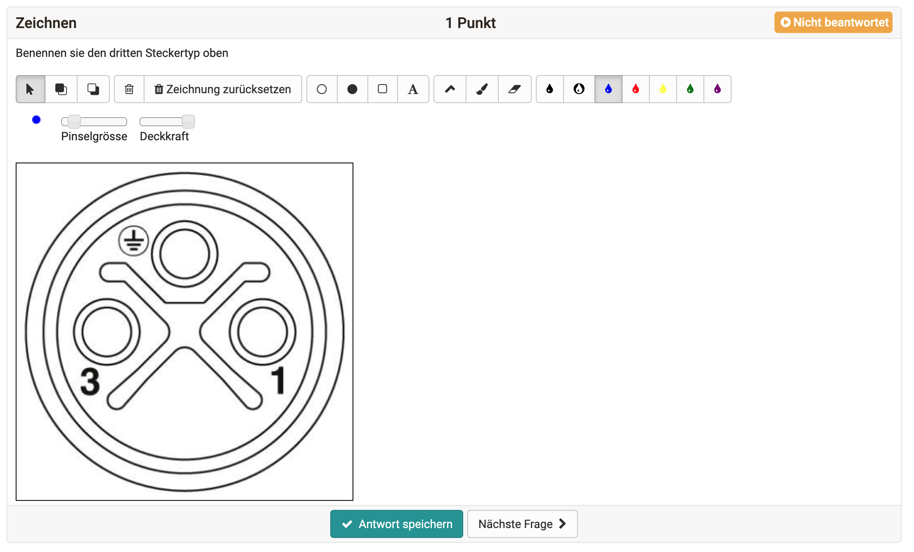

# :o_icon_o_mi_qtidrawing: Zeichnen* {: #draw}

Mit dem Fragetyp Zeichnen lassen Sie die Teilnehmenden ein vorgegebenes Bild mit Zeichenwerkzeugen bearbeiten, etwa um etwas einzuzeichnen oder zu beschriften. Die Antwort ist die bearbeitete Zeichnung, deshalb korrigieren Sie diesen Fragetyp nach der Abgabe von Hand. Darauf weist der * im Namen des Fragetyps hin.

Im Testeditor fügen Besitzer:innen des Tests, Administrator:innen und Lernressourcenverwalter:innen die Frage unter `Test > Administration > Testeditor > Elemente hinzufügen > Zeichnen` hinzu. Im [Fragenpool](../../area_modules/Question_Bank_Create_Questions.de.md) wählen Sie den Typ unter `Fragenpool > Meine Fragen > Frage erstellen` im Feld "Fragetyp".

Geben Sie zuerst unter "Titel" einen kurzen Titel und unter "Frage" die Frage oder die Bearbeitungsanweisung ein. Laden Sie danach unter "Hintergrund" das Bild hoch, das die Teilnehmenden bearbeiten. Titel und Hintergrund sind Pflichtfelder. Eine richtige Antwort legen Sie nicht fest.

Die Teilnehmenden können mit dem Werkzeug "Text" auch Text in die Zeichnung schreiben. Mit dem Regler "Pinselgrösse" bestimmen sie die Strichbreite und die Textgrösse, mit dem Regler "Deckkraft" die Transparenz. Mit "Zeichnung zurücksetzen" entfernen sie alles Gezeichnete und beginnen neu.

Die Antworten korrigieren Betreuer:innen und Besitzer:innen des Kurses im Kursbaustein Test mit dem [Korrekturwerkzeug](../Assessing_tests.de.md#correction_tool), Korrektor:innen über den [Korrektur-Workflow](../Test_correction_workflow.de.md). Wer korrigiert und wann die Teilnehmenden ihre Bewertung sehen, legen Sie im Kursbaustein Test mit der Einstellung [Korrektur](../Course_Element_Test/Test_Setup.de.md#section_correction) fest. Die höchste Punktzahl, die bei der Korrektur zu vergeben ist, legen Sie im [Tab Punkte](../Configure_test_questions.de.md#score) unter "Maximal erreichbare Punktzahl" fest.

!!! info "Hinweis: Einschränkung auf mobile Geräte"

    Die Teilnehmenden bedienen diesen Fragetyp, indem sie freihändig zeichnen. Für die Touch-Bedienung ist er nicht optimiert. Er eignet sich am besten für Tests, welche die Teilnehmenden an einem Desktop-Gerät oder Laptop bearbeiten.

{ class="shadow lightbox" title="Zeichnen aus Sicht der Teilnehmenden" }

## Weiterführende Informationen {: #further_information}

[Fragenpool: Fragen erstellen >](../../area_modules/Question_Bank_Create_Questions.de.md) 
[Tests bewerten >](../Assessing_tests.de.md) 
[Test: Korrektur-Workflow >](../Test_correction_workflow.de.md) 
[Test einrichten >](../Course_Element_Test/Test_Setup.de.md) 
[Fragetypen >](index.de.md) 
[Testfragen konfigurieren >](../Configure_test_questions.de.md) 
[Testeditor >](../Test_editor_QTI_2.1/index.de.md)

[Zum Seitenanfang ^](#draw)
