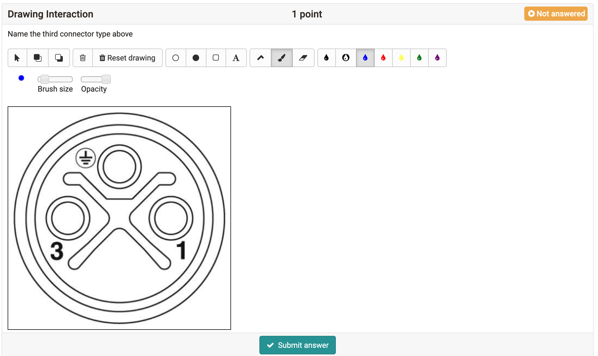

# :o_icon_o_mi_qtidrawing: Drawing* {: #draw}

With the question type Drawing you let the participants edit a given picture with drawing tools, for example to draw something in or to label it. The answer is the edited drawing, therefore you assess this question type manually.

In the test editor, owners of the test, administrators and learning resource managers add the question under `Test > Administration > Test editor > Add elements > Drawing`. In the [question bank](../../area_modules/Question_Bank_Create_Questions.md) you choose the type under `Question bank > My questions > Create question` in the "Type" field.

First enter a short title under "Title" and the question or the editing instruction under "Question". Then upload the picture that the participants edit under "Background". Title and background are mandatory fields. You do not define a correct answer.

With the tool "Text", the participants can also write text into the drawing. With the slider "Brush size" they set the line width and the text size, with the slider "Opacity" the transparency. With "Reset drawing" they remove everything drawn and start again.

!!! info "Note: Restriction to mobile devices"

    The participants operate this question type by drawing freehand. It is not optimized for touch operation. It is best suited for tests that the participants work on at a desktop computer or laptop.

{ class="shadow lightbox" title="Drawing as seen by participants" }

## Further information {: #further_information}

[Question Bank: Create Questions >](../../area_modules/Question_Bank_Create_Questions.md) 
[Question types >](index.md) 
[Configure test questions >](../Configure_test_questions.md) 
[Test editor >](../Test_editor_QTI_2.1/index.md)

[To the top of the page ^](#draw)
