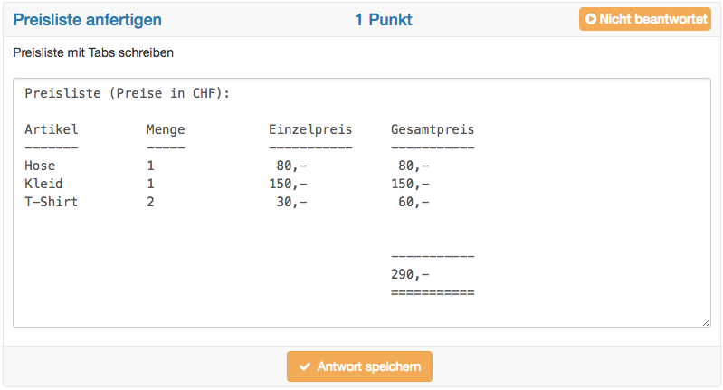

# :o_icon_o_mi_qtiessay: Freitext* {: #essay}

Mit einer Freitext-Frage lassen Sie die Teilnehmenden eine Antwort frei formulieren, etwa einen Aufsatz. Die Teilnehmenden schreiben ihre Antwort in ein Textfeld beliebiger Grösse. Freitext-Fragen bewerten Sie im Test gesondert und manuell.

Im Testeditor fügen Besitzer:innen des Tests, Administrator:innen und Lernressourcenverwalter:innen die Frage unter `Test > Administration > Testeditor > Elemente hinzufügen > Freitext` hinzu. Im [Fragenpool](../../area_modules/Question_Bank_Create_Questions.de.md) wählen Sie den Typ unter `Fragenpool > Meine Fragen > Frage erstellen` im Feld "Fragetyp".

Geben Sie zuerst unter "Titel" einen kurzen Titel und unter "Frage" die Frage ein.

Danach stehen folgende Optionen zur Wahl:

* "Modus": Mit "Standard" schreiben die Teilnehmenden in ein einfaches Textfeld. Mit "Rich Text Formatierung" schreiben sie in einem Editor mit Textformatierung, der auch mathematische Formeln unterstützt. [:octicons-tag-16:{ title="ab Release 16.2 (OO-6071)" }](https://track.frentix.com/issue/OO-6071)
* "Platzhalter": Hier tragen Sie bei Bedarf einen Text ein, den die Teilnehmenden im leeren Textfeld sehen.
* "Höhe (Anzahl Zeilen)": Hier legen Sie die Höhe des Textfelds fest. Die Zeilenzahl begrenzt die Antwort nicht: Das Feld scrollt weiter, wenn die Teilnehmenden mehr Zeilen schreiben.
* "Min Anzahl Wörter": So viele Wörter müssen die Teilnehmenden mindestens schreiben, damit sie die Antwort abgeben können.
* "Max Anzahl Wörter": So viele Wörter dürfen die Teilnehmenden höchstens schreiben, damit sie die Antwort abgeben können. Damit begrenzen Sie die Länge der Antwort.
* "Copy/paste erlauben": Hier legen Sie fest, ob die Teilnehmenden Inhalte per Copy and Paste oder per Drag and Drop aus einer externen Quelle einfügen dürfen. Text innerhalb desselben Felds verschieben sie in jedem Fall. [:octicons-tag-16:{ title="ab Release 20.3.2 (OO-9472)" }](https://track.frentix.com/issue/OO-9472)

Das Antwortfeld verwendet eine Schrift mit fester Zeichenbreite und unterstützt die Tabulatortaste. So formatieren die Teilnehmenden ihre Antworten übersichtlich und bilden zum Beispiel Spalten ab.

{ class="shadow lightbox" title="Freitext aus Sicht der Teilnehmenden" }

!!! info "Autosave"

    Mit dem Fragetyp Freitext schreiben die Teilnehmenden oft Aufsätze. Deshalb speichert eine Autosave-Funktion den geschriebenen Text jede Minute. Wie Sie Aufsätze konfigurieren, beschreibt der folgende Exkurs "Aufsatz schreiben".

??? abstract "Exkurs: Aufsatz schreiben"

    Mit der Lernressource Test und dem Fragetyp Freitext schreiben die Teilnehmenden in OpenOlat Aufsätze. Damit dabei kein Text verloren geht, beachten Sie folgende Punkte:

    * Die Autosave-Funktion speichert den geschriebenen Text jede Minute. Nach der ersten Speicherung steht links unter dem Antwortfeld "Zuletzt gespeichert um:" mit der Uhrzeit. So bleibt der Text auch erhalten, wenn beispielsweise die Internetverbindung abbricht oder ein Session Timeout eintritt. Haben die Teilnehmenden die Antwort nicht mit "Antwort speichern" abgegeben, zeigt OpenOlat bei der Korrektur den per Autosave gespeicherten Inhalt mit einem entsprechenden Hinweis an.
    * Nach einem Unterbruch sollen die Teilnehmenden den Test erneut starten können. Dafür braucht es folgende Einstellungen:
        * Die Anzahl Versuche für den gesamten Test ist unbeschränkt ("Max. Anzahl Versuche"). Damit die Teilnehmenden den Test nach dem Beenden nicht nochmals starten, führen Sie ihn im Safe Exam Browser durch oder beschränken die Sichtbarkeit auf den Prüfungsmodus.
        * Die Option "Unterbrechen erlauben" ist eingeschaltet. So kehren die Teilnehmenden nach einem Unterbruch an die Stelle zurück, an der sie den Test verlassen mussten. OpenOlat hat den Text bis zur letzten Speicherung gesichert, kleine Textverluste sind also möglich.
        * Die Anzahl Versuche für die Freitext-Frage ist unbeschränkt ("Anzahl Versuche einschränken"). So schicken die Teilnehmenden den geschriebenen Text immer wieder ab und schreiben danach weiter. Das regelmässige Abschicken gibt ihnen Sicherheit.
    * Hat der Test eine Zeitbeschränkung, bleibt beim Ablauf der Zeit der Stand der letzten automatischen Speicherung erhalten. Text, den die Teilnehmenden danach schreiben, geht verloren, wenn sie die Antwort nicht vor Ablauf der Zeit mit "Antwort speichern" abgeben. Erinnern Sie die Teilnehmenden kurz vor Schluss daran, die Antwort nochmals abzugeben und danach nichts mehr zu schreiben.

## Weiterführende Informationen {: #further_information}

[Fragenpool: Fragen erstellen >](../../area_modules/Question_Bank_Create_Questions.de.md) 
[Fragetypen >](index.de.md) 
[Testfragen konfigurieren >](../Configure_test_questions.de.md) 
[Testeditor >](../Test_editor_QTI_2.1/index.de.md)

[Zum Seitenanfang ^](#essay)
