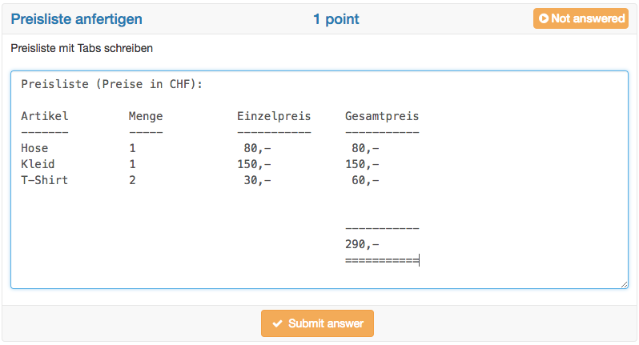

# :o_icon_o_mi_qtiessay: Essay* {: #essay}

With an essay question you let the participants formulate an answer freely, for example an essay. The participants write their answer into a text field of any size. You correct essay answers by hand after submission; the * in the name of the question type indicates this.

In the test editor, owners of the test, administrators and learning resource managers add the question under `Test > Administration > Test editor > Add elements > Essay`. In the [question bank](../../area_modules/Question_Bank_Create_Questions.md) you choose the type under `Question bank > My questions > Create question` in the "Type" field.

{ class="shadow lightbox" title="Essay as seen by participants" }

First enter a short title under "Title" and the question under "Question".

Then the following options are available:

* "Mode": With "Standard", the participants write into a simple text field. With "Rich text formatting", they write in an editor with text formatting that also supports mathematical formulas. [:octicons-tag-16:{ title="from Release 16.2 (OO-6071)" }](https://track.frentix.com/issue/OO-6071)
* "Placeholder": Here you enter, if needed, a text that the participants see in the empty text field.
* "Height (number of lines)": Here you define the height of the text field. The number of lines does not limit the answer: the field scrolls further if the participants write more lines.
* "Min. words": The participants must write at least this number of words to be able to submit the answer.
* "Max. words": The participants may write at most this number of words to be able to submit the answer. With it you limit the length of the answer.
* "Allow copy/paste": Here you define whether the participants may insert content via copy and paste or via drag and drop from an external source. They can move text within the same field in any case. [:octicons-tag-16:{ title="from Release 20.3.2 (OO-9472)" }](https://track.frentix.com/issue/OO-9472)

In the "Standard" mode, the answer field uses a font with fixed character width and supports the tab key. The participants can thus format their answers clearly and, for example, display columns.

Coaches and owners of the course correct the answers in the course element Test with the [correction tool](../Assessing_tests.md#correction_tool), correctors via the [correction workflow](../Test_correction_workflow.md). Who corrects and when the participants see their assessment is defined in the course element Test with the setting [Correction](../Course_Element_Test/Test_Setup.md#section_correction). You define the highest score to be awarded in the correction in the [Score tab](../Configure_test_questions.md#score) under "Max. score".

!!! info "Autosave"

    With the essay question type, participants often write essays. An autosave feature therefore saves the written text every minute. The following digression "Writing essays" describes how you configure essays.

??? abstract "Digression: Writing essays"

    With the learning resource test and the question type essay, the participants write essays in OpenOlat. So that no text is lost, consider the following points:

    * The autosave feature saves the written text every minute. After the first save, "Last saved at:" with the time is shown on the left below the answer field. The text is thus kept even if, for example, the internet connection breaks or the login expires after a period without activity. The answer is only submitted with "Submit answer", however. If the participants have not submitted the answer with "Submit answer", OpenOlat shows the content saved via autosave during the correction, with a note to this effect.
    * After an interruption, the participants should be able to start the test again. This requires the following settings:
        * The number of attempts for the whole test is unlimited ("Max. number of attempts", see [Limit number of test attempts](../Test_settings.md#limit_attempts)). So that the participants do not start the test again after finishing it, carry it out in the [Safe Exam Browser](../Assessment_mode.md#tab-safe-exam-browser) or restrict the visibility to the [assessment mode](../Assessment_mode.md).
        * The option [Allow to suspend](../Test_settings.md#allow_suspend) is switched on. After an interruption, the participants thus return to the point where they had to leave the test. OpenOlat has saved the text up to the last save, so small text losses are possible.
        * The number of attempts for the essay question is unlimited ("Limit number of attempts" in the [Score tab](../Configure_test_questions.md#score)). The participants thus submit the written text again and again and continue writing afterwards. The regular submitting gives them security.
    * If the test has a [time limit](../Configure_tests.md) ("Test configuration" tab in the test editor), the state of the last automatic save is kept when the time runs out. Text that the participants write after that is lost if they do not submit the answer with "Submit answer" before the time runs out. Remind the participants shortly before the end to submit the answer once more and not to write anything afterwards.

## Further information {: #further_information}

**Mentioned on this page** 
[Question Bank: Create Questions >](../../area_modules/Question_Bank_Create_Questions.md) 
[Assessing tests >](../Assessing_tests.md) 
[Test: Correction workflow >](../Test_correction_workflow.md) 
[Set up a test >](../Course_Element_Test/Test_Setup.md) 
[Test: Settings >](../Test_settings.md) 
[Assessment management: Assessment mode >](../Assessment_mode.md) 
[Configure test questions >](../Configure_test_questions.md) 
[Configure tests >](../Configure_tests.md)

**Further reading** 
[Question types >](index.md) 
[Test editor >](../Test_editor_QTI_2.1/index.md)

[To the top of the page ^](#essay)
