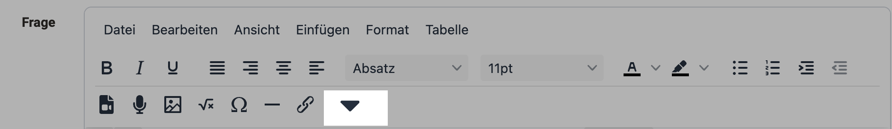
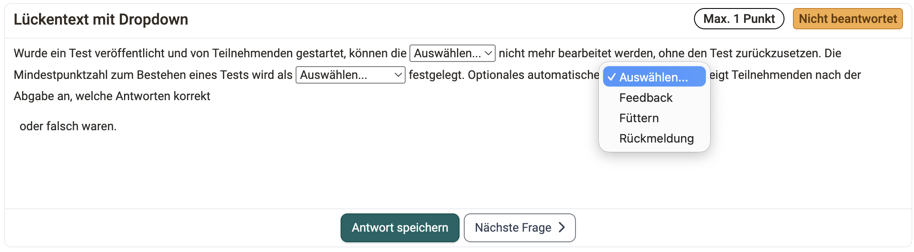
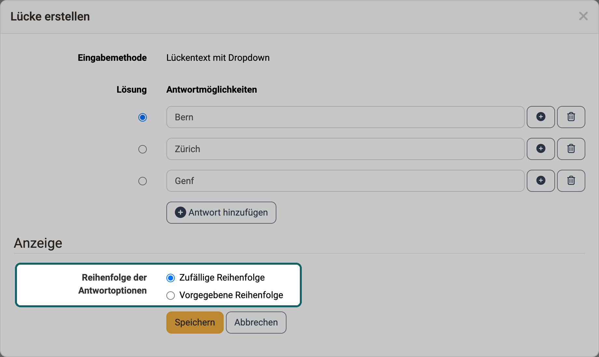
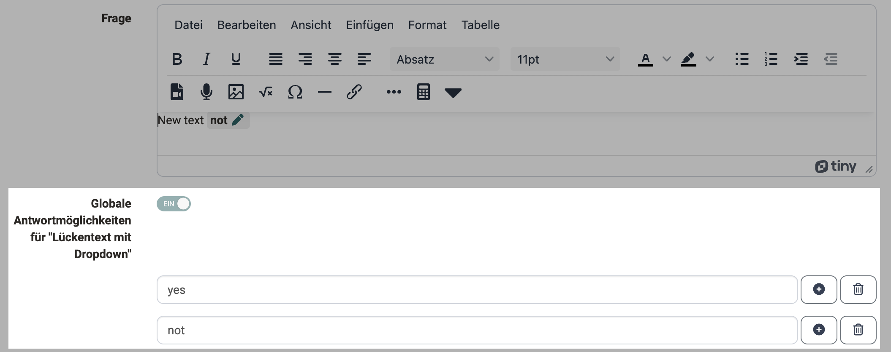

# :o_icon_o_mi_qtiinlinechoice: Lückentext mit Dropdown [:octicons-tag-16:{ title="ab Release 17.0.0 (OO-6270)" }](https://track.frentix.com/issue/OO-6270) {: #gap_dropdown}

Mit einem Lückentext mit Dropdown prüfen Sie Begriffe im Zusammenhang eines Textes, und die Teilnehmenden wählen die Antwort aus einer Liste, statt sie einzutippen. Der Fragetyp verbindet [Lückentext](Gap_text.de.md) und [Single Choice](Single_choice.de.md).

Im Testeditor fügen Besitzer:innen des Tests, Administrator:innen und Lernressourcenverwalter:innen die Frage unter `Test > Administration > Testeditor > Elemente hinzufügen > Lückentext mit Dropdown` hinzu. Im [Fragenpool](../../area_modules/Question_Bank_Create_Questions.de.md) wählen Sie den Typ unter `Fragenpool > Meine Fragen > Frage erstellen` im Feld "Fragetyp".

Wie beim Lückentext bauen Sie Lücken in einen Fliesstext ein, hier mit dem Icon mit dem Dreieck ("Lückentext mit Dropdown"). Jeder Lücke ordnen Sie unter "Antwortmöglichkeiten" mehrere Antworten zu. Weitere Antworten ergänzen Sie mit "Antwort hinzufügen". Die richtige Antwort markieren Sie unter "Lösung".

{ class="shadow lightbox" title="Lückentext mit Dropdown, Werkzeugleiste im Testeditor" }

{ class="shadow lightbox" title="Lückentext mit Dropdown aus Sicht der Teilnehmenden" }

Unter "Anzeige" legen Sie mit "Reihenfolge der Antwortoptionen" fest, ob die Teilnehmenden die Antworten in zufälliger Reihenfolge ("Zufällige Reihenfolge") oder in der von Ihnen erfassten Reihenfolge ("Vorgegebene Reihenfolge") sehen.

{ class="shadow lightbox" title="Dialog Lücke erstellen bei Lückentext mit Dropdown · 2026.11.10" }

Für alle Lücken einer Frage verwenden Sie bei Bedarf globale Antwortmöglichkeiten. Schalten Sie dazu "Globale Antwortmöglichkeiten für 'Lückentext mit Dropdown'" ein. Erfassen Sie die Antworten dann einmal pro Frage. Weitere globale Antworten ergänzen Sie mit der Schaltfläche :o_icon_o_icon_add: ("Globale Antwort hinzufügen"). OpenOlat zeigt die globalen Antworten in jeder Lücke der Frage, und die Teilnehmenden wählen die Antwort, die zur jeweiligen Lücke passt.

{ class="shadow lightbox" title="Globale Antwortmöglichkeiten im Testeditor" }

Die Punkte vergeben Sie pauschal für alle Lücken oder einzeln für jede Antwort einer Lücke.

## Weiterführende Informationen {: #further_information}

[Lückentext >](Gap_text.de.md) 
[Single Choice >](Single_choice.de.md) 
[Fragenpool: Fragen erstellen >](../../area_modules/Question_Bank_Create_Questions.de.md) 
[Fragetypen >](index.de.md) 
[Testfragen konfigurieren >](../Configure_test_questions.de.md) 
[Testeditor >](../Test_editor_QTI_2.1/index.de.md)

[Zum Seitenanfang ^](#gap_dropdown)
