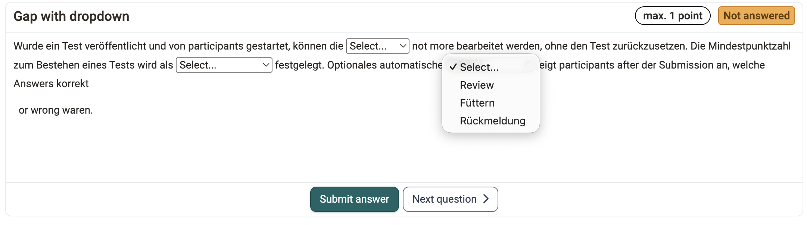
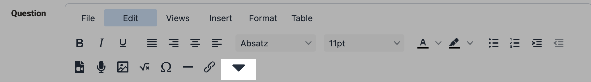
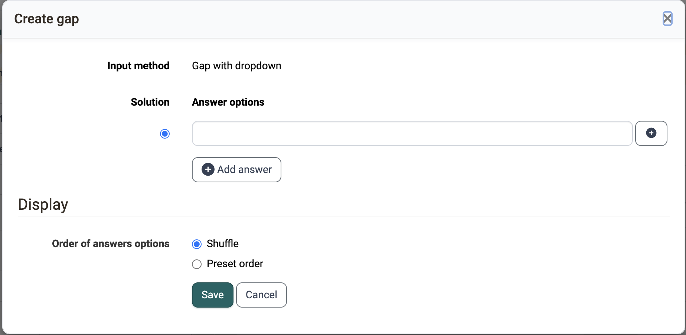
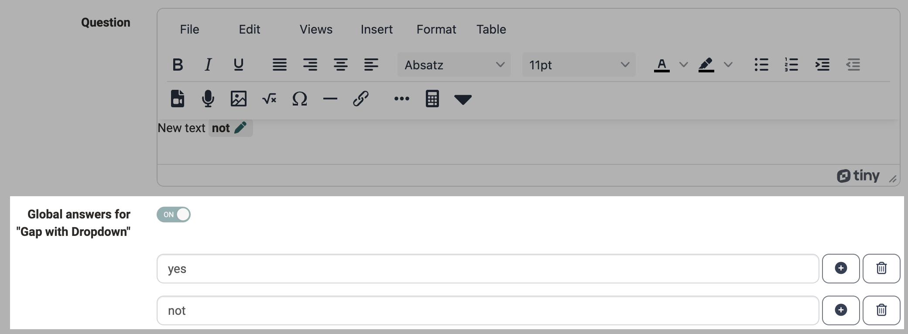

# :o_icon_o_mi_qtiinlinechoice: Gap with dropdown [:octicons-tag-16:{ title="from Release 17.0.0 (OO-6270)" }](https://track.frentix.com/issue/OO-6270) {: #gap_dropdown}

With a gap with dropdown you check terms in the context of a text, and the participants select the answer from a list instead of typing it. The question type combines [gap text](Gap_text.md) and [single choice](Single_choice.md).

In the test editor, owners of the test, administrators and learning resource managers add the question under `Test > Administration > Test editor > Add elements > Gap with dropdown`. In the [question bank](../../area_modules/Question_Bank_Create_Questions.md) you choose the type under `Question bank > My questions > Create question` in the "Type" field.

{ class="shadow lightbox" title="Gap with dropdown as seen by participants" }

As with the gap text, you build gaps into a running text, here with the icon with the triangle ("Gap with dropdown"). To each gap you assign several answers under "Answer options". You add further answers with "Add answer". You mark the correct answer under "Solution".

{ class="shadow lightbox" title="Gap with dropdown, toolbar in the test editor" }

Under "Display", you define with "Order of answer options" whether the participants see the answers in random order ("Shuffle") or in the order you entered ("Preset order").

{ class="shadow lightbox" title="Dialog Create gap in gap with dropdown" }

For all gaps of a question you can use global answer options. To do so, switch on "Global answers for 'Gap with Dropdown'". Then enter the answers once per question. You add further global answers with the button :o_icon_o_icon_add: ("Add global answer"). OpenOlat shows the global answers in each gap of the question, and the participants select the answer that fits the respective gap.

{ class="shadow lightbox" title="Global answers in the test editor" }

You award the points either as a whole for all gaps or individually for each answer of a gap.

## Further information {: #further_information}

[Gap FIB text >](Gap_text.md) 
[Single choice >](Single_choice.md) 
[Question Bank: Create Questions >](../../area_modules/Question_Bank_Create_Questions.md) 
[Question types >](index.md) 
[Configure test questions >](../Configure_test_questions.md) 
[Test editor >](../Test_editor_QTI_2.1/index.md)

[To the top of the page ^](#gap_dropdown)
