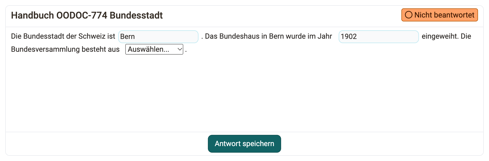
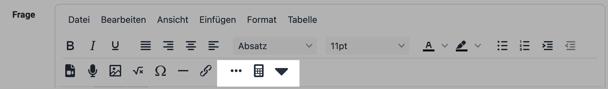

# :o_icon_o_mi_qtigapmixed: Lückentext gemischt [:octicons-tag-16:{ title="ab Release 21.0 (OO-9385)" }](https://track.frentix.com/issue/OO-9385) {: #gap_mixed}

Mit einem Lückentext gemischt prüfen Sie Text, Zahlen und Auswahl in einer einzigen Frage. Text-Lücken, numerische Lücken und Lücken mit Dropdown stehen gemeinsam im selben Fliesstext. So bilden Sie zum Beispiel eine Rechenaufgabe samt Begründung in einer Frage ab, statt mehrere Einzelfragen zu erstellen.

Im Testeditor fügen Besitzer:innen des Tests, Administrator:innen und Lernressourcenverwalter:innen die Frage unter `Test > Administration > Testeditor > Elemente hinzufügen > Lückentext gemischt` hinzu. Im [Fragenpool](../../area_modules/Question_Bank_Create_Questions.de.md) wählen Sie den Typ unter `Fragenpool > Meine Fragen > Frage erstellen` im Feld "Fragetyp".

{ class="shadow lightbox" title="Lückentext gemischt aus Sicht der Teilnehmenden · 2026.11.10" }

Beim Einfügen einer Lücke wählen Sie die Eingabemethode mit dem passenden Icon in der Werkzeugleiste: drei Punkte für "Lückentext", Taschenrechner für "Lückentext numerisch", Dreieck für "Lückentext mit Dropdown". Jede Lücke konfigurieren Sie anschliessend im gleichen Dialog wie beim jeweiligen einzelnen Fragetyp: [Lückentext](Gap_text.de.md), [Lückentext numerisch](Gap_numerical.de.md) oder [Lückentext mit Dropdown](Gap_dropdown.de.md). Oben im Dialog steht unter "Eingabemethode" die Art der Lücke.

{ class="shadow lightbox" title="Lückentext gemischt, Werkzeugleiste im Testeditor" }

Enthält die Frage Lücken mit Dropdown, definieren Sie zusätzlich bei Bedarf globale Antwortmöglichkeiten (siehe [Lückentext mit Dropdown](Gap_dropdown.de.md)).

Bestehende Fragen der Typen Lückentext und Lückentext numerisch, die Text- und numerische Lücken enthalten, zeigen im Testeditor einen Hinweis. Mit der Aktion "Zu 'Lückentext gemischt' konvertieren" wandeln Sie eine solche Frage in den Fragetyp Lückentext gemischt um.

## Weiterführende Informationen {: #further_information}

[Lückentext >](Gap_text.de.md) 
[Lückentext numerisch >](Gap_numerical.de.md) 
[Lückentext mit Dropdown >](Gap_dropdown.de.md) 
[Fragenpool: Fragen erstellen >](../../area_modules/Question_Bank_Create_Questions.de.md) 
[Fragetypen >](index.de.md) 
[Testfragen konfigurieren >](../Configure_test_questions.de.md) 
[Testeditor >](../Test_editor_QTI_2.1/index.de.md)

[Zum Seitenanfang ^](#gap_mixed)
