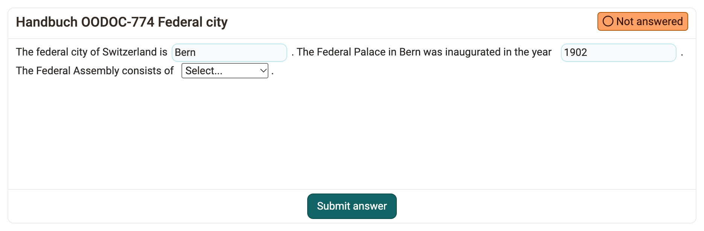
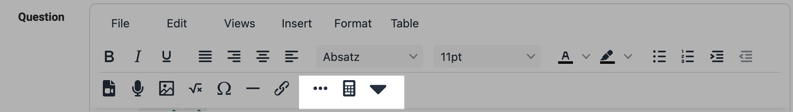

# :o_icon_o_mi_qtigapmixed: Gap mixed [:octicons-tag-16:{ title="from Release 21.0 (OO-9385)" }](https://track.frentix.com/issue/OO-9385) {: #gap_mixed}

With a gap mixed question you check text, numbers and selection in a single question. Text gaps, numerical gaps and gaps with dropdown stand together in the same running text. For example, you map a calculation task including its reasoning in one question instead of creating several individual questions.

In the test editor, owners of the test, administrators and learning resource managers add the question under `Test > Administration > Test editor > Add elements > Gap mixed`. In the [question bank](../../area_modules/Question_Bank_Create_Questions.md) you choose the type under `Question bank > My questions > Create question` in the "Type" field.

{ class="shadow lightbox" title="Gap mixed as seen by participants · 2026.11.10" }

When inserting a gap, you choose the input method with the matching icon in the toolbar: three dots for "Gap FIB text", calculator for "Gap FIB numerical", triangle for "Gap with dropdown". You then configure each gap in the same dialog as for the respective individual question type: [Gap FIB text](Gap_text.md), [Gap FIB numerical](Gap_numerical.md) or [Gap with dropdown](Gap_dropdown.md). At the top of the dialog, "Input method" shows the type of the gap.

{ class="shadow lightbox" title="Gap mixed, toolbar in the test editor" }

If the question contains gaps with dropdown, you can also define global answer options (see [Gap with dropdown](Gap_dropdown.md)).

Existing questions of the types Gap FIB text and Gap FIB numerical that contain text and numerical gaps show a message in the test editor. With the action "Convert to 'Gap mixed'" you convert such a question into the question type Gap mixed.

## Further information {: #further_information}

[Gap FIB text >](Gap_text.md) 
[Gap FIB numerical >](Gap_numerical.md) 
[Gap with dropdown >](Gap_dropdown.md) 
[Question Bank: Create Questions >](../../area_modules/Question_Bank_Create_Questions.md) 
[Question types >](index.md) 
[Configure test questions >](../Configure_test_questions.md) 
[Test editor >](../Test_editor_QTI_2.1/index.md)

[To the top of the page ^](#gap_mixed)
