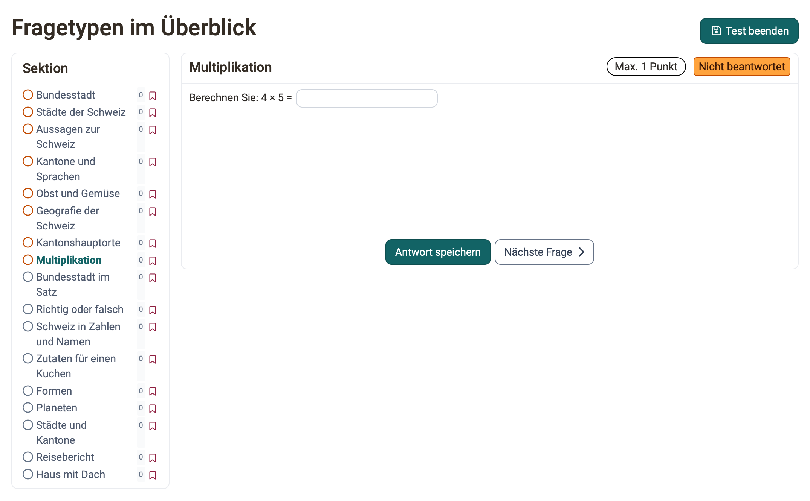
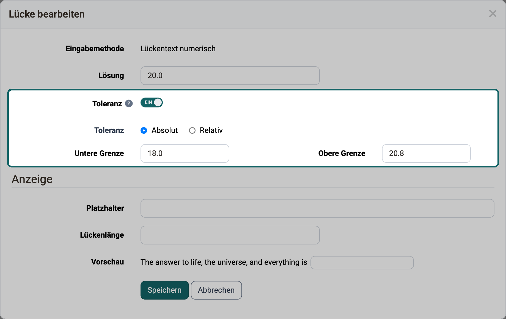

# :o_icon_o_mi_qtinumerical: Lückentext numerisch {: #numeric_input}

Mit einem Lückentext numerisch prüfen Sie Rechenergebnisse und andere Zahlen in einem Text. Aufgebaut ist er wie der [Lückentext](Gap_text.de.md): Sie schreiben einen Text und setzen darin Lücken, als Lösung tragen Sie aber eine Zahl ein. Lücken fügen Sie im Editor der Frage mit dem Icon mit dem Taschenrechner ("Lückentext numerisch") ein. Mit einem Klick auf eine Lücke öffnen Sie den Dialog "Lücke bearbeiten".

Im Testeditor fügen Besitzer:innen des Tests, Administrator:innen und Lernressourcenverwalter:innen die Frage unter `Test > Administration > Testeditor > Elemente hinzufügen > Lückentext numerisch` hinzu. Im [Fragenpool](../../area_modules/Question_Bank_Create_Questions.de.md) wählen Sie den Typ unter `Fragenpool > Meine Fragen > Frage erstellen` im Feld "Fragetyp".

{ class="shadow lightbox" title="Lückentext numerisch aus Sicht der Teilnehmenden · 2026.11.23" }

Der Dialog einer Zahlenlücke zeigt "Lösung", "Toleranz" und "Anzeige". Für Abweichungen von der Lösung ist die "Toleranz" da: Mit ihr lassen Sie einen Bereich um die Lösung als korrekt gelten. Die Felder "Alternative Antworten" und "Korrektur" finden Sie im Dialog des [Lückentexts](Gap_text.de.md), ebenso gilt die Option "Doppelte Eingaben erlauben" im Tab "Punkte" nur für dessen Text-Lücken. Text- und Zahlenlücken in einer Frage kombiniert der Fragetyp [Lückentext gemischt](Gap_mixed.de.md).

Für jede Lücke legen Sie folgende Einstellungen fest:

* "Lösung": Tragen Sie die richtige Zahl ein. Dezimalzahlen schreiben Sie mit Punkt, zum Beispiel 20.8. Das gilt auch für die Grenzen unter "Toleranz". Bei einem Komma meldet der Dialog: "Für Dezimalzahlen wird das Trennzeichen Punkt und nicht Komma verwendet. Beispiele: 15.0, 5.5, 10".
* "Toleranz": Ist der Schalter ausgeschaltet, muss die Antwort genau der Lösung entsprechen. Ist er eingeschaltet, akzeptiert die Lücke Antworten zwischen einer unteren und einer oberen Grenze. Dafür wählen Sie unter "Toleranz" einen von zwei Modi:
    * "Absolut": Sie tragen "Untere Grenze" und "Obere Grenze" als absolute Zahlen ein.

		_Beispiel:_ Lösung 20, untere Grenze 18, obere Grenze 20.8 → Alle Lösungen zwischen 18 und 20.8 sind korrekt.

    * "Relativ": Sie tragen "Untere Grenze" und "Obere Grenze" als relative Zahlen in Prozent ein.

		_Beispiel:_ Lösung 20, untere Grenze 10, obere Grenze 10 → Alle Lösungen zwischen 18 und 22 sind gültig, denn die untere Grenze bedeutet minus 10% (20-2) und die obere Grenze plus 10% (20+2).

* "Anzeige":
    * "Platzhalter": Hier tragen Sie bei Bedarf einen Text ein, den die Teilnehmenden in der leeren Lücke sehen.
    * "Lückenlänge": Hier tragen Sie eine Länge in Zeichen für das Lückenfeld ein, zum Beispiel zur Formatierung. Die Länge der Eingabe begrenzt sie nicht.
    * "Vorschau": Zeigt an einem Beispielsatz direkt im Dialog, wie die Lücke erscheint.

Die Teilnehmenden schreiben Dezimalzahlen mit Punkt oder mit Komma. OpenOlat bewertet "20,5" gleich wie "20.5".

Die Punkte vergeben Sie im [Tab Punkte](../Configure_test_questions.de.md#score). Unter "Bewertungsmethode" stehen "Alle korrekten Antworten", "Punkte pro Antwort" und "Teilpunkte" zur Wahl. Mit "Punkte pro Antwort" erhält jede Lücke eigene Punkte.

{ class="shadow lightbox" title="Dialog Lücke bearbeiten bei Lückentext numerisch · 2026.11.23" }

## Weiterführende Informationen {: #further_information}

[Lückentext >](Gap_text.de.md) 
[Lückentext gemischt >](Gap_mixed.de.md) 
[Fragenpool: Fragen erstellen >](../../area_modules/Question_Bank_Create_Questions.de.md) 
[Fragetypen >](index.de.md) 
[Testfragen konfigurieren >](../Configure_test_questions.de.md) 
[Testeditor >](../Test_editor_QTI_2.1/index.de.md)

[Zum Seitenanfang ^](#numeric_input)
