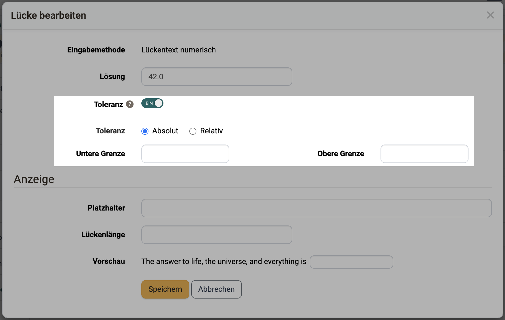
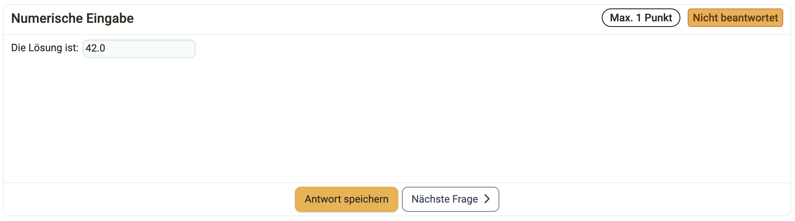

# :o_icon_o_mi_qtinumerical: Lückentext numerisch {: #numeric_input}

Mit einem Lückentext numerisch prüfen Sie Rechenergebnisse und andere Zahlen in einem Text. Er funktioniert wie der [Lückentext](Gap_text.de.md), als Lösung tragen Sie aber Zahlen ein. Lücken fügen Sie mit dem Icon mit dem Taschenrechner ("Lückentext numerisch") ein.

Im Testeditor fügen Besitzer:innen des Tests, Administrator:innen und Lernressourcenverwalter:innen die Frage unter `Test > Administration > Testeditor > Elemente hinzufügen > Lückentext numerisch` hinzu. Im [Fragenpool](../../area_modules/Question_Bank_Create_Questions.de.md) wählen Sie den Typ unter `Fragenpool > Meine Fragen > Frage erstellen` im Feld "Fragetyp".

Für jede Lücke legen Sie folgende Einstellungen fest:

* "Lösung": Tragen Sie hier die richtige Zahl ein.
* "Toleranz": Ist der Schalter ausgeschaltet, muss die Antwort genau der Lösung entsprechen. Ist er eingeschaltet, akzeptiert die Lücke Antworten zwischen einer unteren und einer oberen Grenze. Dafür wählen Sie unter "Toleranz" einen von zwei Modi:
    * "Absolut": Sie tragen "Untere Grenze" und "Obere Grenze" als absolute Zahlen ein.

		_Beispiel:_ Lösung 20, untere Grenze 18, obere Grenze 20,8 → Alle Lösungen zwischen 18 und 20,8 sind korrekt.

    * "Relativ": Sie tragen "Untere Grenze" und "Obere Grenze" als relative Zahlen in Prozent ein.

		_Beispiel:_ Lösung 20, untere Grenze 10, obere Grenze 10 → Alle Lösungen zwischen 18 und 22 sind gültig, denn die untere Grenze bedeutet minus 10% (20-2) und die obere Grenze plus 10% (20+2).

* "Anzeige":
    * "Platzhalter": Hier tragen Sie bei Bedarf einen Text ein, den die Teilnehmenden in der leeren Lücke sehen.
    * "Lückenlänge": Hier tragen Sie eine Länge für das Lückenfeld ein, zum Beispiel zur Formatierung. Die Länge der Eingabe begrenzt sie nicht.
    * "Vorschau": Zeigt an einem Beispielsatz direkt im Dialog, wie die Lücke erscheint.

{ class="shadow lightbox" title="Dialog Lücke bearbeiten bei Lückentext numerisch" }

{ class="shadow lightbox" title="Lückentext numerisch aus Sicht der Teilnehmenden" }

## Weiterführende Informationen {: #further_information}

[Lückentext >](Gap_text.de.md) 
[Fragenpool: Fragen erstellen >](../../area_modules/Question_Bank_Create_Questions.de.md) 
[Fragetypen >](index.de.md) 
[Testfragen konfigurieren >](../Configure_test_questions.de.md) 
[Testeditor >](../Test_editor_QTI_2.1/index.de.md)

[Zum Seitenanfang ^](#numeric_input)
