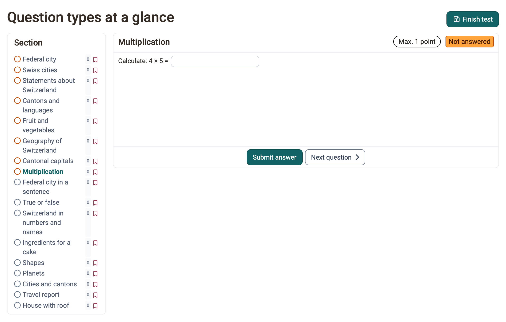
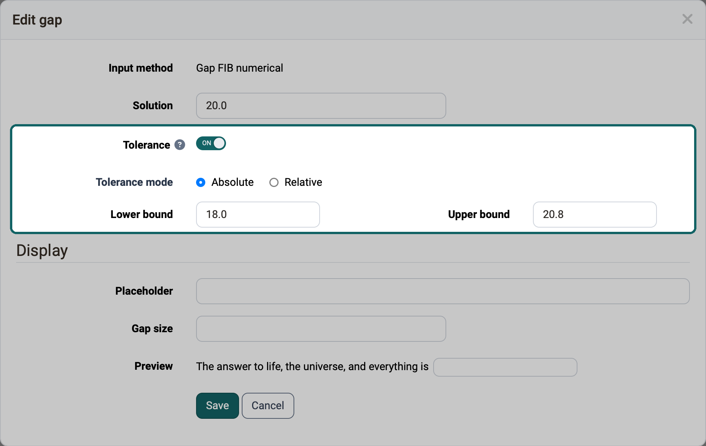

# :o_icon_o_mi_qtinumerical: Gap FIB numerical {: #numeric_input}

With a gap FIB numerical you check calculation results and other numbers in a text. It is built like the [gap text](Gap_text.md): you write a text and set gaps in it, but you enter a number as the solution. You insert gaps in the editor of the question with the icon with the calculator ("Gap FIB numerical"). Click a gap to open the "Edit gap" dialog.

In the test editor, owners of the test, administrators and learning resource managers add the question under `Test > Administration > Test editor > Add elements > Gap FIB numerical`. In the [question bank](../../area_modules/Question_Bank_Create_Questions.md) you choose the type under `Question bank > My questions > Create question` in the "Type" field.

{ class="shadow lightbox" title="Gap FIB numerical as seen by participants · 2026.11.23" }

The dialog of a number gap shows "Solution", "Tolerance" and "Display". For deviations from the solution there is the "Tolerance": with it you let a range around the solution count as correct. The fields "Alternative answers" and "Correction" are in the dialog of the [gap text](Gap_text.md), and the option "Allow twice the same input" in the "Score" tab likewise applies only to its text gaps. The question type [Gap mixed](Gap_mixed.md) combines text and number gaps in one question.

For each gap you define the following settings:

* "Solution": Enter the correct number. Write decimal numbers with a point, for example 20.8. This also applies to the bounds under "Tolerance". With a comma, the dialog reports: "For decimal numbers point and not comma is used as separator. Examples: 15.0, 5.5, 10".
* "Tolerance": If the toggle is switched off, the answer must exactly match the solution. If it is switched on, the gap accepts answers between a lower and an upper bound. For this you choose one of two modes under "Tolerance mode":
    * "Absolute": You enter "Lower bound" and "Upper bound" as absolute numbers.

		_Example:_ Solution 20, lower bound 18, upper bound 20.8 → all solutions between 18 and 20.8 are correct.

    * "Relative": You enter "Lower bound" and "Upper bound" as relative numbers in percent.

		_Example:_ Solution 20, lower bound 10, upper bound 10 → all solutions between 18 and 22 are correct, as the lower bound means minus 10% (20-2) and the upper bound plus 10% (20+2).

* "Display":
    * "Placeholder": Here you enter, if needed, a text that the participants see in the empty gap.
    * "Gap size": Here you enter a length in characters for the gap field, for example for formatting. It does not limit the length of the entry.
    * "Preview": Shows directly in the dialog, using an example sentence, how the gap appears.

The participants write decimal numbers with a point or with a comma. OpenOlat assesses "20,5" the same as "20.5".

You award the points in the [Score tab](../Configure_test_questions.md#score). Under "Method of assessment", "All correct answers", "Score per answer" and "Partial score" are available. With "Score per answer" each gap receives its own points.

{ class="shadow lightbox" title="Dialog Edit gap in gap FIB numerical · 2026.11.23" }

## Further information {: #further_information}

[Gap FIB text >](Gap_text.md) 
[Gap mixed >](Gap_mixed.md) 
[Question Bank: Create Questions >](../../area_modules/Question_Bank_Create_Questions.md) 
[Question types >](index.md) 
[Configure test questions >](../Configure_test_questions.md) 
[Test editor >](../Test_editor_QTI_2.1/index.md)

[To the top of the page ^](#numeric_input)
