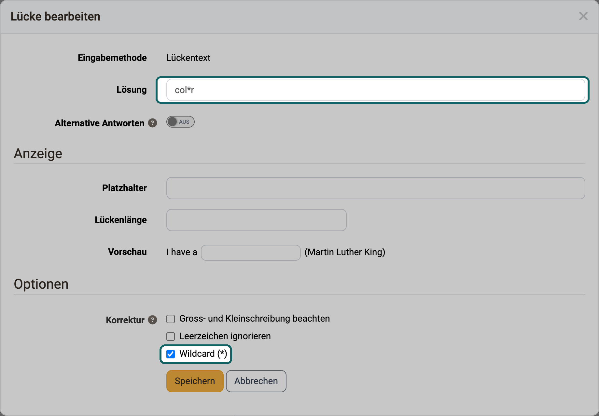
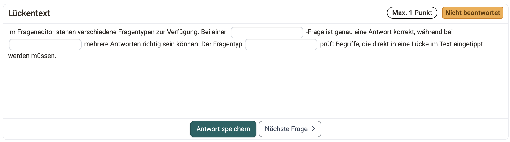

# :o_icon_o_mi_qtifib: Lückentext {: #gap}

Mit einer Lückentext-Frage prüfen Sie, ob die Teilnehmenden fehlende Begriffe in einem Text selbst eintippen. Der Text enthält Lücken, in welche die Teilnehmenden ihre Antwort schreiben.

Im Testeditor fügen Besitzer:innen des Tests, Administrator:innen und Lernressourcenverwalter:innen die Frage unter `Test > Administration > Testeditor > Elemente hinzufügen > Lückentext` hinzu. Im [Fragenpool](../../area_modules/Question_Bank_Create_Questions.de.md) wählen Sie den Typ unter `Fragenpool > Meine Fragen > Frage erstellen` im Feld "Fragetyp".

Lücken fügen Sie im Editor der Frage mit dem Icon mit den drei Punkten ("Lückentext") ein. Mit einem Klick auf eine Lücke bearbeiten Sie sie. Der Dialog "Lücke erstellen" bzw. "Lücke bearbeiten" zeigt oben unter "Eingabemethode" die Art der Lücke und unter "Vorschau", wie die Lücke im Test erscheint.

Für jede Lücke legen Sie folgende Einstellungen fest:

* "Lösung": Tragen Sie hier die richtige Lösung ein.
* "Alternative Antworten": Mit diesem Schalter erfassen Sie weitere akzeptierte Lösungen als Varianten. "Antwort hinzufügen" ergänzt je ein Feld. "Mehrfach hinzufügen" erfasst mehrere Varianten auf einmal, getrennt durch ein wählbares "Trennzeichen".
* "Anzeige":
    * "Platzhalter": Hier tragen Sie bei Bedarf einen Text ein, den die Teilnehmenden in der leeren Lücke sehen.
    * "Lückenlänge": Hier tragen Sie eine Länge für das Lückenfeld ein, zum Beispiel zur Formatierung. Die Länge der Eingabe begrenzt sie nicht.
    * "Vorschau": Zeigt an einem Beispielsatz direkt im Dialog, wie die Lücke mit Platzhalter und Lückenlänge erscheint.
* "Optionen": Mit den Kontrollkästchen unter "Korrektur" legen Sie fest, wie streng OpenOlat die Antworten automatisch korrigiert:
    * "Gross- und Kleinschreibung beachten": Ist die Option gewählt, zählt die Gross- und Kleinschreibung. Sonst spielt sie für die Korrektur keine Rolle.
    * "Leerzeichen ignorieren": Zusätzliche Leerzeichen, Tabulatoren und Zeilenumbrüche in der Antwort führen nicht zu Punktabzug. Bei der Lösung "log in" gilt so auch eine Eingabe mit doppeltem Leerzeichen als richtig. [:octicons-tag-16:{ title="ab Release 21.0 (OO-9560)" }](https://track.frentix.com/issue/OO-9560)
    * "Wildcard (*)": Das Zeichen * steht in der Lösung für "etwas oder nichts" und funktioniert auch in den Varianten. So deckt die Lösung "col*r" die Schreibweisen "color", "colour" und "colr" ab. Tippen die Teilnehmenden selbst ein * ein, zählt es als normales Zeichen. Eine Lösung, die nur aus Wildcards besteht, nimmt OpenOlat beim Speichern nicht an. [:octicons-tag-16:{ title="ab Release 21.0 (OO-9384)" }](https://track.frentix.com/issue/OO-9384)

{ class="shadow lightbox" title="Dialog Lücke bearbeiten bei Lückentext · 2026.11.10" }

Die Punkte legen Sie frei fest. Auch für Varianten vergeben Sie bei Bedarf Punkte.

Enthalten mindestens zwei Lücken eine identische Antwortmöglichkeit, steht im Tab "Punkte" die Option "Doppelte Eingaben erlauben" zur Wahl. Damit lassen Sie zu oder verhindern, dass die Teilnehmenden dieselbe Antwort in mehrere Lücken eintragen.

{ class="shadow lightbox" title="Lückentext aus Sicht der Teilnehmenden" }

## Weiterführende Informationen {: #further_information}

[Fragenpool: Fragen erstellen >](../../area_modules/Question_Bank_Create_Questions.de.md) 
[Fragetypen >](index.de.md) 
[Testfragen konfigurieren >](../Configure_test_questions.de.md) 
[Testeditor >](../Test_editor_QTI_2.1/index.de.md)

[Zum Seitenanfang ^](#gap)
