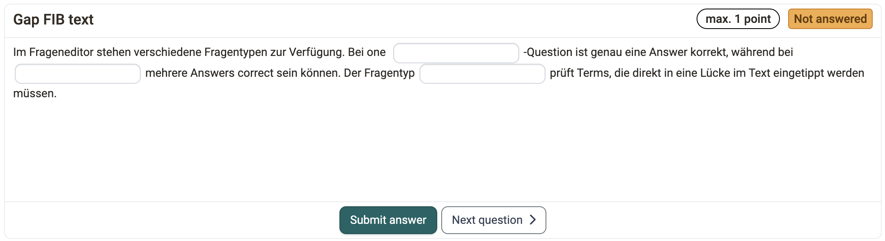
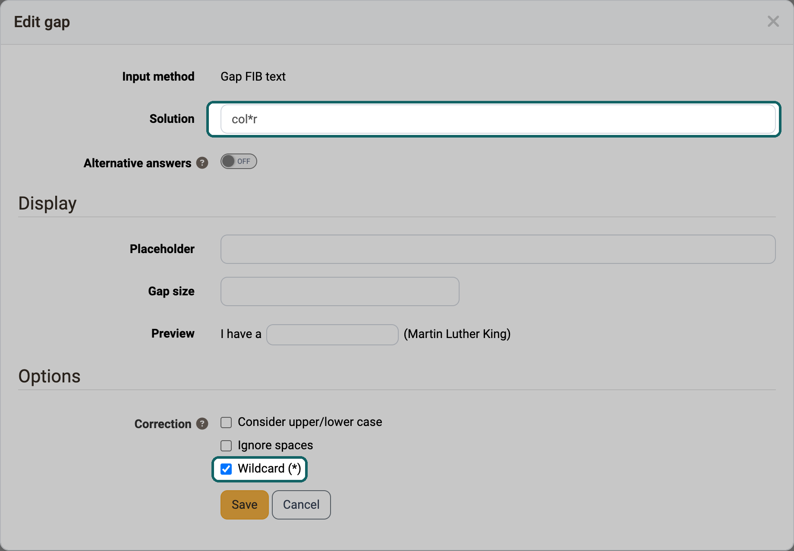

# :o_icon_o_mi_qtifib: Gap FIB text {: #gap}

With a gap text question you check whether the participants type in missing terms in a text themselves. The text contains gaps into which the participants write their answer.

In the test editor, owners of the test, administrators and learning resource managers add the question under `Test > Administration > Test editor > Add elements > Gap FIB text`. In the [question bank](../../area_modules/Question_Bank_Create_Questions.md) you choose the type under `Question bank > My questions > Create question` in the "Type" field.

{ class="shadow lightbox" title="Gap FIB text as seen by participants" }

You insert gaps in the editor of the question with the icon with the three dots ("Gap FIB text"). Click a gap to edit it. The "Create gap" or "Edit gap" dialog shows the type of the gap at the top under "Input method" and under "Preview" how the gap appears in the test.

For each gap you define the following settings:

* "Solution": Enter the correct solution here.
* "Alternative answers": With this toggle you enter further accepted solutions as alternatives. "Add answer" adds one field at a time. "Add multiple" enters several alternatives at once, separated by a selectable "Delimiter".
* "Display":
    * "Placeholder": Here you enter, if needed, a text that the participants see in the empty gap.
    * "Gap size": Here you enter a length for the gap field, for example for formatting. It does not limit the length of the entry.
    * "Preview": Shows directly in the dialog, using an example sentence, how the gap appears with placeholder and gap size.
* "Options": With the checkboxes under "Correction" you define how strictly OpenOlat corrects the answers automatically:
    * "Consider upper/lower case": If the option is selected, upper and lower case counts. Otherwise it plays no role in the correction.
    * "Ignore spaces": Additional spaces, tabs and line breaks in the answer do not lead to a deduction. With the solution "log in", an entry with a double space thus also counts as correct. [:octicons-tag-16:{ title="from Release 21.0 (OO-9560)" }](https://track.frentix.com/issue/OO-9560)
    * "Wildcard (*)": The character * stands for "something or nothing" in the solution and also works in the alternatives. The solution "col*r" thus covers the spellings "color", "colour" and "colr". If the participants type a * themselves, it counts as a normal character. OpenOlat does not accept a solution that consists only of wildcards when saving. [:octicons-tag-16:{ title="from Release 21.0 (OO-9384)" }](https://track.frentix.com/issue/OO-9384)

{ class="shadow lightbox" title="Dialog Edit gap in gap FIB text · 2026.11.10" }

You define the points freely. You can also award points for alternatives.

If at least two gaps contain an identical answer option, the option "Allow twice the same input" is available in the "Score" tab. With it you allow or prevent the participants from entering the same answer in several gaps.

## Further information {: #further_information}

[Question Bank: Create Questions >](../../area_modules/Question_Bank_Create_Questions.md) 
[Question types >](index.md) 
[Configure test questions >](../Configure_test_questions.md) 
[Test editor >](../Test_editor_QTI_2.1/index.md)

[To the top of the page ^](#gap)
