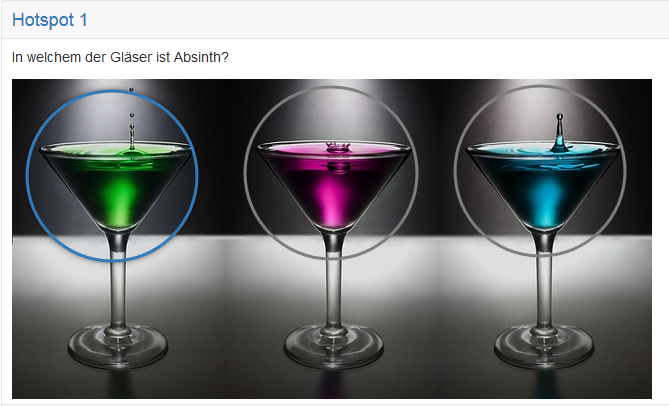

# :o_icon_o_mi_qtihotspot: Hotspot {: #hotspot}

Mit einer Hotspot-Frage prüfen Sie, ob die Teilnehmenden auf einem Bild die richtigen Stellen erkennen. Auf dem Bild liegen Bereiche, die Hotspots, und die Teilnehmenden wählen die richtigen aus. Die Hotspots sind für die Teilnehmenden sichtbar. Unter "Typ" legen Sie fest, ob die Teilnehmenden genau einen Hotspot wählen ("Single choice") oder mehrere ("Multiple choice"). Die Form der Hotspots, ihre Farbe ("Hotspot Farbe") und die Bildgrösse passen die Darstellung an.

Im Testeditor fügen Besitzer:innen des Tests, Administrator:innen und Lernressourcenverwalter:innen die Frage unter `Test > Administration > Testeditor > Elemente hinzufügen > Hotspot` hinzu. Im [Fragenpool](../../area_modules/Question_Bank_Create_Questions.de.md) wählen Sie den Typ unter `Fragenpool > Meine Fragen > Frage erstellen` im Feld "Fragetyp".

## Vorgehen {: #procedure}

* Geben Sie zuerst unter "Titel" einen kurzen Titel und unter "Frage" die Frage ein.
* Laden Sie danach unter "Hintergrund" das Bild hoch.
* Platzieren Sie dann mit "Kreis" oder "Viereck" Hotspots auf dem Bild. Über "Erweiterte Bearbeitung" öffnen Sie den Dialog "Hotspots bearbeiten": Dort duplizieren Sie Hotspots, richten sie aneinander aus und legen Position und Grösse mit den Feldern X, Y, W und H fest.
* Wählen Sie unter "Korrekte Spots" die richtigen Antworten.
* Legen Sie zum Schluss im [Tab Punkte](../Configure_test_questions.de.md#score) die Punktzahl fest. Unter "Bewertungsmethode" stehen "Alle korrekten Antworten" und "Punkte pro Antwort" zur Wahl. Mit "Punkte pro Antwort" erscheint darunter eine Tabelle, in der Sie in der Spalte "Punkte" für jeden Hotspot eigene Punkte eintragen, auch negative. Steht "Typ" auf "Multiple choice", kommt die Methode "Teilpunkte" dazu.

{ class="shadow lightbox" title="Hotspot aus Sicht der Teilnehmenden" }

## Weiterführende Informationen {: #further_information}

[Fragenpool: Fragen erstellen >](../../area_modules/Question_Bank_Create_Questions.de.md) 
[Fragetypen >](index.de.md) 
[Testfragen konfigurieren >](../Configure_test_questions.de.md) 
[Testeditor >](../Test_editor_QTI_2.1/index.de.md)

[Zum Seitenanfang ^](#hotspot)
