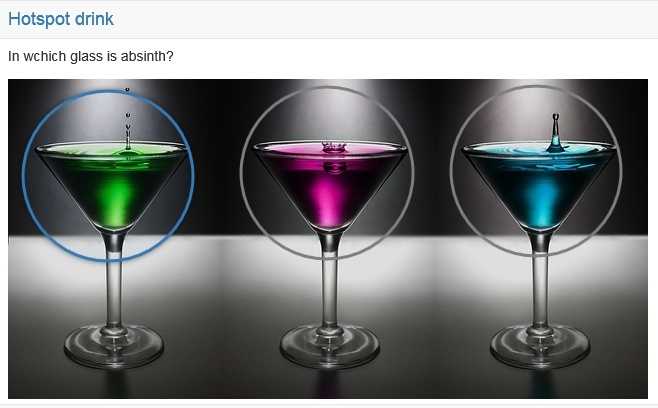

# :o_icon_o_mi_qtihotspot: Hotspot {: #hotspot}

With a hotspot question you check whether the participants recognise the right places on a picture. Areas, the hotspots, lie on the picture, and the participants select the correct ones. The hotspots are visible for the participants. Under "Type" you define whether the participants select exactly one hotspot ("Single choice") or several ("Multiple choice"). The shape of the hotspots, their colour ("Layout") and the image size adjust the display.

In the test editor, owners of the test, administrators and learning resource managers add the question under `Test > Administration > Test editor > Add elements > Hotspot`. In the [question bank](../../area_modules/Question_Bank_Create_Questions.md) you choose the type under `Question bank > My questions > Create question` in the "Type" field.

## Approach {: #procedure}

* First enter a short title under "Title" and the question under "Question".
* Then upload the picture under "Background".
* Then place hotspots on the picture with "Circle" or "Rectangle". Via "Advanced edit" you open the "Edit hotspots" dialog: there you duplicate hotspots, align them with each other and set position and size with the fields X, Y, W and H.
* Select the correct answers under "Correct spots".
* Finally, define the score in the [Score tab](../Configure_test_questions.md#score). Under "Method of assessment", "All correct answers" and "Score per answer" are available. With "Score per answer" a table appears below, in which you enter separate points for each hotspot in the "Points" column, also negative ones. If "Type" is set to "Multiple choice", the method "Partial score" is added.

{ class="shadow lightbox" title="Hotspot as seen by participants" }

## Further information {: #further_information}

[Question Bank: Create Questions >](../../area_modules/Question_Bank_Create_Questions.md) 
[Question types >](index.md) 
[Configure test questions >](../Configure_test_questions.md) 
[Test editor >](../Test_editor_QTI_2.1/index.md)

[To the top of the page ^](#hotspot)
