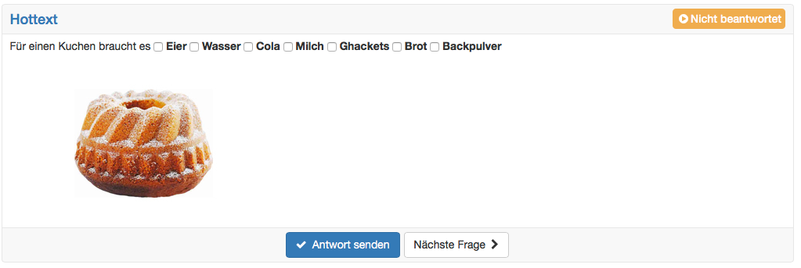

# :o_icon_o_mi_qtihottext: Hottext [:octicons-tag-16:{ title="ab Release 11.4 (OO-2610)" }](https://track.frentix.com/issue/OO-2610) {: #hottext}

Mit einer Hottext-Frage prüfen Sie, ob die Teilnehmenden die passenden Begriffe in einem Text erkennen. Sie markieren im Fliesstext Begriffe, welche die Teilnehmenden anschliessend auswählen. Die Frage funktioniert wie [Multiple Choice](Multiple_choice.de.md), nur stehen die Antworten als markierte Begriffe im Text. Anders als beim [Lückentext](Gap_text.de.md) tippen die Teilnehmenden nichts ein, sondern wählen aus.

Im Testeditor fügen Besitzer:innen des Tests, Administrator:innen und Lernressourcenverwalter:innen die Frage unter `Test > Administration > Testeditor > Elemente hinzufügen > Hottext` hinzu. Im [Fragenpool](../../area_modules/Question_Bank_Create_Questions.de.md) wählen Sie den Typ unter `Fragenpool > Meine Fragen > Frage erstellen` im Feld "Fragetyp".

Geben Sie zuerst unter "Titel" einen kurzen Titel ein.

Schreiben Sie danach unter "Frage" den Text. Markieren Sie darin einen Auswahlbegriff und klicken Sie in der Werkzeugleiste des Editors auf das Icon "Hottext". Vor jedem Hottext erscheint im Text ein Kästchen: Kreuzen Sie es bei den korrekten Antworten an.

Legen Sie zum Schluss im [Tab Punkte](../Configure_test_questions.de.md#score) die Punktzahl fest. Unter "Bewertungsmethode" stehen wie bei Multiple Choice "Alle korrekten Antworten", "Punkte pro Antwort" und "Teilpunkte" zur Wahl. Mit "Min. Anzahl möglicher Antworten" und "Max. Anzahl möglicher Antworten" legen Sie fest, wie viele Begriffe die Teilnehmenden mindestens und höchstens auswählen.

{ class="shadow lightbox" title="Hottext aus Sicht der Teilnehmenden" }

## Weiterführende Informationen {: #further_information}

[Multiple Choice >](Multiple_choice.de.md) 
[Lückentext >](Gap_text.de.md) 
[Fragenpool: Fragen erstellen >](../../area_modules/Question_Bank_Create_Questions.de.md) 
[Fragetypen >](index.de.md) 
[Testfragen konfigurieren >](../Configure_test_questions.de.md) 
[Testeditor >](../Test_editor_QTI_2.1/index.de.md)

[Zum Seitenanfang ^](#hottext)
