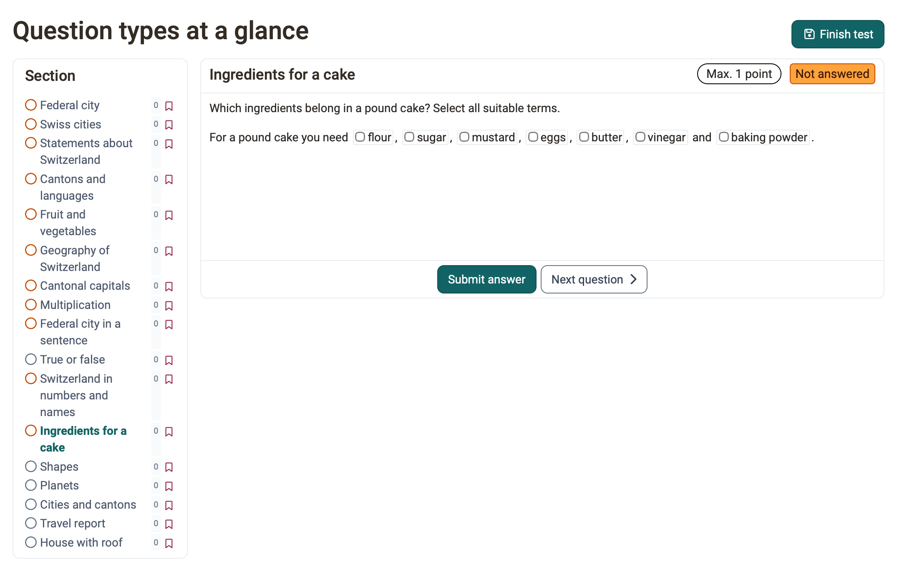

# :o_icon_o_mi_qtihottext: Hottext [:octicons-tag-16:{ title="from Release 11.4 (OO-2610)" }](https://track.frentix.com/issue/OO-2610) {: #hottext}

With a hottext question you check whether the participants recognise the matching terms in a text. You mark terms in the running text, which the participants then select. The question works like [multiple choice](Multiple_choice.md), except that the answers are marked terms in the text. Unlike the [gap text](Gap_text.md), the participants do not type anything but select.

In the test editor, owners of the test, administrators and learning resource managers add the question under `Test > Administration > Test editor > Add elements > Hottext`. In the [question bank](../../area_modules/Question_Bank_Create_Questions.md) you choose the type under `Question bank > My questions > Create question` in the "Type" field.

{ class="shadow lightbox" title="Hottext as seen by participants · 2026.11.23" }

First enter a short title under "Title".

Then write the text under "Question". Mark a selectable term in it and click the "Hottext" icon in the toolbar of the editor. A box appears in the text in front of each hottext: tick it for the correct answers.

Finally, define the score in the [Score tab](../Configure_test_questions.md#score). As with multiple choice, "All correct answers", "Score per answer" and "Partial score" are available under "Method of assessment". With "Min. number of possible answers" and "Max. number of possible answers" you define how many terms the participants select at least and at most.

## Further information {: #further_information}

[Multiple choice >](Multiple_choice.md) 
[Gap FIB text >](Gap_text.md) 
[Question Bank: Create Questions >](../../area_modules/Question_Bank_Create_Questions.md) 
[Question types >](index.md) 
[Configure test questions >](../Configure_test_questions.md) 
[Test editor >](../Test_editor_QTI_2.1/index.md)

[To the top of the page ^](#hottext)
