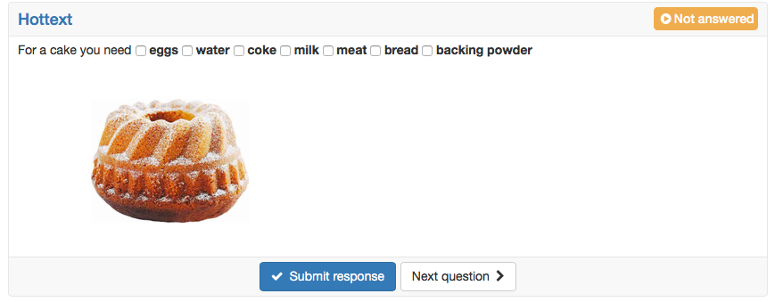

# :o_icon_o_mi_qtihottext: Hottext [:octicons-tag-16:{ title="from Release 11.4 (OO-2610)" }](https://track.frentix.com/issue/OO-2610) {: #hottext}

With a hottext question you check whether the participants recognise the matching terms in a text. You mark terms in the running text, which the participants then select. The question is similar to a [gap text](Gap_text.md).

In the test editor, owners of the test, administrators and learning resource managers add the question under `Test > Administration > Test editor > Add elements > Hottext`. In the [question bank](../../area_modules/Question_Bank_Create_Questions.md) you choose the type under `Question bank > My questions > Create question` in the "Type" field.

First enter a short title under "Title".

Then write the text under "Question". Mark the selectable terms in it as hottext with the "Hottext" icon. Finally, tick the box of the correct answers.

{ class="shadow lightbox" title="Hottext as seen by participants" }

## Further information {: #further_information}

[Gap FIB text >](Gap_text.md) 
[Question Bank: Create Questions >](../../area_modules/Question_Bank_Create_Questions.md) 
[Question types >](index.md) 
[Configure test questions >](../Configure_test_questions.md) 
[Test editor >](../Test_editor_QTI_2.1/index.md)

[To the top of the page ^](#hottext)
