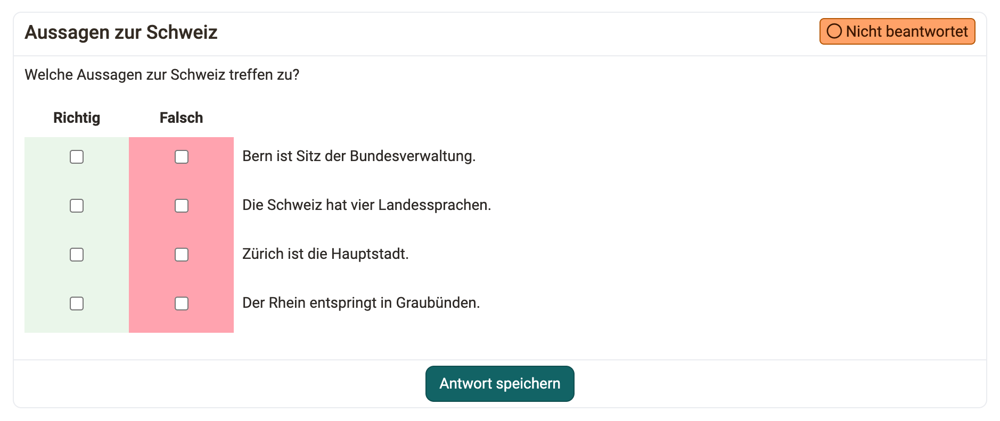

# :o_icon_o_mi_qtikprim: Kprim {: #kprim}

Mit einer Kprim-Frage prüfen Sie, ob die Teilnehmenden vier Aussagen zu einem Thema richtig einschätzen. Die Frage hat immer genau vier Antworten. Die Teilnehmenden entscheiden bei jeder Antwort, ob sie zutrifft. 0 bis 4 Antworten können richtig sein.

Im Testeditor fügen Besitzer:innen des Tests, Administrator:innen und Lernressourcenverwalter:innen die Frage unter `Test > Administration > Testeditor > Elemente hinzufügen > Kprim` hinzu. Im [Fragenpool](../../area_modules/Question_Bank_Create_Questions.de.md) wählen Sie den Typ unter `Fragenpool > Meine Fragen > Frage erstellen` im Feld "Fragetyp".

Geben Sie zuerst unter "Titel" einen kurzen Titel und unter "Frage" die Frage ein.

Legen Sie danach fest, ob die Antworten in zufälliger Reihenfolge erscheinen ("Zufällige Reihenfolge") und ob die Auswahlfelder links oder rechts stehen ("Check-box Ausrichtung").

Erfassen Sie dann die vier Antworttexte. Mit den Pfeilen ändern Sie die Reihenfolge der Antworten. Die Zahl der Antworten ist fest auf vier gesetzt. Wählen Sie für jede Antwort "Richtig" oder "Falsch".

Das Punkteschema ist bei Kprim-Fragen fest vorgegeben:

Alle Antworten korrekt = 100% der Punktzahl 
3 korrekte Antworten = 50% der Punktzahl 
2, 1 oder 0 korrekte Antworten = 0% der Punktzahl

{ class="shadow lightbox" title="Kprim, Vorschau im Testeditor · 2026.11.10" }

## Weiterführende Informationen {: #further_information}

[Fragenpool: Fragen erstellen >](../../area_modules/Question_Bank_Create_Questions.de.md) 
[Fragetypen >](index.de.md) 
[Testfragen konfigurieren >](../Configure_test_questions.de.md) 
[Testeditor >](../Test_editor_QTI_2.1/index.de.md)

[Zum Seitenanfang ^](#kprim)
