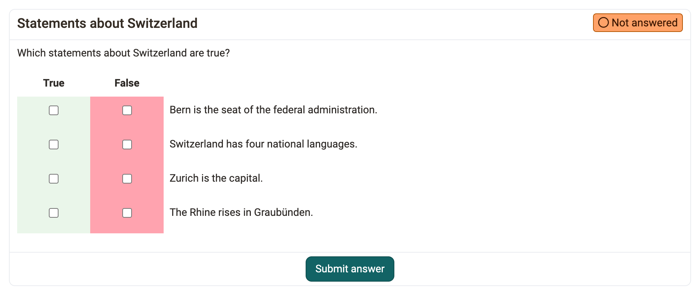

# :o_icon_o_mi_qtikprim: Kprim {: #kprim}

With a Kprim question you check whether the participants assess four statements on a topic correctly. The question always has exactly four answers. For each answer, the participants decide whether it applies. 0 to 4 answers can be correct.

In the test editor, owners of the test, administrators and learning resource managers add the question under `Test > Administration > Test editor > Add elements > Kprim`. In the [question bank](../../area_modules/Question_Bank_Create_Questions.md) you choose the type under `Question bank > My questions > Create question` in the "Type" field.

{ class="shadow lightbox" title="Kprim, preview in the test editor · 2026.11.10" }

First enter a short title under "Title" and the question under "Question".

Then define whether the answers appear in random order ("Shuffle answers") and whether the selection fields are on the left or on the right ("Check-box alignment").

Then enter the four answer texts. Use the arrows to change the order of the answers. The number of answers is fixed at four. For each answer, select "True" or "False".

The scoring scheme for Kprim questions is fixed:

All correct answers = 100% score 
3 correct answers = 50% score 
2, 1 or 0 correct answers = 0% score

## Further information {: #further_information}

[Question Bank: Create Questions >](../../area_modules/Question_Bank_Create_Questions.md) 
[Question types >](index.md) 
[Configure test questions >](../Configure_test_questions.md) 
[Test editor >](../Test_editor_QTI_2.1/index.md)

[To the top of the page ^](#kprim)
