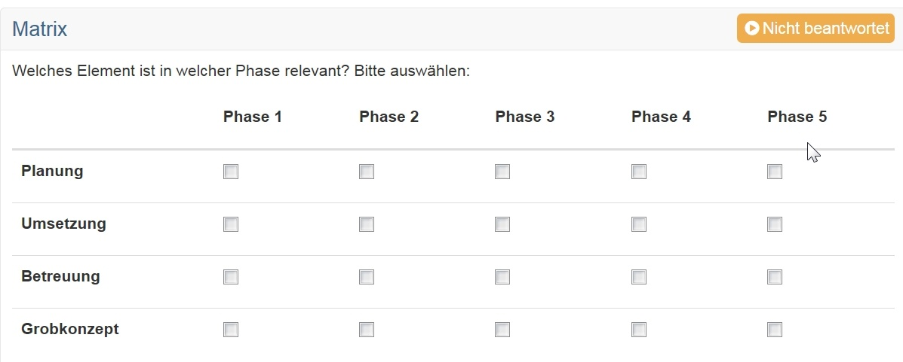

# :o_icon_o_mi_qtimatch: Matrix [:octicons-tag-16:{ title="ab Release 11.2 (OO-2343)" }](https://track.frentix.com/issue/OO-2343) {: #matrix}

Mit einer Matrix-Frage prüfen Sie mehrere Zuordnungen auf einmal in einer Tabelle. Die Teilnehmenden kreuzen je Zeile an, welche Spalte zutrifft, als Single Choice oder als Multiple Choice pro Zeile.

Im Testeditor fügen Besitzer:innen des Tests, Administrator:innen und Lernressourcenverwalter:innen die Frage unter `Test > Administration > Testeditor > Elemente hinzufügen > Matrix` hinzu. Im [Fragenpool](../../area_modules/Question_Bank_Create_Questions.de.md) wählen Sie den Typ unter `Fragenpool > Meine Fragen > Frage erstellen` im Feld "Fragetyp".

{ class="shadow lightbox" title="Matrix aus Sicht der Teilnehmenden" }

**Tab "Matrix"** 
Geben Sie auch hier zuerst unter "Titel" den Titel und unter "Frage" die Frage ein.

Legen Sie danach unter "Zufällige Reihenfolge" fest, ob die Antworten in zufälliger Reihenfolge erscheinen. Unter "Typ" wählen Sie, ob pro Zeile Single Choice oder Multiple Choice gilt.

Tragen Sie dann die Werte in die Spalten und in die Zeilen ein. Weitere Spalten und Zeilen ergänzen Sie mit "Kolonne hinzufügen" und "Zeile hinzufügen". Wählen Sie zum Schluss pro Zeile die korrekten Antworten: bei Single Choice eine Antwort pro Zeile, bei Multiple Choice eine oder mehrere.

**Tab "Punkte"** 
Unter "Bewertungsmethode" stehen für diesen Fragetyp drei Methoden zur Wahl:

* **Alle korrekten Antworten** 
Die Teilnehmenden erhalten die volle Punktzahl nur, wenn sie alle richtigen und keine falsche Antwort auswählen. Fehlt eine richtige Antwort oder ist eine falsche ausgewählt, beträgt die Punktzahl 0.

* **Punkte pro Antwort** 
Sie vergeben für jede Antwortoption einzeln positive oder negative Punkte.

* **Teilpunkte** 
OpenOlat addiert für jede richtig ausgewählte Antwort eine gewichtete Punktzahl und zieht für jede falsch ausgewählte Antwort eine gewichtete Punktzahl ab. Die Formel lautet: 
Punktzahl = maximale Punktzahl * (Anzahl der richtig markierten Antworten / Anzahl der richtigen Antworten) - maximale Punktzahl * (Anzahl der falsch markierten Antworten / Anzahl der falschen Antworten)

## Weiterführende Informationen {: #further_information}

[Fragenpool: Fragen erstellen >](../../area_modules/Question_Bank_Create_Questions.de.md) 
[Fragetypen >](index.de.md) 
[Testfragen konfigurieren >](../Configure_test_questions.de.md) 
[Testeditor >](../Test_editor_QTI_2.1/index.de.md)

[Zum Seitenanfang ^](#matrix)
