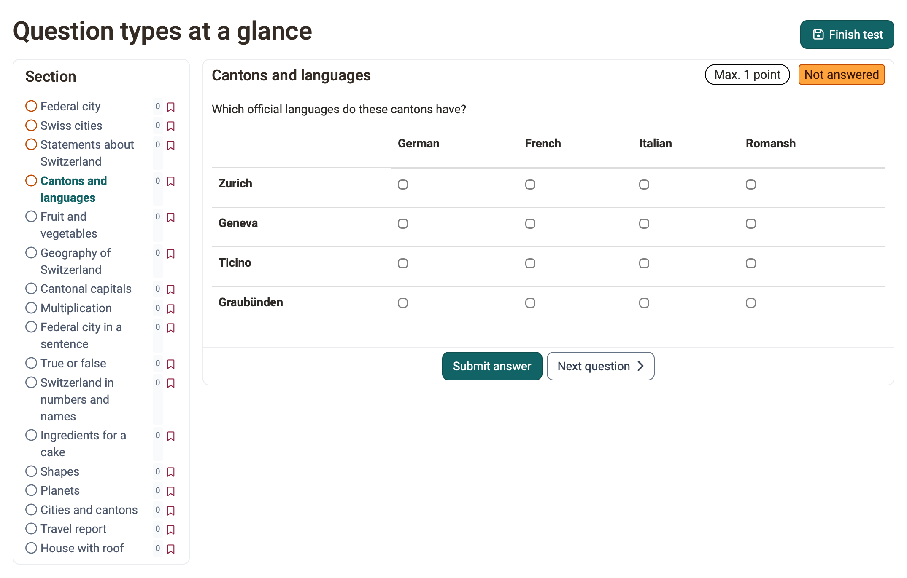

# :o_icon_o_mi_qtimatch: Match [:octicons-tag-16:{ title="from Release 11.2 (OO-2343)" }](https://track.frentix.com/issue/OO-2343) {: #matrix}

With a match question you check several assignments at once in a table. Per row, the participants tick which column applies, either as single choice or as multiple choice per row.

In the test editor, owners of the test, administrators and learning resource managers add the question under `Test > Administration > Test editor > Add elements > Match`. In the [question bank](../../area_modules/Question_Bank_Create_Questions.md) you choose the type under `Question bank > My questions > Create question` in the "Type" field.

{ class="shadow lightbox" title="Match as seen by participants · 2026.11.23" }

**Tab "Match"** 
Here, too, first enter the title under "Title" and the question under "Question".

Then define under "Shuffle answers" whether the answers appear in random order. Under "Type" you choose whether single choice or multiple choice applies per row.

Then enter the values in the columns and in the rows. You add further columns and rows with "Add column" and "Add row". Finally, select the correct answers per row: one answer per row for single choice, one or more for multiple choice.

**Tab "Score"** 
Under "Method of assessment", three methods are available for this question type:

* **All correct answers** 
The participants receive the full score only if they select all correct answers and no incorrect one. If a correct answer is missing or an incorrect one is selected, the score is 0.

* **Score per answer** 
You award positive or negative points for each answer option individually.

* **Partial score** 
OpenOlat adds a weighted score for each correctly selected answer and subtracts a weighted score for each incorrectly selected answer. The formula is: 
Score = maximum score * (number of correctly marked answers / number of correct answers) - maximum score * (number of incorrectly marked answers / number of incorrect answers)

## Further information {: #further_information}

[Question Bank: Create Questions >](../../area_modules/Question_Bank_Create_Questions.md) 
[Question types >](index.md) 
[Configure test questions >](../Configure_test_questions.md) 
[Test editor >](../Test_editor_QTI_2.1/index.md)

[To the top of the page ^](#matrix)
