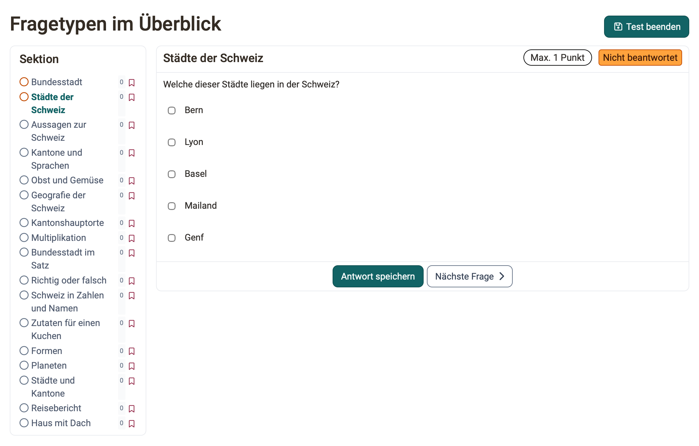

# :o_icon_o_mi_qtimc: Multiple Choice {: #mc}

Mit einer Multiple-Choice-Frage prüfen Sie, ob die Teilnehmenden alle zutreffenden Antworten erkennen. Die Frage hat mindestens zwei Antworten, mehrere davon können richtig sein, und die Teilnehmenden wählen mehrere Antworten aus.

Im Testeditor fügen Besitzer:innen des Tests, Administrator:innen und Lernressourcenverwalter:innen die Frage unter `Test > Administration > Testeditor > Elemente hinzufügen > Multiple Choice` hinzu. Im [Fragenpool](../../area_modules/Question_Bank_Create_Questions.de.md) wählen Sie den Typ unter `Fragenpool > Meine Fragen > Frage erstellen` im Feld "Fragetyp".

{ class="shadow lightbox" title="Multiple Choice aus Sicht der Teilnehmenden · 2026.11.23" }

**Tab "Auswahl"** 
Geben Sie im Tab "Auswahl" zuerst unter "Titel" einen kurzen Titel und unter "Frage" die Frage ein.

Legen Sie danach fest, ob die Antworten in zufälliger Reihenfolge erscheinen ("Zufällige Reihenfolge"), ob sie vertikal oder horizontal angeordnet sind ("Ausrichtung der Antworten") und ob die Auswahlfelder links oder rechts stehen ("Check-box Ausrichtung").

Erfassen Sie dann die Antworttexte. Mit der Schaltfläche :o_icon_o_icon_add: fügen Sie eine Antwort hinzu, mit der Schaltfläche :o_icon_o_icon_delete: entfernen Sie eine.

Markieren Sie in der Spalte "Korrekt" alle richtigen Antworten. Mit den Pfeilen ändern Sie die Reihenfolge der Antworten.

**Tab "Punkte"** 
Unter "Bewertungsmethode" stehen für Multiple-Choice-Fragen drei Methoden zur Wahl:

* **Alle korrekten Antworten** 
Die Teilnehmenden erhalten die volle Punktzahl nur, wenn sie alle richtigen und keine falsche Antwort auswählen. Fehlt eine richtige Antwort oder ist eine falsche ausgewählt, beträgt die Punktzahl 0.

* **Punkte pro Antwort** 
Sie vergeben für jede Antwortoption einzeln positive oder negative Punkte.

* **Teilpunkte** 
OpenOlat addiert für jede richtig ausgewählte Antwort eine gewichtete Punktzahl und zieht für jede falsch ausgewählte Antwort eine gewichtete Punktzahl ab. Die Formel lautet: 
Punktzahl = maximale Punktzahl * (Anzahl der richtig markierten Antworten / Anzahl der richtigen Antworten) - maximale Punktzahl * (Anzahl der falsch markierten Antworten / Anzahl der falschen Antworten)

Mit "Min. Anzahl möglicher Antworten" und "Max. Anzahl möglicher Antworten" legen Sie im selben Tab fest, wie viele Antworten die Teilnehmenden mindestens und höchstens auswählen.

## Weiterführende Informationen {: #further_information}

[Fragenpool: Fragen erstellen >](../../area_modules/Question_Bank_Create_Questions.de.md) 
[Fragetypen >](index.de.md) 
[Testfragen konfigurieren >](../Configure_test_questions.de.md) 
[Testeditor >](../Test_editor_QTI_2.1/index.de.md)

[Zum Seitenanfang ^](#mc)
