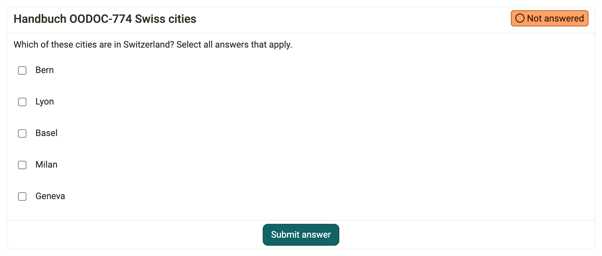

# :o_icon_o_mi_qtimc: Multiple choice {: #mc}

With a multiple-choice question you check whether the participants recognise all applicable answers. The question has at least two answers, several of them can be correct, and the participants select several answers.

In the test editor, owners of the test, administrators and learning resource managers add the question under `Test > Administration > Test editor > Add elements > Multiple choice`. In the [question bank](../../area_modules/Question_Bank_Create_Questions.md) you choose the type under `Question bank > My questions > Create question` in the "Type" field.

{ class="shadow lightbox" title="Multiple choice as seen by participants · 2026.11.10" }

**Tab "Choice"** 
In the "Choice" tab, first enter a short title under "Title" and the question under "Question".

Then define whether the answers appear in random order ("Shuffle answers"), whether they are arranged vertically or horizontally ("Alignment of answers") and whether the selection fields are on the left or on the right ("Check-box alignment").

Then enter the answer texts. With the button :o_icon_o_icon_add: you add an answer, with the button :o_icon_o_icon_delete: you remove one.

Mark all correct answers in the "Correct" column. Use the arrows to change the order of the answers.

**Tab "Score"** 
Under "Method of assessment", three methods are available for multiple-choice questions:

* **All correct answers** 
The participants receive the full score only if they select all correct answers and no incorrect one. If a correct answer is missing or an incorrect one is selected, the score is 0.

* **Score per answer** 
You award positive or negative points for each answer option individually.

* **Partial score** 
OpenOlat adds a weighted score for each correctly selected answer and subtracts a weighted score for each incorrectly selected answer. The formula is: 
Score = maximum score * (number of correctly marked answers / number of correct answers) - maximum score * (number of incorrectly marked answers / number of incorrect answers)

With "Min. number of possible answers" and "Max. number of possible answers" you define in the same tab how many answers the participants select at least and at most.

## Further information {: #further_information}

[Question Bank: Create Questions >](../../area_modules/Question_Bank_Create_Questions.md) 
[Question types >](index.md) 
[Configure test questions >](../Configure_test_questions.md) 
[Test editor >](../Test_editor_QTI_2.1/index.md)

[To the top of the page ^](#mc)
