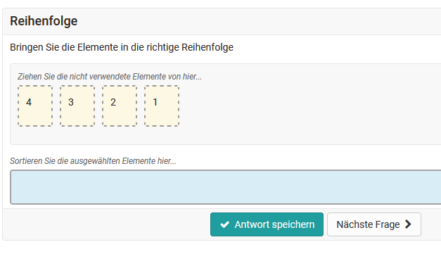

# :o_icon_o_mi_qtiorder: Reihenfolge [:octicons-tag-16:{ title="ab Release 15.0 (OO-4456)" }](https://track.frentix.com/issue/OO-4456) {: #order}

Mit einer Reihenfolge-Frage prüfen Sie, ob die Teilnehmenden Abläufe oder Rangfolgen kennen. Die Teilnehmenden bringen Elemente (Texte oder Bilder) in die richtige Reihenfolge. Die Bedienung ähnelt einer [Drag-and-Drop-Frage](Drag_and_drop.de.md).

Im Testeditor fügen Besitzer:innen des Tests, Administrator:innen und Lernressourcenverwalter:innen die Frage unter `Test > Administration > Testeditor > Elemente hinzufügen > Reihenfolge` hinzu. Im [Fragenpool](../../area_modules/Question_Bank_Create_Questions.de.md) wählen Sie den Typ unter `Fragenpool > Meine Fragen > Frage erstellen` im Feld "Fragetyp".

Geben Sie zuerst unter "Titel" den Titel und unter "Frage" die Frage ein.

Erfassen Sie dann die Antworten in der richtigen Reihenfolge. Unter "Ausrichtung der Antworten" legen Sie fest, ob sie vertikal oder horizontal erscheinen.

{ class="shadow lightbox" title="Reihenfolge aus Sicht der Teilnehmenden" }

!!! info "Hinweis: Einschränkung auf mobile Geräte"

    Die Teilnehmenden bedienen diesen Fragetyp, indem sie die Antwortelemente ziehen. Für die Touch-Bedienung ist er nicht optimiert. Er eignet sich am besten für Tests, welche die Teilnehmenden an einem Desktop-Gerät oder Laptop bearbeiten.

## Weiterführende Informationen {: #further_information}

[Drag and Drop >](Drag_and_drop.de.md) 
[Fragenpool: Fragen erstellen >](../../area_modules/Question_Bank_Create_Questions.de.md) 
[Fragetypen >](index.de.md) 
[Testfragen konfigurieren >](../Configure_test_questions.de.md) 
[Testeditor >](../Test_editor_QTI_2.1/index.de.md)

[Zum Seitenanfang ^](#order)
