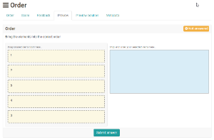

# :o_icon_o_mi_qtiorder: Order [:octicons-tag-16:{ title="from Release 15.0 (OO-4456)" }](https://track.frentix.com/issue/OO-4456) {: #order}

With an order question you check whether the participants know sequences or rankings. The participants put elements (text or images) in the correct order. The operation is similar to a [drag and drop question](Drag_and_drop.md).

In the test editor, owners of the test, administrators and learning resource managers add the question under `Test > Administration > Test editor > Add elements > Order`. In the [question bank](../../area_modules/Question_Bank_Create_Questions.md) you choose the type under `Question bank > My questions > Create question` in the "Type" field.

First enter the title under "Title" and the question under "Question".

Then enter the answers in the correct order. Under "Alignment of answers" you define whether they appear vertically or horizontally.

{ class="shadow lightbox" title="Order, preview in the test editor" }

!!! info "Note: Restriction to mobile devices"

    The participants operate this question type by dragging the answer elements. It is not optimized for touch operation. It is best suited for tests that the participants work on at a desktop computer or laptop.

## Further information {: #further_information}

[Drag and Drop >](Drag_and_drop.md) 
[Question Bank: Create Questions >](../../area_modules/Question_Bank_Create_Questions.md) 
[Question types >](index.md) 
[Configure test questions >](../Configure_test_questions.md) 
[Test editor >](../Test_editor_QTI_2.1/index.md)

[To the top of the page ^](#order)
