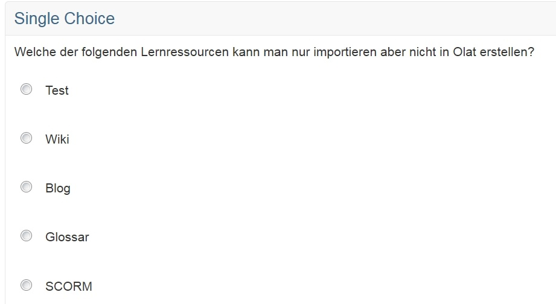

# :o_icon_o_mi_qtisc: Single Choice {: #sc}

Mit einer Single-Choice-Frage prüfen Sie, ob die Teilnehmenden unter mehreren Antworten die eine richtige erkennen. Die Frage hat mehrere Antworten, genau eine davon ist richtig, und die Teilnehmenden wählen genau eine aus.

Im Testeditor fügen Besitzer:innen des Tests, Administrator:innen und Lernressourcenverwalter:innen die Frage unter `Test > Administration > Testeditor > Elemente hinzufügen > Single Choice` hinzu. Im [Fragenpool](../../area_modules/Question_Bank_Create_Questions.de.md) wählen Sie den Typ unter `Fragenpool > Meine Fragen > Frage erstellen` im Feld "Fragetyp".

Geben Sie zuerst unter "Titel" einen kurzen Titel und unter "Frage" die Frage ein.

Legen Sie danach fest, ob die Antworten in zufälliger Reihenfolge erscheinen ("Zufällige Reihenfolge"), ob sie vertikal oder horizontal angeordnet sind ("Ausrichtung der Antworten") und ob die Auswahlfelder links oder rechts stehen ("Check-box Ausrichtung").

Erfassen Sie dann die Antworttexte. Mit der Schaltfläche :o_icon_o_icon_add: fügen Sie eine Antwort hinzu, mit der Schaltfläche :o_icon_o_icon_delete: entfernen Sie eine.

Markieren Sie in der Spalte "Korrekt" die richtige Antwort. Mit den Pfeilen ändern Sie die Reihenfolge der Antworten.

{ class="shadow lightbox" title="Single Choice aus Sicht der Teilnehmenden" }

## Weiterführende Informationen {: #further_information}

[Fragenpool: Fragen erstellen >](../../area_modules/Question_Bank_Create_Questions.de.md) 
[Fragetypen >](index.de.md) 
[Testfragen konfigurieren >](../Configure_test_questions.de.md) 
[Testeditor >](../Test_editor_QTI_2.1/index.de.md)

[Zum Seitenanfang ^](#sc)
