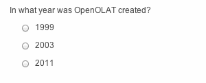

# :o_icon_o_mi_qtisc: Single choice {: #sc}

With a single-choice question you check whether the participants recognise the one correct answer among several. The question has several answers, exactly one of them is correct, and the participants select exactly one.

In the test editor, owners of the test, administrators and learning resource managers add the question under `Test > Administration > Test editor > Add elements > Single choice`. In the [question bank](../../area_modules/Question_Bank_Create_Questions.md) you choose the type under `Question bank > My questions > Create question` in the "Type" field.

First enter a short title under "Title" and the question under "Question".

Then define whether the answers appear in random order ("Shuffle answers"), whether they are arranged vertically or horizontally ("Alignment of answers") and whether the selection fields are on the left or on the right ("Check-box alignment").

Then enter the answer texts. With the button :o_icon_o_icon_add: you add an answer, with the button :o_icon_o_icon_delete: you remove one.

Mark the correct answer in the "Correct" column. Use the arrows to change the order of the answers. The participants see them in this order if "Shuffle answers" is set to "No".

Finally, define the score in the [Score tab](../Configure_test_questions.md#score). For single choice, "All correct answers" and "Score per answer" are available under "Method of assessment". With "All correct answers" the participants receive the full score for the correct answer and 0 points for any other. With "Score per answer" you award separate points for each answer, also negative ones. The method "Partial score" is offered by [multiple choice](Multiple_choice.md), because several answers can be correct there.

{ class="shadow lightbox" title="Single choice as seen by participants" }

## Further information {: #further_information}

[Question Bank: Create Questions >](../../area_modules/Question_Bank_Create_Questions.md) 
[Multiple choice >](Multiple_choice.md) 
[Question types >](index.md) 
[Configure test questions >](../Configure_test_questions.md) 
[Test editor >](../Test_editor_QTI_2.1/index.md)

[To the top of the page ^](#sc)
