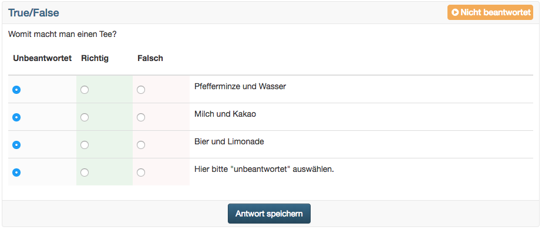

# :o_icon_o_mi_qtimatch_truefalse: True/false [:octicons-tag-16:{ title="ab Release 12.4 (OO-3220)" }](https://track.frentix.com/issue/OO-3220) {: #true_false}

Mit einer True/false-Frage lassen Sie die Teilnehmenden beliebig viele Aussagen als richtig oder falsch beurteilen. Der Fragetyp ähnelt [Kprim](Kprim.de.md), hat aber beliebig viele Zeilen. In jeder Zeile beurteilen die Teilnehmenden eine Aussage.

Im Testeditor fügen Besitzer:innen des Tests, Administrator:innen und Lernressourcenverwalter:innen die Frage unter `Test > Administration > Testeditor > Elemente hinzufügen > True/false` hinzu. Im [Fragenpool](../../area_modules/Question_Bank_Create_Questions.de.md) wählen Sie den Typ unter `Fragenpool > Meine Fragen > Frage erstellen` im Feld "Fragetyp".

Die Teilnehmenden wählen je Zeile eine von drei Antwortoptionen: "Unbeantwortet", "Richtig" oder "Falsch". Zu Beginn ist immer "Unbeantwortet" ausgewählt. Die drei Spalten sind fest. Im Editor ergänzen Sie weitere Zeilen mit "Zeile hinzufügen".

Welche Antwort in einer Zeile korrekt ist, legen Sie im Editor fest: Wählen Sie in jeder Zeile das Optionsfeld in der Spalte "Richtig" oder "Falsch". Auch "Unbeantwortet" steht als korrekte Antwort zur Wahl: Dann zählt die Zeile als richtig, wenn die Teilnehmenden sie offenlassen.

Anders als bei Kprim legen Sie die Punkte im [Tab Punkte](../Configure_test_questions.de.md#score) frei fest: Unter "Bewertungsmethode" stehen "Alle korrekten Antworten" und "Punkte pro Antwort" zur Wahl. Mit "Punkte pro Antwort" tragen Sie in jeder Zelle der Tabelle Punkte ein, bei Bedarf auch für die Antwortoption "Unbeantwortet".

{ class="shadow lightbox" title="True/false aus Sicht der Teilnehmenden" }

## Weiterführende Informationen {: #further_information}

[Kprim >](Kprim.de.md) 
[Fragenpool: Fragen erstellen >](../../area_modules/Question_Bank_Create_Questions.de.md) 
[Fragetypen >](index.de.md) 
[Testfragen konfigurieren >](../Configure_test_questions.de.md) 
[Testeditor >](../Test_editor_QTI_2.1/index.de.md)

[Zum Seitenanfang ^](#true_false)
