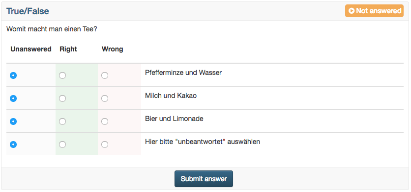

# :o_icon_o_mi_qtimatch_truefalse: True/false [:octicons-tag-16:{ title="from Release 12.4 (OO-3220)" }](https://track.frentix.com/issue/OO-3220) {: #true_false}

With a true/false question, the participants assess any number of statements as right or wrong. The question type is similar to [Kprim](Kprim.md) but has any number of rows. In each row, the participants assess one statement.

In the test editor, owners of the test, administrators and learning resource managers add the question under `Test > Administration > Test editor > Add elements > True/false`. In the [question bank](../../area_modules/Question_Bank_Create_Questions.md) you choose the type under `Question bank > My questions > Create question` in the "Type" field.

Per row, the participants choose one of three answer options: "Unanswered", "Right" or "Wrong". At the start, "Unanswered" is always selected. The three columns are fixed; you add further rows with "Add row".

Unlike Kprim, you define the points freely. You can also award points for the answer option "Unanswered".

{ class="shadow lightbox" title="True/false as seen by participants" }

## Further information {: #further_information}

[Kprim >](Kprim.md) 
[Question Bank: Create Questions >](../../area_modules/Question_Bank_Create_Questions.md) 
[Question types >](index.md) 
[Configure test questions >](../Configure_test_questions.md) 
[Test editor >](../Test_editor_QTI_2.1/index.md)

[To the top of the page ^](#true_false)
