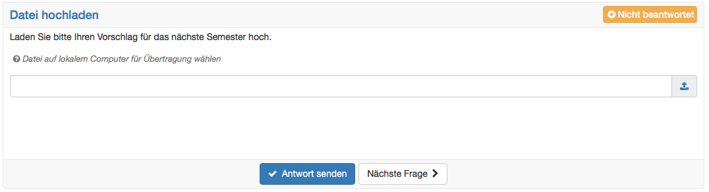

# :o_icon_o_mi_qtiupload: Datei hochladen* [:octicons-tag-16:{ title="ab Release 11.2 (OO-2344)" }](https://track.frentix.com/issue/OO-2344) {: #file_upload}

Mit einer Frage vom Typ Datei hochladen lassen Sie die Teilnehmenden eine Arbeit als Datei abgeben. Die Teilnehmenden laden als Antwort eine oder mehrere Dateien hoch.

Im Testeditor fügen Besitzer:innen des Tests, Administrator:innen und Lernressourcenverwalter:innen die Frage unter `Test > Administration > Testeditor > Elemente hinzufügen > Datei hochladen` hinzu. Im [Fragenpool](../../area_modules/Question_Bank_Create_Questions.de.md) wählen Sie den Typ unter `Fragenpool > Meine Fragen > Frage erstellen` im Feld "Fragetyp".

Geben Sie unter "Titel" einen kurzen Titel und unter "Frage" die Frage ein. Unter "Anzahl Upload Felder" legen Sie fest, wie viele Dateien die Teilnehmenden höchstens hochladen. Zur Wahl stehen 1 bis 10 Upload-Felder.

Eine korrekte Antwort markieren Sie bei diesem Fragetyp nicht, denn Sie bewerten ihn ausschliesslich manuell.

{ class="shadow lightbox" title="Datei hochladen aus Sicht der Teilnehmenden" }

## Weiterführende Informationen {: #further_information}

[Fragenpool: Fragen erstellen >](../../area_modules/Question_Bank_Create_Questions.de.md) 
[Fragetypen >](index.de.md) 
[Testfragen konfigurieren >](../Configure_test_questions.de.md) 
[Testeditor >](../Test_editor_QTI_2.1/index.de.md)

[Zum Seitenanfang ^](#file_upload)
