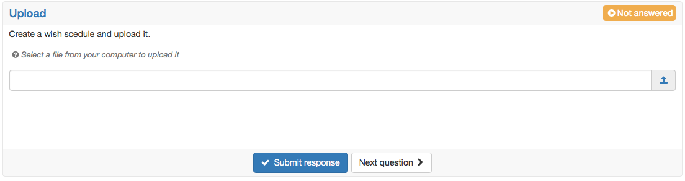

# :o_icon_o_mi_qtiupload: Upload file* [:octicons-tag-16:{ title="from Release 11.2 (OO-2344)" }](https://track.frentix.com/issue/OO-2344) {: #file_upload}

With an upload file question you let the participants hand in a piece of work as a file. The participants upload one or more files as their answer.

In the test editor, owners of the test, administrators and learning resource managers add the question under `Test > Administration > Test editor > Add elements > Upload file`. In the [question bank](../../area_modules/Question_Bank_Create_Questions.md) you choose the type under `Question bank > My questions > Create question` in the "Type" field.

Enter a short title under "Title" and the question under "Question". Under "Number of upload fields" you define how many files the participants upload at most. You can choose from 1 to 10 upload fields.

You do not mark a correct answer for this question type, because you correct the uploaded files by hand after submission. The * in the name of the question type indicates this.

Coaches and owners of the course correct the answers in the course element Test with the [correction tool](../Assessing_tests.md#correction_tool), correctors via the [correction workflow](../Test_correction_workflow.md). Who corrects and when the participants see their assessment is defined in the course element Test with the setting [Correction](../Course_Element_Test/Test_Setup.md#section_correction). You define the highest score to be awarded in the correction in the [Score tab](../Configure_test_questions.md#score) under "Max. score".

{ class="shadow lightbox" title="Upload file as seen by participants" }

## Further information {: #further_information}

[Question Bank: Create Questions >](../../area_modules/Question_Bank_Create_Questions.md) 
[Assessing tests >](../Assessing_tests.md) 
[Test: Correction workflow >](../Test_correction_workflow.md) 
[Set up a test >](../Course_Element_Test/Test_Setup.md) 
[Question types >](index.md) 
[Configure test questions >](../Configure_test_questions.md) 
[Test editor >](../Test_editor_QTI_2.1/index.md)

[To the top of the page ^](#file_upload)
