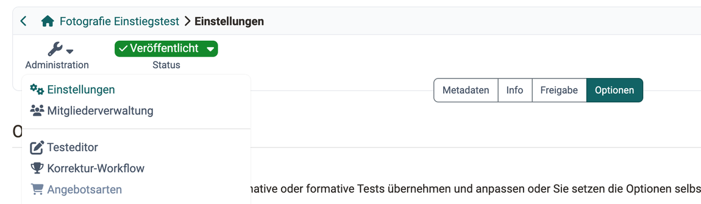
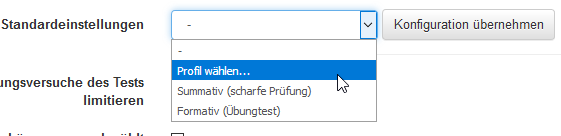
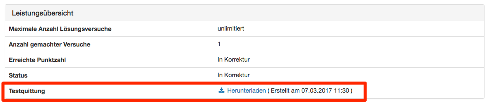

# Test: Einstellungen {: #test_settings}

Wie viele Versuche Teilnehmende haben, was ihnen während des Tests angezeigt wird und was sie nach der Abgabe sehen, legen Sie in den Einstellungen des Tests fest. Sie öffnen sie unter `Test > Administration > Einstellungen`. Den Eintrag "Einstellungen" sehen Besitzer:innen der Lernressource, Lernressourcenverwalter:innen und Administrator:innen. Die übrigen Einträge des Menüs beschreibt die Seite [Test: Administration](Test_administration/index.de.md).

[Zum Seitenanfang ^](#test_settings)

---

## Tabs der Einstellungen {: #settings}

Wichtig für Tests ist vor allem der Tab "Optionen". Hier konfigurieren Sie den gesamten Test.

{ class="shadow lightbox" title="Einstellungen einer Test-Lernressource · 2026.09.28" }

Darüber hinaus können in den weiteren Tabs "Metadaten", "Info" und "Freigabe" weitere Einstellungen der Lernressource vorgenommen werden. Ist das Modul "Katalog" auf "Katalog V1" eingestellt, erscheint zusätzlich der Tab "Katalog". Achten Sie hier besonders darauf, dass die eingestellte Lizenzangabe unter "Metadaten" Ihren Vorstellungen entspricht.

### Tab Optionen [:octicons-tag-16:{ title="ab Release 20.3.0 (OO-8321)" }](https://track.frentix.com/issue/OO-8321)

Im Tab "Optionen" legen Sie fest, wie Teilnehmende den Test durchlaufen: wie viele Versuche sie haben, was ihnen während des Tests angezeigt wird und was sie nach dem Abschluss zu sehen bekommen.

!!! info "Wichtig"
    Die Einstellungen, welche unter Optionen vorgenommen werden, werden beim Einbinden des Tests in einen [Kurs](Tests_at_course_level.de.md) automatisch übernommen und können falls gewünscht im jeweiligen Kursbaustein Test im Kurseditor in den Tabs "Test-Konfiguration" bzw. "Optionen" angepasst werden.

    Ob die Ergebnisse auf der Test-Startseite im Kurs dargestellt werden, wird ebenfalls direkt im Kurs konfiguriert.

#### Standardeinstellungen {: #default_settings}

Hier wählen Sie eine vorkonfigurierte Auswahl von typischen Einstellungen für unterschiedliche Nutzungssituationen von Tests.

Entscheiden Sie z. B., ob es sich um einen summativen oder formativen Test handelt, oder verwenden Sie eine andere voreingestellte Konfiguration. Das erleichtert es gerade unerfahrenen Autor:innen schnell zu einer passenden Einstellung zu gelangen. Spätere Änderungen und individuelle Anpassungen sind aber weiterhin möglich.

{ class="shadow lightbox" title="Feld Standardeinstellungen im Tab Optionen" }

#### Anzahl der Testversuche einschränken {: #limit_attempts}

Aktivieren Sie diese Option, um die Anzahl der möglichen Lösungsversuche für einen Test zu limitieren. Tragen Sie im Feld "Max. Anzahl Versuche" die gewünschte Anzahl ein. Der Wert kann maximal 20 betragen.

#### Erster bestandener Lösungsversuch zählt {: #block_after_success}

Sobald das Ergebnis "bestanden" erreicht wird, können Teilnehmende den Test nicht noch einmal durchführen.

#### Anonyme Benutzer:innen (Gäste) erlauben {: #guest}

Personen ohne OpenOlat Account können ebenfalls den Test absolvieren. Gäste können den Test jedoch nicht unterbrechen. Es werden nur abgeschlossene Tests gezählt. Die Resultate stehen ebenfalls in der Teststatistik zur Verfügung.

#### Nur Modul anzeigen, LMS ausblenden {: #hide_lms}

Diese Auswahl wird gewählt, um zu verhindern, dass Teilnehmende während eines Tests auf andere OpenOlat-Funktionen Zugriff haben. OpenOlat wird dabei ausgeblendet und erst wieder nach Beenden des Tests angezeigt.

#### Fragetitel anzeigen {: #show_question_titles}

Markieren Sie die Checkbox, um den Teilnehmenden die Titel der Fragen anzuzeigen. Wenn die Titel nicht angezeigt werden sollen, aber die Navigation aktiviert ist, dann erscheint in der Menü-Navigation ein anonymisierter Titel.

#### Menu-Navigation anzeigen {: #show_menu}

Wenn Sie die Menu-Navigation _nicht_ erlauben:

* ist am Test "nicht lineare Navigation" eingestellt, kann die Navigation unterhalb der Frage über einen Button aufgerufen werden, um eine andere Frage auszuwählen.
* ist am Test "lineare Navigation" eingestellt, erscheint nach dem Abschicken einer Antwort automatisch die nächste Frage und Teilnehmende können nicht zu anderen Fragen navigieren.

#### Persönliche Notizen {: #notes}

Sie können den Teilnehmenden erlauben, während des Tests persönliche Notizen zu erstellen, die nach Abschluss des Tests nicht mehr zur Verfügung stehen.

#### Anzahl Fragen und Fortschritt im Test anzeigen {: #question_progress}

Markieren Sie die Checkbox, um den Teilnehmenden die Anzahl Fragen anzuzeigen.

#### Anzahl Punkte und Punktestand im Test anzeigen {: #score_progress}

Markieren Sie die Checkbox, um den Teilnehmenden ihre momentane Punktezahl im Testverlauf anzuzeigen.

#### Max. Punkte der Frage anzeigen {: #max_score_question}

Ist die Checkbox markiert, werden die maximal erreichbaren Punkte pro Frage im Test angezeigt.

#### Unterbrechen erlauben {: #allow_suspend}

Das Ankreuzen der Checkbox bewirkt, dass Teilnehmende den Test unterbrechen können. Hierbei werden die bisherigen Antworten gespeichert und sie haben die Möglichkeit zu einem späteren Zeitpunkt mit der Beantwortung der Fragen fortzufahren.

#### Abbrechen erlauben {: #allow_cancel}

Mit dem Ankreuzen der Checkbox erlauben Sie den Teilnehmenden den Test abzubrechen, ohne dass die Antworten gespeichert werden.

#### Testquittung erstellen {: #digital_signature}

Wenn diese Option angewählt wird, wird nach Beenden des Tests eine Testquittung erstellt, welche als XML-File heruntergeladen werden kann. Es dient der Verifizierung des Tests.

{ class="shadow lightbox" title="Leistungsübersicht eines abgeschlossenen Tests" }

Wenn die Option "Testquittung erstellen" ausgewählt ist, kann die Option "Testquittung per Mail schicken" zusätzlich aktiviert werden. Das erstellte XML-File wird dann zusätzlich per Mail an die Teilnehmenden verschickt.

#### Feedbacks anzeigen {: #show_feedbacks}

Solange diese Checkbox ausgewählt ist, werden die Feedbacks im Testverlauf angezeigt. Wenn die Checkbox nicht mehr ausgewählt ist, werden keine Feedbacks mehr angezeigt. Dies betrifft die Feedbacks aller Frageitems und auch das Feedback, welches auf der Ebene Test hinzugefügt werden kann. Die einzelnen Feedbacks werden im Testeditor konfiguriert.

#### Resultate nach Abgabe des Tests anzeigen {: #results}

Wenn diese Checkbox ausgewählt ist, wird das Resultat nach Beenden des Tests angezeigt. Was genau angezeigt wird, wählen Sie darunter unter "Übersicht Resultate":

* **Testzusammenfassung**: Die Metadaten des gesamten Tests werden als Zusammenfassung angezeigt (inkl. Punkte und Bestanden/Nicht bestanden).
* **Sektionszusammenfassung**: Die Metadaten der Sektion werden als Zusammenfassung angezeigt.
* **Fragezusammenfassung**: Die Metadaten jeder einzelnen Frage werden angezeigt.
* **Antwort, von Teilnehmer:in abgegeben**: Es wird die Fragestellung zusammen mit der Antwort der teilnehmenden Person angezeigt.
* **Lösung**: Es wird die Fragestellung zusammen mit der korrekten Lösung angezeigt. Wenn im Tab Feedback eine korrekte Lösung hinterlegt ist, wird diese in der Resultatansicht mit dieser Option auch angezeigt.

[Zum Seitenanfang ^](#test_settings)

---

## Weiterführende Informationen {: #further_information}

**Auf dieser Seite erwähnt** 
[Test: Administration >](Test_administration/index.de.md) 
[Tests auf Kursebene >](Tests_at_course_level.de.md)

**Weiterführend** 
[Wie gehe ich vor, wenn ich einen Test erstelle? >](../../manual_how-to/test_creation_procedure/test_creation_procedure.de.md) 
[Testeditor >](Test_editor_QTI_2.1/index.de.md) 
[Test einrichten >](Course_Element_Test/Test_Setup.de.md)

[Zum Seitenanfang ^](#test_settings)