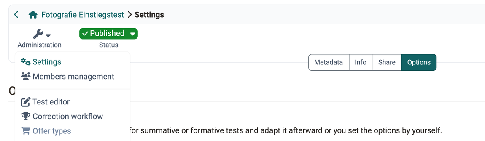
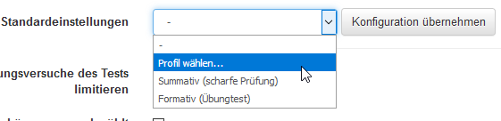
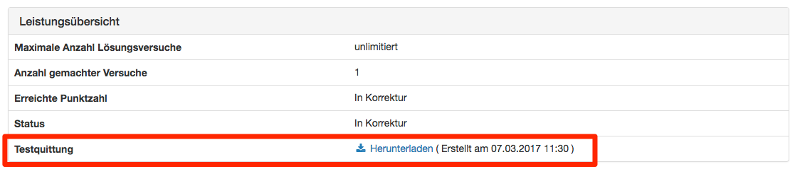

# Test: Settings {: #test_settings}

How many attempts participants have, what is displayed to them during the test and what they see after submitting it, you define in the settings of the test. You open them under `Test > Administration > Settings`. Owners of the learning resource, learning resource managers and administrators see the entry "Settings". The other entries of the menu are described on the page [Test: Administration](Test_administration/index.md).

[To the top of the page ^](#test_settings)

---

## Tabs of the settings {: #settings}

The "Options" tab is particularly important for tests. This is where you configure the entire test.

{ class="shadow lightbox" title="Settings of a test learning resource · 2026.09.28" }

In addition, further settings for the learning resource can be made in the other tabs "Metadata", "Info" and "Share". If the module "Catalog" is set to "Catalog V1", the tab "Catalog" appears as well. Make sure that the license information under "Metadata" corresponds to your requirements.

### Tab Options [:octicons-tag-16:{ title="from Release 20.3.0 (OO-8321)" }](https://track.frentix.com/issue/OO-8321)

In the "Options" tab you define how participants work through the test: how many attempts they have, what is displayed to them during the test, and what they see after completion.

!!! info "Important"
    The settings made under Options are automatically adopted when the test is included in a [course](Tests_at_course_level.md) and, if desired, can be adapted in the respective course element Test in the course editor in the tabs "Test configuration" or "Options".

    Whether the results are displayed on the test start page in the course is also configured directly in the course.

#### Standard settings {: #default_settings}

Here you can choose a preconfigured selection of typical settings for different test usage situations.

Decide, for example, whether it is a summative or formative test or use a different preset configuration. This makes it easier for inexperienced authors in particular to quickly find a suitable setting. However, later changes and individual adjustments are still possible.

{ class="shadow lightbox" title="Standard settings field in the Options tab" }

#### Limit number of test attempts {: #limit_attempts}

Activate this option to limit the number of possible solution attempts for a test. Enter the desired number in the "Max. number of attempts" field. The value can be a maximum of 20.

#### First successful attempt counts {: #block_after_success}

As soon as the result "passed" is achieved, participants cannot perform the test again.

#### Anonym users (guests) allowed {: #guest}

People without an OpenOlat account can also take the test. However, guests cannot interrupt the test. Only completed tests are counted. The results are also available in the test statistics.

#### Display only module, hide LMS {: #hide_lms}

This selection is made to prevent participants from accessing other OpenOlat functions during a test. OpenOlat is hidden and only displayed again once the test has been completed.

#### Show question title {: #show_question_titles}

Select the checkbox to show participants the titles of the questions. If the titles are not to be displayed but the navigation is activated, an anonymized title will appear in the menu navigation.

#### Show menu navigation {: #show_menu}

If you _do not_ allow menu navigation:

* If "non-linear navigation" is set on the test, the navigation below the question can be called up via a button to select a different question.
* If "linear navigation" is set on the test, the next question appears automatically after submitting an answer and participants cannot navigate to other questions.

#### Personal notes {: #notes}

You can allow participants to create personal notes during the test, which are no longer available after the test has been completed.

#### Show number of questions and progress in test {: #question_progress}

Select the checkbox to show participants the number of questions.

#### Show points and score in test {: #score_progress}

Select the checkbox to show participants their current score in the test history.

#### Show questions max. points {: #max_score_question}

If the checkbox is marked, the maximum achievable points per question in the test are displayed.

#### Allow to suspend {: #allow_suspend}

Ticking the checkbox allows participants to interrupt the test. The previous answers are saved and participants can continue answering the questions at a later time.

#### Allow to cancel {: #allow_cancel}

By ticking the checkbox, you allow participants to cancel the test without saving their answers.

#### Generate a test receipt {: #digital_signature}

If this option is selected, a test receipt is created at the end of the test, which can be downloaded as an XML file. It is used to verify the test.

{ class="shadow lightbox" title="Performance overview of a completed test" }

If the "Generate a test receipt" option is selected, the option "Send the test receipt per mail" can also be activated. The XML file created is then also sent to the participant by email.

#### Show feedbacks {: #show_feedbacks}

As long as this checkbox is selected, the feedback is displayed in the test history. If the checkbox is no longer selected, feedback is no longer displayed. This applies to the feedback for all question items and also the feedback that can be added at the test level. The individual feedbacks are configured in the test editor.

#### Show results after test has been submitted {: #results}

If this checkbox is selected, the result is displayed after the test has been completed. You select what exactly is displayed below under "Overview results":

* **Test summary**: The metadata of the entire test is displayed as a summary (incl. points and pass/fail).
* **Section summary**: The metadata of the section is displayed as a summary.
* **Question summary**: The metadata for each individual question is displayed.
* **Answer, submitted by participant**: The question is displayed together with the participant's answer.
* **Solution**: The question is displayed together with the correct solution. If a correct solution is stored in the Feedback tab, it is also displayed in the results view with this option.

[To the top of the page ^](#test_settings)

---

## Further information {: #further_information}

**Mentioned on this page** 
[Test: Administration >](Test_administration/index.md) 
[Tests at course level >](Tests_at_course_level.md)

**Further reading** 
[How do I proceed when I create a test? >](../../manual_how-to/test_creation_procedure/test_creation_procedure.md) 
[Test editor >](Test_editor_QTI_2.1/index.md) 
[Set up a test >](Course_Element_Test/Test_Setup.md)

[To the top of the page ^](#test_settings)
