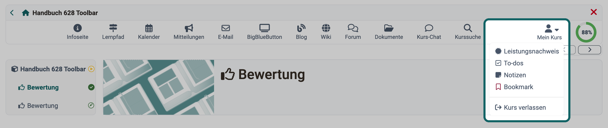
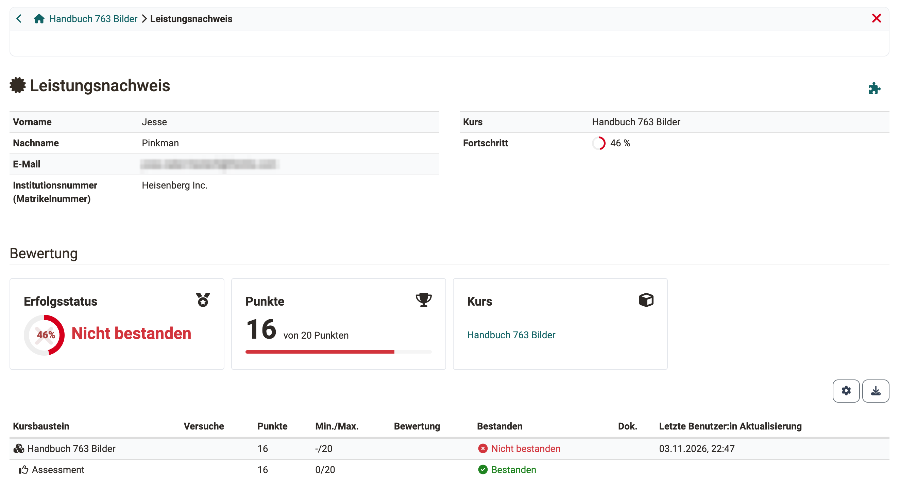
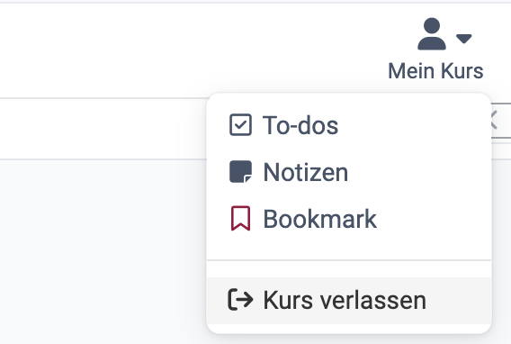
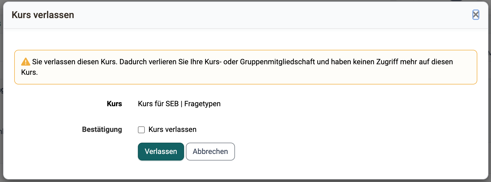

# Toolbar: Mein Kurs {: #my_course}

Im Menü "Mein Kurs" der Toolbar finden Sie als Teilnehmer:in alles, was Ihre eigenen Daten im geöffneten Kurs betrifft: Leistungsnachweis, To-dos, Notizen und weitere persönliche Werkzeuge.

{ class="shadow lightbox" title="Menü Mein Kurs in der Toolbar, Sicht Teilnehmer:in · 2026.10.27" }

## Wie wird das Icon "Mein Kurs" in der Toolbar angezeigt bzw. entfernt? {: #display_icon}

"Mein Kurs" erscheint automatisch, sobald mindestens einer seiner Einträge verfügbar ist.

Welche Einträge das Menü zeigt, hängt von Ihrer Rolle im Kurs ab: Leistungsnachweis, To-dos, "Meine Badges" und "Kurs verlassen" erhalten Teilnehmer:innen, "Vergebene Badges" erhalten Besitzer:innen und berechtigte Betreuer:innen des Kurses.

[Zum Seitenanfang ^](#my_course)

---

## Wie füge ich einen Eintrag in "Mein Kurs" hinzu? {: #display_entries}

Die Einträge unter "Mein Kurs" erscheinen automatisch, sobald die zugehörige Funktion im Kurs verfügbar oder eingeschaltet ist. Von Hand fügen Sie keinen Eintrag hinzu.

**Beispiel:** 
Ist im Kurs der Leistungsnachweis eingeschaltet, erscheint unter "Mein Kurs" der Eintrag "Leistungsnachweis".

[Zum Seitenanfang ^](#my_course)

---

## Was kann in "Mein Kurs" angezeigt werden? {: #entries}

Unter "Mein Kurs" finden Sie Ihre persönlichen Werkzeuge im aktuellen Kurs. Welche der folgenden Einträge erscheinen, hängt von den Einstellungen des Kurses und von Ihrer Rolle im Kurs ab.

* [**Leistungsnachweis**](#evidence_of_achievement): Ihre Bewertungen im Kurs und, falls eingeschaltet, das [Zertifikat](Course_Settings_Assessment/index.de.md#section_certificate) des Kurses.
* [**To-dos**](#to-dos): die aktuellen To-dos des Kurses.
* [**Meine Badges**](#my_badges): Ihre Badges aus diesem Kurs.
* [**Vergebene Badges**](#issued_badges): die im Kurs vergebenen Badges, für Kursbesitzer:innen und berechtigte Betreuer:innen.
* [**Notizen**](#notes): Ihre Notizen zum Kurs, die nur Sie lesen.
* [**Bookmark**](#bookmark): Mit einem Bookmark erscheint der Kurs im Menü "Kurse" im Tab "Favoriten".
* [**Einwilligung**](#terms_of_use): Haben Sie Nutzungsbedingungen oder einer Datenschutzerklärung des Kurses zugestimmt, lesen Sie sie hier nach und widerrufen bei Bedarf Ihre Einwilligung.
* [**Gruppen**](#groups): die Gruppen des Kurses, in denen Sie Mitglied sind, mit direktem Zugang.
* [**Kurs verlassen**](#leave_course): Sie tragen sich selbst aus dem Kurs aus.

[Zum Seitenanfang ^](#my_course)

---

### Leistungsnachweis {: #evidence_of_achievement}

Der Leistungsnachweis zeigt Ihnen, was Sie im Kurs erreicht haben: die bewerteten Kursbausteine wie Tests und Aufgaben, Ihre Punkte und weitere Angaben. Den Eintrag gibt es, sobald die Besitzer:innen des Kurses den Leistungsnachweis eingeschaltet haben.

{ class="shadow lightbox" title="Leistungsnachweis eines Kurses · 2026.11.09" }

Hat der Kurs Ihnen ein [Zertifikat](Course_Settings_Assessment/index.de.md#section_certificate) ausgestellt, laden Sie es ebenfalls unter "Leistungsnachweis" herunter. Betreuer:innen des Kurses sehen die Zertifikate im [Coaching](../area_modules/Coaching/index.de.md).

Stellt OpenOlat das Zertifikat nach dem erfolgreichen Abschluss automatisch aus, erhalten Sie dazu eine E-Mail.

!!! note "Hinweis"

    Leistungsnachweise und Zertifikate aus allen Ihren Kursen finden Sie im persönlichen Menü unter ["Leistungsnachweise"](../personal_menu/Evidence_of_Achievements.de.md).

[Mehr über Leistungsnachweise >](../personal_menu/Evidence_of_Achievements.de.md)

[Zum Seitenanfang ^](#my_course)

---

### To-dos [:octicons-tag-16:{ title="ab Release 18.2.0 (OO-7039)" }](https://track.frentix.com/issue/OO-7039) {: #to-dos}

Die To-dos zeigen Ihnen, was im Kurs gerade zu tun ist. Einen Teil erzeugt OpenOlat aus den [Aufgaben-Kursbausteinen](../learningresources/Course_Element_Task/index.de.md): Ein solches To-do fordert Sie zum nächsten Schritt im Aufgabenablauf auf, etwa eine Aufgabe auszuwählen oder eine Lösung abzugeben. Daneben weisen Betreuer:innen allen Teilnehmenden oder einzelnen Personen eigene To-dos zu. Haben Sie eine Aktion erledigt, ändern Sie den Status des To-dos.

Alle Ihre To-dos, auch die aus anderen Kursen, sehen Sie in den ["Persönlichen Werkzeugen"](../personal_menu/To-Dos.de.md). Dort erstellen Sie auch eigene To-dos.

[Mehr über To-dos >](../basic_concepts/To_Dos_Basics.de.md) 
[Mehr über To-dos in einem Kurs >](../learningresources/Course_todos.de.md)

[Zum Seitenanfang ^](#my_course)

---

### Meine Badges [:octicons-tag-16:{ title="ab Release 18.0.0 (OO-7003)" }](https://track.frentix.com/issue/OO-7003) {: #my_badges}

Sind im Kurs Badges eingeschaltet, zeigt "Meine Badges" alle Badges, die Sie in diesem Kurs erhalten haben.

[Mehr über Badges >](../personal_menu/OpenBadges.de.md)

[Zum Seitenanfang ^](#my_course)

---

### Vergebene Badges {: #issued_badges}

Unter "Vergebene Badges" sehen Sie, welche Badges der Kurs an wen vergeben hat. Den Eintrag gibt es, wenn im Kurs der Schalter "Badges vergeben" eingeschaltet ist: `Kurs > Administration > Einstellungen > Tab "Bewertung" > Abschnitt "Badges"`. Kursbesitzer:innen, Administrator:innen und Lernressourcenverwalter:innen sehen ihn dann immer. Betreuer:innen sehen ihn nur, wenn der Kurs die manuelle Vergabe "für Betreuer:innen" erlaubt.

[Mehr über das Vergeben von Kurs-Badges >](OpenBadges.de.md#award_a_course-badge)

[Zum Seitenanfang ^](#my_course)

---

### Notizen {: #notes}

In jedem Kurs halten Sie eigene Notizen fest. Unter "Notizen" sehen, bearbeiten und drucken Sie Ihre Notizen zu diesem Kurs.

[Mehr über Notizen >](../personal_menu/Notes.de.md)

[Zum Seitenanfang ^](#my_course)

---

### Bookmark {: #bookmark}

Mit einem Bookmark finden Sie den Kurs schneller wieder: Er steht dann im Menü "Kurse" im Tab "Favoriten".

[Zum Seitenanfang ^](#my_course)

---

### Einwilligung [:octicons-tag-16:{ title="ab Release 15.0 (OO-4455)" }](https://track.frentix.com/issue/OO-4455) {: #terms_of_use}

Verlangt der Kurs zu Beginn Ihre Einwilligung in Nutzungsbedingungen oder Datenschutzbestimmungen, lesen Sie diese hier jederzeit nach.

[Mehr über Nutzungsbedingungen >](../basic_concepts/Terms_Of_Use.de.md)

[Zum Seitenanfang ^](#my_course)

---

### Gruppen {: #groups}

Sind Sie über eine Gruppe im Kurs, als Gruppenteilnehmer:in oder Gruppenbetreuer:in, öffnet dieser Eintrag die Gruppe direkt.

[Zum Seitenanfang ^](#my_course)

---

### Kurs verlassen [:octicons-tag-16:{ title="ab Release 20.3.0 (OO-9272)" }](https://track.frentix.com/issue/OO-9272) {: #leave_course}

Brauchen Sie einen Kurs nicht mehr, tragen Sie sich mit "Kurs verlassen" selbst aus. OpenOlat beendet sofort Ihre Kurs- oder Gruppenmitgliedschaft, je nachdem, worüber Sie im Kurs sind. Danach haben Sie keinen Zugriff mehr auf den Kurs. Für einen erneuten Zugriff wenden Sie sich an die Betreuer:innen des Kurses oder der Gruppe.

Austreten können nur Teilnehmende, nicht Betreuer:innen oder Besitzer:innen. Die Besitzer:innen des Kurses lassen das Austreten in den Einstellungen des Kurses im Tab "Freigabe" zu.

{ class="shadow lightbox" title="Menü Mein Kurs in der Toolbar" }

**Wann ist "Kurs verlassen" verfügbar?**

"Kurs verlassen" erscheint nur, wenn folgende Bedingungen erfüllt sind:

- Die aktive Rolle ist "Teilnehmer:in". Beim Rollenwechsel erscheint die Option nur bei aktiver Teilnehmer:innen-Rolle.
- Der Kurs hat den Verwendungszweck "Eigenständig" (siehe [Kurseinstellungen - Tab Freigabe](Course_Settings_Share/index.de.md#section_usage)). Verwaltet stattdessen der Course Planner den Kurs (Verwendungszweck "Verwendung im Course Planner"), steht "Kurs verlassen" nicht zur Verfügung. Haben Sie eine Durchführung gebucht, stornieren Sie die Buchung auf der Infoseite der Durchführung, wenn das Angebot es erlaubt, siehe [Infoseite: Buchung stornieren](General_Functions_Infopage.de.md#cancel_booking). [:octicons-tag-16:{ title="ab Release 20.0 (OO-8397)" }](https://track.frentix.com/issue/OO-8397) Ist die Durchführung vom Typ Einzelkurs, öffnet der Link "Infoseite" in der Toolbar diese Infoseite direkt, und "Buchung stornieren" steht dort im Kasten "Mein Kurs". [:octicons-tag-16:{ title="ab Release 21.1.2 (OO-9977)" }](https://track.frentix.com/issue/OO-9977)
- Unter [Kurseinstellungen - Tab Freigabe > "Teilnehmer:innen können austreten"](Course_Settings_Share/index.de.md#section_share_leave) ist eine andere Option als "Nie" gewählt.
- Im Kurs läuft gerade kein Prüfungsmodus.

Ist die Option "Nach Kursenddatum oder Status "Beendet"" gewählt, erscheint "Kurs verlassen" schon, ist aber ausgegraut, bis der Durchführungszeitraum abgelaufen ist oder der Kurs den Status "Beendet" hat.

**Zusätzliche Bedingungen bei einer Gruppenmitgliedschaft**

Sind Sie über eine Gruppe im Kurs, entscheidet zusätzlich die Gruppe darüber, ob "Kurs verlassen" erscheint. Alle drei folgenden Bedingungen müssen erfüllt sein:

- In den Einstellungen der Gruppe ist "Teilnehmer:innen können Gruppe verlassen" erlaubt.
- Die Gruppe ist nur mit diesem einen Kurs verbunden. Eine Gruppe, die mehrere Kurse bedient, lässt sich nicht über einen einzelnen Kurs verlassen.
- Wird die Gruppe von einem [Kursbaustein Einschreibung](Course_Element_Enrolment.de.md) verwendet, ist dort "Austragen erlaubt" gesetzt.

**Bestätigungsdialog**

Nach Klick auf "Kurs verlassen" erscheint ein Bestätigungsdialog mit folgendem Warntext:

> "Sie verlassen diesen Kurs. Dadurch verlieren Sie Ihre Kurs- oder Gruppenmitgliedschaft und haben keinen Zugriff mehr auf diesen Kurs."

Der Dialog nennt unter "Kurs" den betroffenen Kurs. Um den Austritt abzuschliessen, kreuzen Sie unter "Bestätigung" die Checkbox "Kurs verlassen" an und klicken auf "Verlassen".

{ class="shadow lightbox" title="Bestätigungsdialog zum Verlassen eines Kurses" }

[Zum Seitenanfang ^](#my_course)

---

## Weiterführende Informationen {: #further_information}

**Auf dieser Seite erwähnt** 
[Kurseinstellungen - Tab Bewertung >](Course_Settings_Assessment/index.de.md) 
[Coaching - Übersicht >](../area_modules/Coaching/index.de.md) 
[Persönliche Erfolge/Leistungen: Leistungsnachweise >](../personal_menu/Evidence_of_Achievements.de.md) 
[Kursbaustein "Aufgabe" >](../learningresources/Course_Element_Task/index.de.md) 
[Persönliche Werkzeuge: To-dos >](../personal_menu/To-Dos.de.md) 
[To-dos: Grundlagen >](../basic_concepts/To_Dos_Basics.de.md) 
[To-dos im Kurs >](../learningresources/Course_todos.de.md) 
[Persönliche Erfolge/Leistungen: Badges >](../personal_menu/OpenBadges.de.md) 
[Badges >](OpenBadges.de.md) 
[Persönliche Werkzeuge: Notizen >](../personal_menu/Notes.de.md) 
[Nutzungsbedingungen >](../basic_concepts/Terms_Of_Use.de.md) 
[Kurseinstellungen - Tab Freigabe >](Course_Settings_Share/index.de.md) 
[Allgemeine Funktionen: Infoseite >](General_Functions_Infopage.de.md) 
[Kursbaustein "Einschreibung" >](Course_Element_Enrolment.de.md)

**Weiterführend** 
[Toolbar >](Course_Settings_Toolbar.de.md) 
[Persönliche Werkzeuge >](../personal_menu/Personal_Tools/index.de.md)

[Zum Seitenanfang ^](#my_course)
