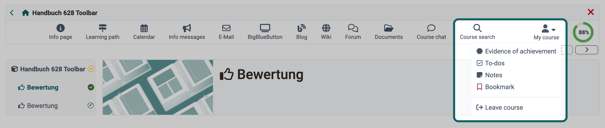
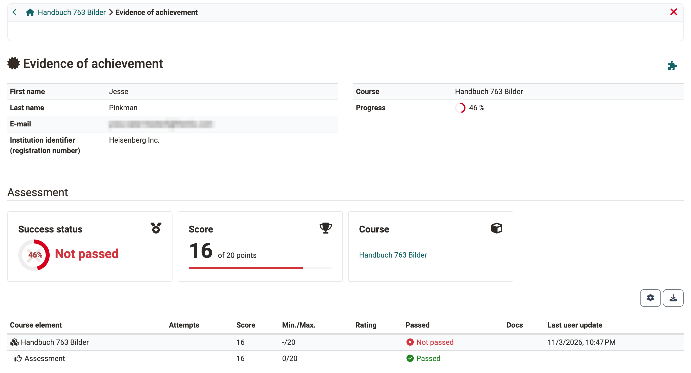
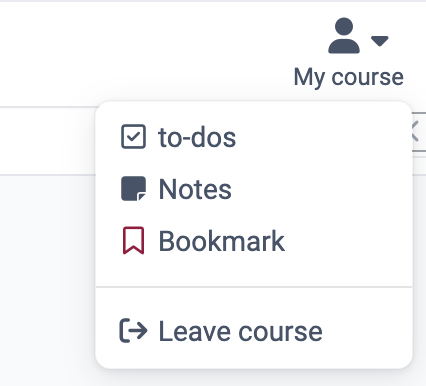
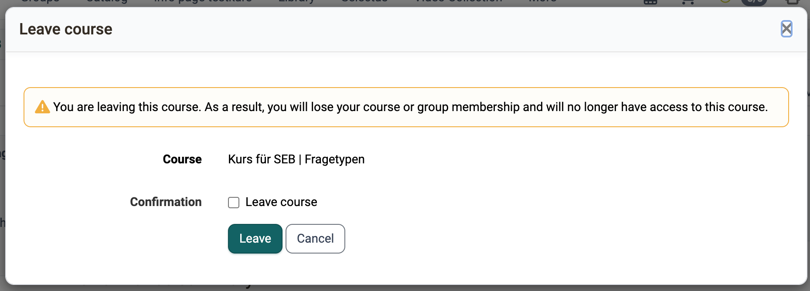

# Toolbar: My Course {: #my_course}

In the menu "My course" of the toolbar, you as a participant find everything that concerns your own data in the opened course: evidence of achievement, to-dos, notes and other personal tools.

{ class="shadow lightbox" title="Menu My course in the toolbar, participant view · 2026.10.27" }

## How is the "My course" icon displayed or removed from the toolbar?  {: #display_icon}

"My course" appears automatically as soon as at least one of its entries is available.

Only participants of the course see the menu, because it shows personal content.

[To the top of the page ^](#my_course)

---

## How do I add an entry to "My course"? {: #display_entries}

The entries under "My course" appear automatically as soon as the related function is available or switched on in the course. You do not add an entry by hand.

**Example:** 
If the evidence of achievement is switched on in the course, the entry "Evidence of achievement" appears under "My course".

[To the top of the page ^](#my_course)

---

## What can be displayed in "My course"?  {: #entries}

Under "My course", you only find tools that concern your personal data in the current course. Depending on the settings of the course, some of the following entries are missing.

* [**Evidence of achievement**](#evidence_of_achievement): your assessments in the course and, if switched on, the [certificate](Course_Settings_Assessment/index.md#section_certificate) of the course.
* [**To-dos**](#to-dos): the current to-dos of the course.
* [**My badges**](#my_badges): your badges from this course.
* [**Notes**](#notes): your notes on the course, which only you read.
* [**Bookmark**](#bookmark): With a bookmark, the course appears in the "Courses" menu in the "Favorites" tab.
* [**Consent**](#terms_of_use): If you have agreed to terms of use or a privacy policy of the course, you read them here and revoke your consent if needed.
* [**Groups**](#groups): the groups of the course in which you are a member, with direct access.
* [**Leave course**](#leave_course): you remove yourself from the course.

[To the top of the page ^](#my_course)

---

### Evidence of achievement {: #evidence_of_achievement}

The evidence of achievement shows you what you have achieved in the course: the assessed course elements such as tests and tasks, your score and further details. The entry exists as soon as the owners of the course have switched on the evidence of achievement.

{ class="shadow lightbox" title="Evidence of achievement of a course · 2026.11.09" }

If the course has issued you a [certificate](Course_Settings_Assessment/index.md#section_certificate), you also download it under "Evidence of achievement". Coaches of the course see the certificates in [Coaching](../area_modules/Coaching/index.md).

If OpenOlat issues the certificate automatically after successful completion, you receive an e-mail about it.

!!! note "Note"

    You find evidences of achievement and certificates from all your courses in the personal menu under ["Evidence of achievement"](../personal_menu/Evidence_of_Achievements.md).

[More about evidence of achievement >](../personal_menu/Evidence_of_Achievements.md)

[To the top of the page ^](#my_course)

---

### To-dos [:octicons-tag-16:{ title="from Release 18.2.0 (OO-7039)" }](https://track.frentix.com/issue/OO-7039) {: #to-dos}

The to-dos show you what currently needs to be done in the course. OpenOlat creates some of them from the [task course elements](../learningresources/Course_Element_Task/index.md): such a to-do asks you to take the next step in the task process, for example to select a task or to submit a solution. In addition, coaches assign their own to-dos to all participants or to individual persons. Once you have completed an action, you change the status of the to-do.

You see all your to-dos, including those from other courses, in the ["User tools"](../personal_menu/To-Dos.md). There, you also create your own to-dos.

[More about To-dos >](../basic_concepts/To_Dos_Basics.md) 
[More about To-dos in a course >](../learningresources/Course_todos.md)

[To the top of the page ^](#my_course)

---

### My badges [:octicons-tag-16:{ title="from Release 18.0.0 (OO-7003)" }](https://track.frentix.com/issue/OO-7003) {: #my_badges}

If badges are switched on in the course, "My badges" shows all badges you have received in this course.

[More about badges >](../personal_menu/OpenBadges.md)

[To the top of the page ^](#my_course)

---

### Notes {: #notes}

In every course, you keep your own notes. Under "Notes", you see, edit and print your notes on this course.

[More about notes >](../personal_menu/Notes.md)

[To the top of the page ^](#my_course)

---

### Bookmark {: #bookmark}

With a bookmark, you find the course again faster: it then appears in the "Courses" menu in the "Favorites" tab.

[To the top of the page ^](#my_course)

---

### Consent [:octicons-tag-16:{ title="from Release 15.0 (OO-4455)" }](https://track.frentix.com/issue/OO-4455) {: #terms_of_use}

If the course requires your consent to terms of use or a privacy policy at the beginning, you read them here at any time.

[More about terms of use >](../basic_concepts/Terms_Of_Use.md)

[To the top of the page ^](#my_course)

---

### Groups {: #groups}

If you are in the course via a group, as a group participant or group coach, this entry opens the group directly.

[To the top of the page ^](#my_course)

---

### Leave course [:octicons-tag-16:{ title="from Release 20.3.0 (OO-9272)" }](https://track.frentix.com/issue/OO-9272) {: #leave_course}

If you no longer need a course, you remove yourself with "Leave course". OpenOlat immediately ends your course or group membership, depending on how you are in the course. After that, you no longer have access to the course. For renewed access, contact the coaches of the course or the group.

Only participants can leave, not coaches or owners. The owners of the course allow leaving in the settings of the course in the tab "Share".

{ class="shadow lightbox" title="Menu My course in the toolbar" }

**When is "Leave course" available?**

"Leave course" only appears if the following conditions are met:

- The active role is "Participant". When switching roles, the option only appears while the participant role is active.
- The course has the usage "Standalone" (see [Course settings - Tab Share](Course_Settings_Share/index.md#section_usage)). If the Course Planner manages the course instead (usage "Use in Course Planner"), "Leave course" is not available. If you have booked an implementation, you cancel the booking on the info page of the implementation if the offer allows it, see [Info page: Cancel booking](General_Functions_Infopage.md#cancel_booking). [:octicons-tag-16:{ title="from Release 20.0 (OO-8397)" }](https://track.frentix.com/issue/OO-8397) If the implementation is of type Single course, the link "Info page" in the toolbar opens this info page directly, and "Cancel booking" appears there in the box "My course". [:octicons-tag-16:{ title="from Release 21.1.2 (OO-9977)" }](https://track.frentix.com/issue/OO-9977)
- Under [Course settings - Tab Share > "Participants can leave"](Course_Settings_Share/index.md#section_share_leave), an option other than "Never" is selected.
- No assessment mode is currently running in the course.

If the option "After course end date or status "Finished"" is selected, "Leave course" already appears but is greyed out until the execution period has ended or the course has the status "Finished".

**Additional conditions for a group membership**

If you are in the course through a group, the group additionally decides whether "Leave course" appears. All three of the following conditions must be met:

- In the settings of the group, "Participants can leave group" is allowed.
- The group is linked to this one course only. A group that serves several courses cannot be left through an individual course.
- If the group is used by an [Enrolment course element](Course_Element_Enrolment.md), "Delisting permitted" is set there.

**Confirmation dialog**

After clicking "Leave course," a confirmation dialog appears with the following warning text:

> "You are leaving this course. As a result, you will lose your course or group membership and will no longer have access to this course."

The dialog names the course concerned under "Course". To complete the withdrawal, tick the checkbox "Leave course" under "Confirmation" and click "Leave".

{ class="shadow lightbox" title="Confirmation dialog for leaving a course" }

[To the top of the page ^](#my_course)

---

## Further information {: #further_information}

**Mentioned on this page** 
[Course Settings - Tab Assessment >](Course_Settings_Assessment/index.md) 
[Coaching - Overview >](../area_modules/Coaching/index.md) 
[Personal achievements/successes: Evidence of Achievements >](../personal_menu/Evidence_of_Achievements.md) 
[Course Element "Task" >](../learningresources/Course_Element_Task/index.md) 
[User tools: To-dos >](../personal_menu/To-Dos.md) 
[To-dos: basics >](../basic_concepts/To_Dos_Basics.md) 
[To-dos in the course >](../learningresources/Course_todos.md) 
[Personal achievements/successes: Badges >](../personal_menu/OpenBadges.md) 
[User tools: Notes >](../personal_menu/Notes.md) 
[Terms of Use >](../basic_concepts/Terms_Of_Use.md) 
[Course settings - Tab Share >](Course_Settings_Share/index.md) 
[General Functions: Info Page >](General_Functions_Infopage.md) 
[Course Element "Enrolment" >](Course_Element_Enrolment.md)

**Further reading** 
[Toolbar >](Course_Settings_Toolbar.md) 
[User tools >](../personal_menu/Personal_Tools/index.md)

[To the top of the page ^](#my_course)
