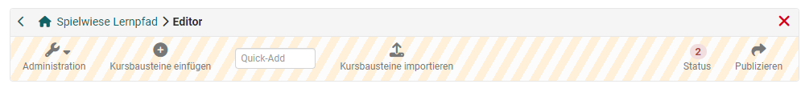
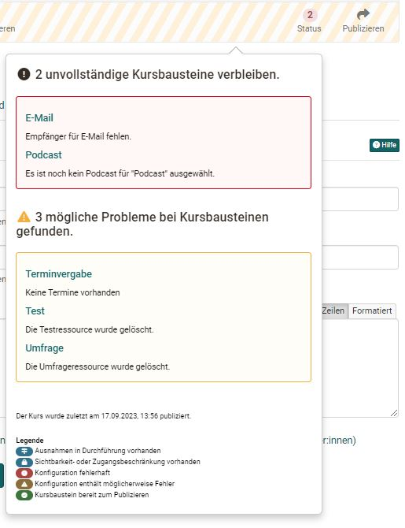

# Kurseditorwerkzeuge {: #course_editor_tools}

Während Sie einen Kurs im Kurseditor aufbauen, stehen Ihnen in der Toolbar die Editorwerkzeuge zur Verfügung. Mit ihnen fügen Sie Kursbausteine ein oder importieren sie, prüfen die Konfiguration auf Probleme, sehen sich den Kurs als Vorschau an und publizieren ihn. Den Kurseditor öffnen Kursbesitzer:innen, Administrator:innen, Lernressourcenverwalter:innen und Personen mit dem [Kursrecht "Kurseditor"](Members_management.de.md#additional_rights): `Kurs > Administration > Kurseditor`.

{ class="shadow lightbox" title="Toolbar des Kurseditors" }

## Administration

Über das Menü "Administration" des Kurses erreichen Sie weitere Kurswerkzeuge. Sie sind auf der Seite [Kurs-Administration](Administration/index.de.md) beschrieben.

## Kursbausteine einfügen

Mit "Kursbausteine einfügen" bauen Sie Ihren Kurs aus. Der Dialog zeigt alle [Kursbausteine](Course_Elements/index.de.md), die Sie in einen Kurs einfügen können, in Gruppen geordnet. Wählen Sie einen Kursbaustein aus, fügt OpenOlat ihn dem Kurs hinzu. Zwei Einträge legen mehrere Kursbausteine in einem Schritt an: [Mehrere HTML-Seiten](Course_Element_HTML_Page.de.md#multi) in der Gruppe "Andere" und [Mehrere Checklisten](Course_Element_Checklist.de.md#multi). Mehr dazu auf der Seite [Kursbausteine im Kurseditor](../learningresources/General_Configuration_of_Course_Elements.de.md).

## Quick-Add [:octicons-tag-16:{ title="ab Release 16.2 (OO-5984)" }](https://track.frentix.com/issue/OO-5984){:target="_blank"} {: #quick_add}

Kennen Sie den Namen des Kursbausteins, fügen Sie ihn mit "Quick-Add" schneller ein. Schreiben Sie den Namen in das Feld, und wählen Sie den Kursbaustein aus der Liste. Quick-Add legt jeweils einen Kursbaustein an. Je nach Grösse Ihres Bildschirmfensters zeigt die Toolbar das Feld "Quick-Add" an.

## Kursbausteine importieren [:octicons-tag-16:{ title="ab Release 16.1 (OO-5210)" }](https://track.frentix.com/issue/OO-5210){:target="_blank"}

Haben Sie Kursbausteine in einem anderen Kurs bereits eingerichtet, übernehmen Sie sie mit "Kursbausteine importieren" in den aktuellen Kurs, statt sie neu aufzubauen. Ein Assistent führt Sie durch den Import.

Wählen Sie einen Kurs aus, den Sie besitzen oder den Autor:innen laut seiner Freigabe kopieren dürfen. Wählen Sie dann einen oder mehrere Kursbausteine dieses Kurses. Bei einigen Kursbausteinen legen Sie im Assistenten weitere Einstellungen fest. Klicken Sie abschliessend auf "Fertigstellen". OpenOlat fügt die gewählten Kursbausteine dem aktuellen Kurs hinzu.

## Status

Der Status zeigt, ob es bei der Konfiguration der Kursbausteine Probleme gibt. Klicken Sie auf die angegebene Zahl, zeigt OpenOlat die zugehörigen Probleme. Folgen Sie den Links, um die Probleme zu beheben. Die Legende unten zeigt, um welche Art von Problem es sich handelt.

{ class="shadow lightbox" title="Status im Kurseditor" }

Konfigurationsprobleme zeigt OpenOlat zusätzlich im Kursmenü des Kurseditors bei den betroffenen Kursbausteinen an.

!!! note "Hinweis"

    Verwechseln Sie den "Status" im Kurseditor nicht mit dem ["Status" bei geschlossenem Kurseditor](../learningresources/Access_configuration.de.md). Das sind zwei verschiedene Funktionen.

## Kursvorschau (nur für herkömmliche Kurse) {: #preview}

Mit der "Kursvorschau" prüfen Sie Kurseinstellungen und Inhalte aus der Sicht von Teilnehmenden, bevor Sie publizieren. Ein Klick auf "Kursvorschau" öffnet zuerst ein Formular. Dort simulieren Sie, dass jemand den Kurs zu einem bestimmten Zeitpunkt, als Mitglied einer bestimmten Gruppe oder mit bestimmten Attributen betritt.

Die Kursvorschau zeigt auch alle noch nicht publizierten Kursbausteine und Änderungen. Funktionen, bei denen Teilnehmende Daten im System hinterlassen, stehen in der Kursvorschau nicht zur Verfügung. Dazu gehören das Einschreiben in Gruppen, das Starten von Tests, Selbsttests und Umfragen und die Abgabe von Lösungen im Kursbaustein "Aufgabe".

Die Kursvorschau eignet sich zum Beispiel, um einen Kurs vor dem Start aus der Perspektive der Teilnehmenden zu betrachten oder Sichtbarkeitsregeln zu überprüfen.

!!! tip "Tipp"

    In der Regel ist diese Vorschau nicht notwendig, da Sie bei geschlossenem Kurseditor einfach die "Teilnehmer:innenansicht" wählen können. Dieser Weg eignet sich auch für Lernpfadkurse.

### Konfiguration der Kursvorschau

In diesem Formular bestimmen Sie, welche Bedingungen für die Kursvorschau gelten.

#### Datum {: #preview_date}

Dieses Feld müssen Sie ausfüllen. Geben Sie einen Zeitpunkt mit Datum und Uhrzeit ein, zu dem OpenOlat die Kursvorschau zeigt. Voreingestellt sind das aktuelle Datum und die aktuelle Uhrzeit.

#### Gruppe {: #preview_group}

Wählen Sie eine oder mehrere Gruppen, um den Kurs aus Sicht der Mitglieder dieser Gruppen anzuzeigen.

#### Lernbereich {: #preview_area}

Geben Sie den Namen eines Lernbereichs ein, um den Kurs aus Sicht der Mitglieder dieses Lernbereichs anzuzeigen.

#### Rolle {: #preview_role}

Wählen Sie, für welche Rolle OpenOlat die Vorschau zeigt.

* "Registrierte OpenOlat-Benutzer:innen": Zeigt den Kurs, wie er sich Personen mit der Rolle "Benutzer:in" (in der Regel Teilnehmende) präsentiert.
* "Gäste": Zeigt den Kurs, wie er sich einem Gast (also Personen, die sich ohne OpenOlat-Konto anmelden) präsentiert, sofern der Kurs für Gäste freigeschaltet ist.
* "Betreuer:innen": Zeigt den Kurs, wie er sich einer Betreuer:in einer beliebigen Gruppe im Kurs präsentiert.
* "Besitzer:innen des Kurses": Zeigt den Kurs, wie er sich den Besitzer:innen des Kurses präsentiert.
* "OpenOlat-Autor:innen": Zeigt den Kurs, wie er sich Personen mit der Rolle "Autor:in" präsentiert.

#### Attribute {: #preview_attributes}

In diesen Feldern geben Sie bis zu fünf AAI-Attribut-Namen mit ihren Werten an. Die Vorschau zeigt den Kurs dann so, wie ihn eine Person mit diesen AAI-Attributen sieht.

**Beispiel**: 
Attribut-Name: swissEduPersonStudyBranch3 
Attribut-Wert: 4600 
Diese Eingabe zeigt den Kurs, wie ihn die Studierenden der Fachrichtung Chemie sehen.

Mehr zu AAI-Attributen finden Sie auf der Seite [Zugriffsbeschränkungen im Expertenmodus](Access_Restrictions_in_the_Expert_Mode.de.md) sowie bei [Switch](http://www.switch.ch/aai/).

## Publizieren {: #publish}

Im Kurseditor bereiten Sie Ihren Kurs in Ruhe vor, bauen ihn auf und gestalten ihn. Alle Einstellungen und Änderungen geben Sie anschliessend mit "Publizieren" frei.

Erst wenn Sie den Kurs publizieren, sind die Kursbausteine und Ihre Änderungen bei geschlossenem Kurseditor sichtbar. Damit Teilnehmende den Kurs sehen, muss er zudem veröffentlicht und der Zugang konfiguriert sein, siehe [Zugangskonfiguration / Freigabe](Access_configuration.de.md).

Am schnellsten publizieren Sie, indem Sie den Kurseditor schliessen: Klicken Sie in der Breadcrumb-Navigation auf den Titel des Kurses. OpenOlat fragt, ob Sie automatisch, manuell oder nicht publizieren wollen.

Manuelles Publizieren entspricht dem Editorwerkzeug "Publizieren" und führt Sie mit einem Assistenten durch die Schritte.

!!! warning "Achtung"

    Publizieren Sie den Kurs, während Teilnehmende im Kurs arbeiten, gehen deren aktuelle Bewegungsdaten wie nicht gespeicherte Foren- und Wiki-Einträge verloren.

### Manuelles Publizieren mit Assistent

Schritt 1 - Kursbausteine wählen: Wählen Sie alle Kursbausteine aus, die Sie geändert haben und veröffentlichen möchten. Die Auswahl enthält nur Kursbausteine, die sich publizieren lassen.

Schritt 2 - Änderung des Kurszugriffs: Hier legen Sie die generellen Veröffentlichungsoptionen des Kurses fest und bestimmen, welche OpenOlat-Benutzer:innen Zugriff auf Ihren Kurs haben. Welche Optionen zur Verfügung stehen, beschreibt das Kapitel [Kurseinstellungen](Course_Settings/index.de.md). Nach diesem Schritt schliessen Sie das Publizieren mit "Fertigstellen" ab.

Je nach Kurs zeigt der Assistent danach noch Hinweise an. Mit dem [Katalog 1.0](../area_modules/catalog1.0.de.md) tragen Sie den Kurs hier gezielt in den Katalog ein. Mit dem [Katalog 2.0](../area_modules/catalog2.0/index.de.md) trägt OpenOlat den Kurs automatisch nach der Taxonomie-Konfiguration ein.

## Weiterführende Informationen {: #further_information}

**Auf dieser Seite erwähnt** 
[Mitgliederverwaltung >](Members_management.de.md) 
[Kurs-Administration: Übersicht >](Administration/index.de.md) 
[Kursbausteine im Überblick >](Course_Elements/index.de.md) 
[Kursbaustein "HTML-Seite" >](Course_Element_HTML_Page.de.md) 
[Kursbaustein "Checkliste" >](Course_Element_Checklist.de.md) 
[Kursbausteine im Kurseditor >](../learningresources/General_Configuration_of_Course_Elements.de.md) 
[Zugangskonfiguration / Freigabe >](Access_configuration.de.md) 
[Zugriffsbeschränkungen im Expertenmodus >](Access_Restrictions_in_the_Expert_Mode.de.md) 
[Switch AAI >](http://www.switch.ch/aai/) 
[Kurseinstellungen >](Course_Settings/index.de.md) 
[Katalog 1.0 >](../area_modules/catalog1.0.de.md) 
[Katalog 2.0: Übersicht >](../area_modules/catalog2.0/index.de.md)

[Zum Seitenanfang ^](#course_editor_tools)
