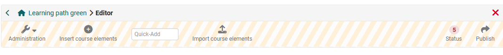
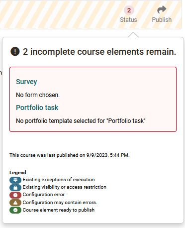

# Course editor tools {: #course_editor_tools}

While you build a course in the course editor, the editor tools are available in the toolbar. With them, you insert or import course elements, check the configuration for problems, view the course as a preview and publish it. The course editor can be opened by course owners, administrators, learning resource managers and persons with the [course right "Course editor"](Members_management.md#additional_rights): `Course > Administration > Course editor`.

{ class="shadow lightbox" title="Toolbar of the course editor" }

## Administration

Via the "Administration" menu of the course you reach further course tools. They are described on the page [Course Administration](Administration/index.md).

## Insert course elements

With "Insert course elements" you extend your course. The dialog shows all [course elements](Course_Elements/index.md) that you can insert into a course, sorted into groups. If you select a course element, OpenOlat adds it to the course. Two entries create several course elements in one step: [Multiple HTML pages](Course_Element_HTML_Page.md#multi) in the group "Other" and [Multiple checklists](Course_Element_Checklist.md#multi). More about this on the page [Course elements in the Course editor](../learningresources/General_Configuration_of_Course_Elements.md).

## Quick-Add [:octicons-tag-16:{ title="from Release 16.2 (OO-5984)" }](https://track.frentix.com/issue/OO-5984){:target="_blank"} {: #quick_add}

If you know the name of the course element, you insert it faster with "Quick-Add". Type the name into the field and select the course element from the list. Quick-Add creates one course element at a time. Depending on the size of your screen window, the toolbar shows the field "Quick-Add".

## Import course elements [:octicons-tag-16:{ title="from Release 16.1 (OO-5210)" }](https://track.frentix.com/issue/OO-5210){:target="_blank"}

If you have already set up course elements in another course, you take them over into the current course with "Import course elements" instead of building them again. A wizard guides you through the import.

Select a course that you own or that authors may copy according to its share settings. Then select one or more course elements of this course. For some course elements, you define further settings in the wizard. Finally, click "Finish". OpenOlat adds the selected course elements to the current course.

## Status

The status shows whether there are problems in the configuration of the course elements. If you click the number indicated, OpenOlat shows the corresponding problems. Follow the links to solve the problems. The legend below shows what kind of problem it is.

{ class="shadow lightbox" title="Status in the course editor" }

OpenOlat also shows configuration problems in the course menu of the course editor next to the affected course elements.

!!! note "Note"

    Do not confuse the "Status" in the course editor with the ["Status" when the course editor is closed](../learningresources/Access_configuration.md). These are two different functions.

## Course preview (only for conventional courses) {: #preview}

With the "Course preview" you check course settings and content from the participants' point of view before you publish. A click on "Course preview" first opens a form. There you simulate that someone enters the course at a certain time, as a member of a certain group or with certain attributes.

The course preview also shows all course elements and modifications not yet published. Functions in which participants leave data in the system are not available in the course preview. These include enrolling in groups, starting tests, self-tests and surveys, and submitting solutions in the course element "Task".

The course preview is useful, for example, to view a course from the participants' perspective before it starts or to check visibility rules.

!!! tip "Tip"

    Usually this preview is not necessary, as you can simply select the "Participant view" when the course editor is closed. This method is also suitable for learning path courses.

### Configuration of the course preview

In this form you define the conditions that apply to the course preview.

#### Date {: #preview_date}

This field is mandatory. Enter a point in time with date and time at which OpenOlat shows the course preview. The current date and time are preset.

#### Group {: #preview_group}

Select one or more groups to view the course from the perspective of the members of these groups.

#### Learning area {: #preview_area}

Enter the name of a learning area to view the course from the perspective of the members of this learning area.

#### Role {: #preview_role}

Select the role for which OpenOlat shows the preview.

* "Registered OLAT users": Shows the course as it is presented to persons with the role "User" (usually participants).
* "Guests": Shows the course as it is presented to a guest (persons who log in without an OpenOlat account), provided the course is available for guests.
* "Coaches": Shows the course as it is presented to a coach of any group in the course.
* "Course owners": Shows the course as it is presented to the owners of the course.
* "OLAT authors": Shows the course as it is presented to persons with the role "Author".

#### Attributes {: #preview_attributes}

In these fields you enter up to five AAI attribute names with their values. The preview then shows the course as a person with these AAI attributes sees it.

**Example**: 
Attribute name: swissEduPersonStudyBranch3 
Attribute value: 4600 
This entry shows the course as Chemistry students see it.

More about AAI attributes can be found on the page [Access Restrictions in the Expert Mode](Access_Restrictions_in_the_Expert_Mode.md) and at [Switch](http://www.switch.ch/aai/).

## Publishing {: #publish}

In the course editor you prepare, set up and design your course at your leisure. Afterwards, you release all settings and modifications with "Publish".

Only once you have published the course are the course elements and your modifications visible with the course editor closed. For participants to see the course, it must also be published and the access configured, see [Access configuration](Access_configuration.md).

The fastest way to publish is to close the course editor: click the course title in the breadcrumb navigation. OpenOlat asks whether you want to publish automatically, manually, or not at all.

Publishing manually corresponds to the editor tool "Publish" and guides you through the steps with a wizard.

!!! warning "Attention"

    If you publish the course while participants are working in it, their current activity data such as unsaved forum and wiki entries will be lost.

### Manual publishing with wizard

Step 1 - Select course elements: Select all course elements that you have modified and want to publish. The selection only contains course elements that can be published.

Step 2 - Modification of course access: Here you define the general publishing options of the course and determine which OpenOlat users have access to your course. The chapter [Course Settings](Course_Settings/index.md) describes which options are available. After this step, you complete publishing with "Finish".

Depending on the course, the wizard then shows further notes. With the [Catalog 1.0](../area_modules/catalog1.0.md) you enter the course specifically into the catalog here. With the [Catalog 2.0](../area_modules/catalog2.0/index.md), OpenOlat enters the course automatically according to the taxonomy configuration.

## Further information {: #further_information}

**Mentioned on this page** 
[Members management >](Members_management.md) 
[Course Administration: Overview >](Administration/index.md) 
[Course elements at a glance >](Course_Elements/index.md) 
[Course Element "HTML page" >](Course_Element_HTML_Page.md) 
[Course Element "Checklist" >](Course_Element_Checklist.md) 
[Course elements in the Course editor >](../learningresources/General_Configuration_of_Course_Elements.md) 
[Access configuration >](Access_configuration.md) 
[Access Restrictions in the Expert Mode >](Access_Restrictions_in_the_Expert_Mode.md) 
[Switch AAI >](http://www.switch.ch/aai/) 
[Course Settings >](Course_Settings/index.md) 
[Catalog 1.0 >](../area_modules/catalog1.0.md) 
[Catalog 2.0: Overview >](../area_modules/catalog2.0/index.md)

[To the top of the page ^](#course_editor_tools)
