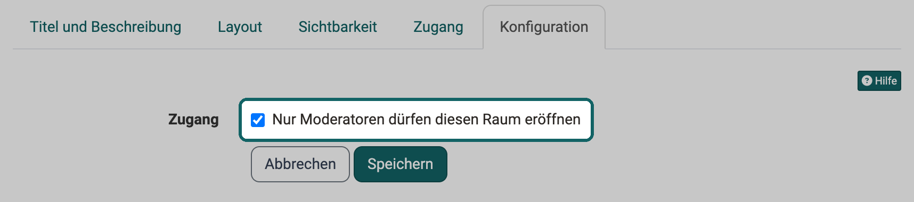
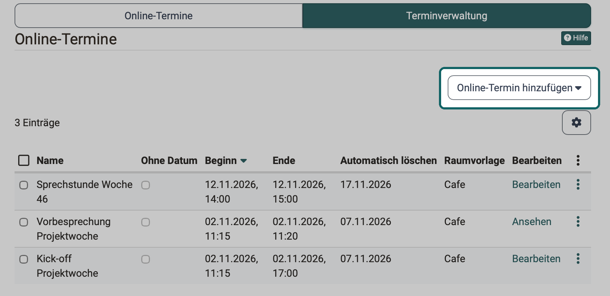
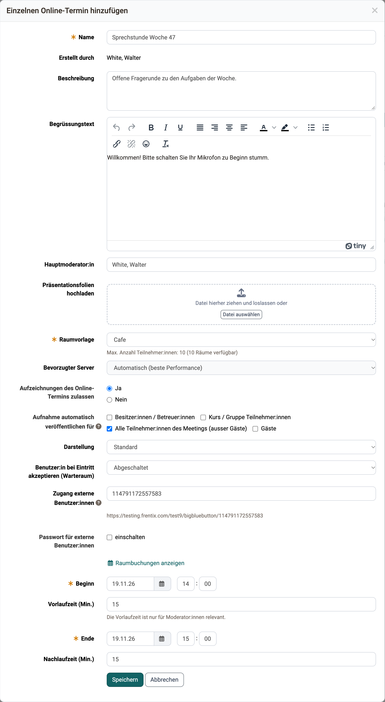
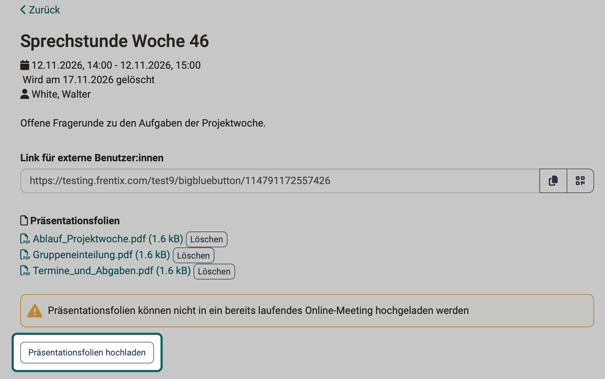
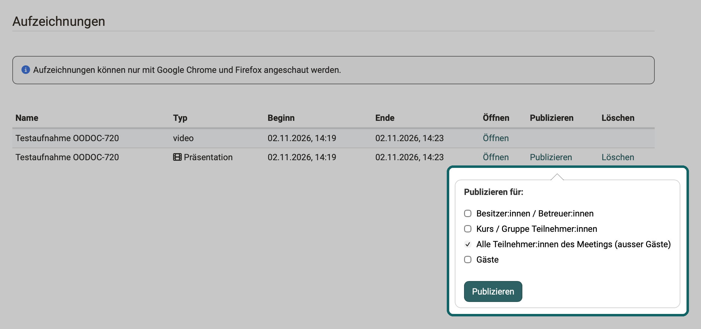
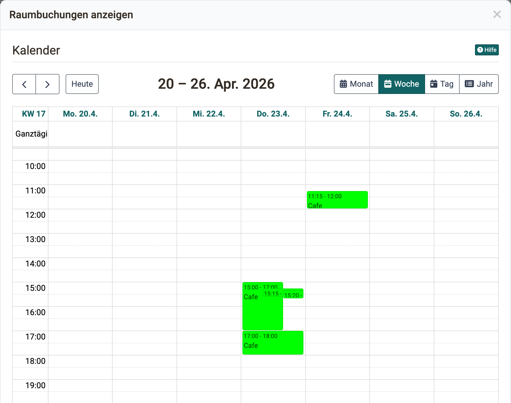
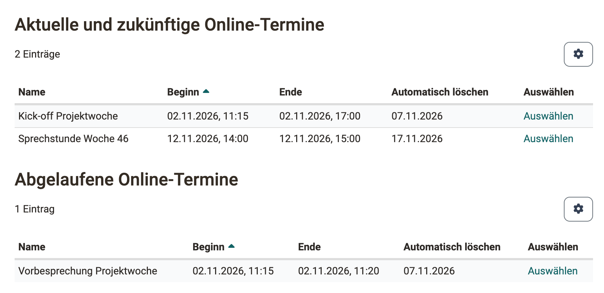
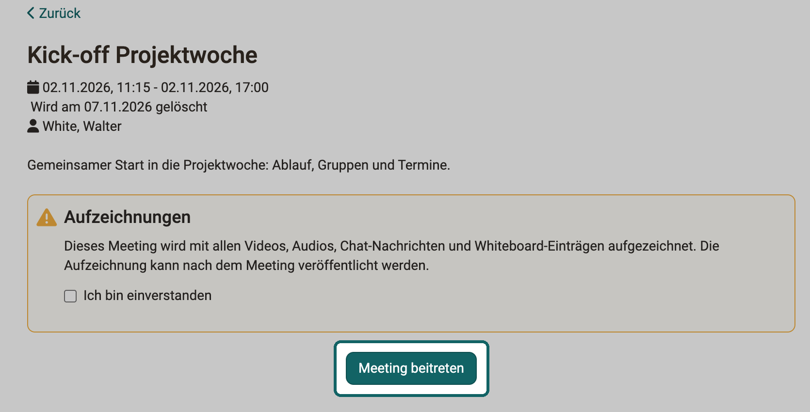
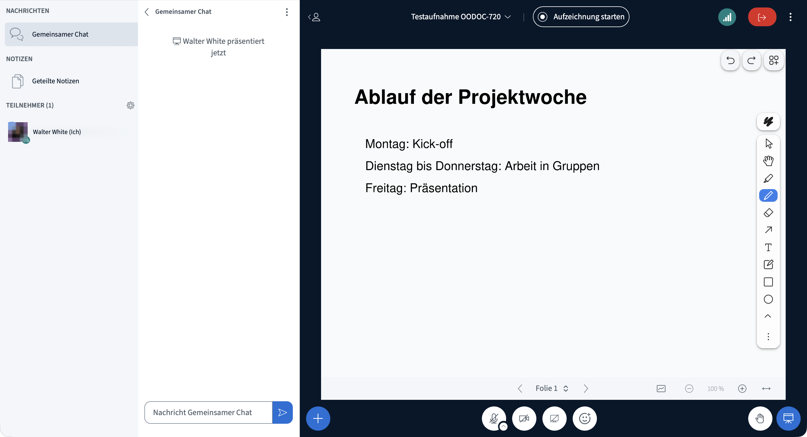
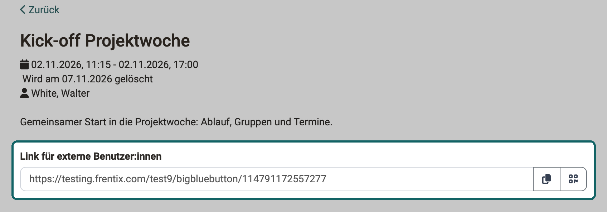

# Kursbaustein "BigBlueButton" {: #bbb_course_element}

## Steckbrief

Name | BigBlueButton
---------|----------
Icon | :o_icon_o_vc_icon:
Verfügbar seit | Release 14.2.5 (2020)
Funktionsgruppe | Kommunikation und Kollaboration
Verwendungszweck | Integration der Webkonferenz-Software BigBlueButton
Bewertbar | nein
Spezialität / Hinweis | BigBlueButton ist eine Open-Source-Software (LGPL-Lizenz). Um den Kursbaustein zu nutzen, ist ein separates Serverhosting erforderlich.

## Allgemeines

!!! note "Hinweis"

    BigBlueButton ist eine Open-Source-Software (LGPL-Lizenz). Um den Kursbaustein zu nutzen, ist ein separates Serverhosting erforderlich. Anbieter-Webseite: <https://bigbluebutton.org/>

:octicons-device-camera-video-24: **Video-Einführung**: [BigBlueButton](https://www.youtube.com/embed/yVZ4V4rXUJQ){:target="_blank"}

### Funktionen der Software

BigBlueButton ermöglicht virtuelle Klassenräume mit folgenden Funktionalitäten:

* Webcam- und Audio-Unterstützung
* Folienpräsentation, zum Beispiel als PDF
* Screensharing
* Multi-User-Whiteboard
* Umfrage-Funktionen
* Gruppenräume, Gruppenchat
* Privater Chat
* Gemeinsame Notizen

### Systemvoraussetzungen

BigBlueButton ist eine browserbasierte Software-Lösung und benötigt keine zusätzlichen Plugins oder Installationen. Für den vollen Funktionsumfang (für Betreuer:innen und Teilnehmende) wird Google Chrome oder Mozilla Firefox empfohlen. Unter Windows lässt sich auch Edge mit Chromium Engine verwenden. Für das Teilen des eigenen Bildschirms empfiehlt sich **Google Chrome**.

## Konfiguration im Kurseditor

Bei der Einbindung von BigBlueButton im Kurs legen Sie fest, ob nur die Moderierenden oder auch Teilnehmende die Online-Termine des Kursbausteins starten dürfen. Moderierende sind die Besitzer:innen und Betreuer:innen des Kurses. Ist im Feld "Zugang" die Option "Nur Moderatoren dürfen diesen Raum eröffnen" gesetzt, können Teilnehmende den Online-Termin erst betreten, wenn die Moderation ihn gestartet hat. Die Option steht unter: 
`Kurs > Administration > Kurseditor > Kursbaustein "BigBlueButton" > Tab "Konfiguration"`

{ class="shadow lightbox" title="Tab Konfiguration im Kurseditor · 2026.11.02" }

## Räume erstellen, konfigurieren und betreten

Online-Termine legen Sie im Kursbaustein selbst an, bei geschlossenem Kurseditor.

### Tab "Terminverwaltung"

Im Tab "Terminverwaltung" legen die Besitzer:innen und Betreuer:innen des Kurses neue Online-Termine an und konfigurieren sie. Bereits angelegte Online-Termine lassen sich hier auch kopieren oder löschen. Der Tab fehlt, solange für ihre Rolle keine aktivierte Raumvorlage freigegeben ist. Die Freigabe setzen Systemadministrator:innen in der Raumvorlage im Feld "Raumvorlage aktiviert für" ([Modul BigBlueButton](../../../manual_admin/administration/BigBlueButton_module.de.md#room_config)).

{ class="shadow lightbox" title="Tab Terminverwaltung im Kursbaustein BigBlueButton · 2026.11.02" }

Die Liste "Online-Termine" zeigt je Termin Name, Beginn, Ende und Raumvorlage. Löscht OpenOlat Online-Termine automatisch, nennt die Spalte "Automatisch löschen" das Datum der Löschung [:octicons-tag-16:{ title="ab Release 17.1 (OO-5191)" }](https://track.frentix.com/issue/OO-5191){:target="_blank"}. Mit "Bearbeiten" öffnen Sie einen Termin. Hat der Termin schon begonnen, steht dort "Ansehen", weil sich seine Einstellungen nicht mehr ändern lassen.

Folgende Varianten lassen sich erstellen:

* **Einzelnen Online-Termin hinzufügen** 
  Bietet sich an, wenn es nur einen konkreten Termin für den Kursbaustein geben soll.
* **Permanente Reservierung hinzufügen** 
  Eignet sich für einen BigBlueButton-Raum, der permanent zur Verfügung steht und mehrfach genutzt wird.
* **Täglich wiederkehrende Online-Termine hinzufügen** 
  Erstellt rasch tägliche Termine.
* **Wöchentlich wiederkehrende Online-Termine hinzufügen** 
  Erstellt rasch wöchentliche Termine, zum Beispiel für Webinar-Serien oder ein Semester.

Die Varianten unterscheiden sich nur in der Erstellung der Termine. Es entstehen separate Online-Termine beziehungsweise Reservierungen, die sich anschliessend einzeln bearbeiten lassen. Je nach Konfiguration des Servers stehen unterschiedliche Auswahlmöglichkeiten bereit.

{ class="shadow lightbox" title="Dialog Einzelnen Online-Termin hinzufügen · 2026.11.02" }

Die Einstellungen im Detail:

**Konfiguration Online-Termin**

* **Name**: Bezeichnung des Termins
* **Erstellt durch**: Der Name der erstellenden Person erscheint automatisch.
* **Beschreibung**: Beschreibung des Termins. Was ist der Inhalt beziehungsweise das Thema der synchronen Session?
* **Begrüssungstext**: Der Text erscheint im BigBlueButton-Raum als Willkommensnachricht im Chatbereich für alle Teilnehmenden.
* **Hauptmoderator:in**: Hier lässt sich der Name einer Person eintragen.
* **Präsentationsfolien hochladen**: Laden Sie Ihre Folien bereits vor dem Meeting hoch, per Ziehen und Ablegen oder über "Datei auswählen". Bereits hochgeladene Folien lassen sich hier auch löschen.
* **Raumvorlage**: Auswahl der konfigurierten Raumvorlagen. Die Raumvorlage bestimmt die Anzahl Teilnehmende und diverse Voreinstellungen im Online-Meeting. Die Details hängen von der Konfiguration des BigBlueButton-Servers ab.
* **Bevorzugter Server**: Steht auf "Automatisch (beste Performance)". Einen bestimmten Server wählen nur Personen mit der Rolle Administrator:in.
* **Aufzeichnungen des Online-Termins zulassen**: ja oder nein
* **Aufnahme automatisch veröffentlichen für**: Wählen Sie hier die Rollen, denen OpenOlat die Aufzeichnung nach dem Meeting bereitstellt: "Besitzer:innen / Betreuer:innen", "Kurs / Gruppe Teilnehmer:innen", "Alle Teilnehmer:innen des Meetings (ausser Gäste)" und "Gäste". Ist keine Rolle gewählt, veröffentlicht OpenOlat die Aufzeichnung nicht automatisch. Sie lässt sich dann nach dem Meeting von Hand veröffentlichen.
* **Darstellung**: Standard oder Webcam-Termin, abhängig von der Konfiguration durch die BigBlueButton-Administration
* **Benutzer:in bei Eintritt akzeptieren (Warteraum)**: Legt fest, ob Personen zunächst in einem Warteraum landen und nicht sofort in den Meeting-Raum gelangen. Mit "Abgeschaltet" gelangen alle Personen direkt in den Meeting-Raum. Mit "Alle Benutzer:innen" landen alle im Warteraum. Mit "Nur Gäste und externe Benutzer:innen" gelangen die Teilnehmenden des Kurses direkt in den Meeting-Raum, alle anderen in den Warteraum.
* **Gäste**: Mit "erlauben" öffnen Sie den Online-Termin für Gäste. Die Option erscheint nur, wenn der Kurs selbst für Gäste freigeschaltet ist.
* **Zugang externe Benutzer:innen**: Sofern die Raumvorlage externe Benutzer:innen zulässt, tragen Sie hier ein Kennzeichen für den Online-Termin ein, ein eindeutiges Wort ohne Sonderzeichen. OpenOlat schlägt eine Zahl vor. Unter dem Feld steht die vollständige URL, die Sie an externe Personen versenden. Der Link erscheint anschliessend auch für Besitzer:innen und Betreuer:innen in der Detailansicht des Online-Termins. Teilnehmende sehen den Link nicht.
* **Passwort für externe Benutzer:innen**: Hinterlegen Sie hier ein Passwort, das externe Benutzer:innen, also Personen ohne OpenOlat Account, für den Zutritt zum Raum eingeben müssen.
* **Raumbuchungen anzeigen**: Öffnet einen Kalender, in dem Sie belegte Zeiten prüfen.

Nur bei termingebundenen Räumen:

* **Beginn**: Geben Sie den Starttermin ein.
* **Vorlaufzeit (Min.)**: 0 bis 30 Minuten konfigurierbare Vorlaufzeit. In dieser Zeit können Besitzer:innen und Betreuer:innen das Meeting bereits starten, Teilnehmende dagegen nicht. So lässt sich zum Beispiel eine Präsentation vorbereiten.
* **Ende**: Ende des Meetings. Die maximale Laufzeit eines Meetings hängt von der gewählten Raumvorlage ab.
* **Nachlaufzeit (Min.)**: 0 bis 30 Minuten konfigurierbare Nachlaufzeit. Das Meeting verlängert sich nach Erreichen der Endzeit automatisch für alle Personen um die Nachlaufzeit. Es erscheint eine Anzeige mit der verbleibenden Konferenzzeit.

Nur bei wiederkehrenden Terminen:

* **Start wiederkehrendes Datum**: 1. Online-Termin. Bei wöchentlicher Wiederholung entspricht dies dem Wochentag der Serie.
* **Ende wiederkehrendes Datum**: Ende der wiederkehrenden Termine

Bei wiederkehrenden Terminen lassen sich die Termine im zweiten Prozessschritt "Datum" vor der Erstellung bearbeiten, löschen oder mit freien Daten ergänzen.

!!! warning "Achtung"

    Sobald ein BigBlueButton-Meeting gestartet, das heisst der Online-Raum geöffnet wurde, lassen sich die Einstellungen am Online-Termin nicht mehr bearbeiten.

### Tab "Online-Termine" [:octicons-tag-16:{ title="ab Release 15.2 (OO-4818)" }](https://track.frentix.com/issue/OO-4818){:target="_blank"}

Im Tab "Online-Termine" öffnen Sie einen bestimmten Online-Termin beziehungsweise Raum.

In der Detailansicht sehen Besitzer:innen und Betreuer:innen des Kurses, an welchem Tag OpenOlat den Online-Termin löscht, den Link für externe Benutzer:innen und die Präsentationsfolien. Folien laden sie vor dem Meeting hoch, damit sie bei Beginn bereitstehen. OpenOlat zeigt das oberste Dokument der Liste direkt an. Die Schaltfläche "Präsentationsfolien hochladen" und die Schaltflächen "Löschen" je Folie stehen nur bis zur Beginnzeit des Online-Termins bereit, bei einer permanenten Reservierung jederzeit. Der Upload nimmt je Durchgang eine Datei auf.

{ class="shadow lightbox" title="Detailansicht eines Online-Termins im Tab Online-Termine · 2026.11.02" }

#### Aufzeichnungen

Die Aufzeichnungen eines Meetings finden Sie ebenfalls im Tab "Online-Termine". Automatisch veröffentlichte Aufzeichnungen sind hier direkt wählbar. Ist im Online-Termin unter "Aufnahme automatisch veröffentlichen für" keine Rolle gewählt, sehen zunächst nur Besitzer:innen und Betreuer:innen die Aufzeichnungen und legen unter "Publizieren" fest, für welche Zielgruppe die Aufzeichnung bereitstehen soll. Je nach Serverkonfiguration lässt sich eine Aufzeichnung auch herunterladen. Über der Liste der Aufzeichnungen erscheint je nach Serverkonfiguration der Hinweis, dass sich Aufzeichnungen nur mit Google Chrome oder Firefox ansehen lassen.

!!! warning "Achtung"

    Die Einstellungen unter "Publizieren" wie auch unter "Löschen" gelten sowohl für die Aufzeichnung als auch für den Download. Löschen Sie einen Eintrag, wird die gesamte Aufzeichnung gelöscht.

{ class="shadow lightbox" title="Aufzeichnungen in der Detailansicht eines Online-Termins · 2026.11.02" }

## Kalenderanzeige

Sofern es einen Kalender im Kurs gibt, erscheinen die BigBlueButton-Termine ebenfalls im Kalender.

In der Konfiguration eines Raums öffnet der Link "Raumbuchungen anzeigen" beim Erstellen und beim Bearbeiten eine Übersicht über alle gebuchten BigBlueButton-Räume der Instanz. Das erleichtert es, zeitliche Engpässe beziehungsweise eine starke Auslastung des Systems frühzeitig zu erkennen und gegebenenfalls einen anderen Termin zu wählen.

Zusätzlich erscheinen die in BigBlueButton erstellten Online-Termine automatisch im kursspezifischen Kalender. Von hier aus gelangen alle Kursmitglieder rasch in den entsprechend verlinkten BigBlueButton-Raum.

{ class="shadow lightbox" title="Dialog Raumbuchungen anzeigen · 2026.10.27" }

## Ansicht für Teilnehmende

Rufen Teilnehmende einen BigBlueButton-Kursbaustein auf, sehen sie die Liste "Aktuelle und zukünftige Online-Termine" und, sofern vorhanden, die Liste "Abgelaufene Online-Termine". Beide Listen nennen je Termin Name, Beginn und Ende, bei automatischer Löschung zusätzlich das Datum in der Spalte "Automatisch löschen". Permanente Reservierungen stehen ohne Datum in der ersten Liste. Ein Klick auf "Auswählen" führt zur Detailansicht des jeweiligen Online-Termins.

{ class="shadow lightbox" title="Kursbaustein BigBlueButton aus Sicht der Teilnehmenden · 2026.11.02" }

Laufende Online-Termine betreten Sie mit "Meeting beitreten". Damit gelangen Sie in den BigBlueButton-Raum. Erlaubt die Raumvorlage Aufzeichnungen, steht darüber der Hinweis "Aufzeichnungen": Erst mit dem Häkchen "Ich bin einverstanden" lässt sich das Meeting betreten [:octicons-tag-16:{ title="ab Release 15.3.2 (OO-5018)" }](https://track.frentix.com/issue/OO-5018){:target="_blank"}. Dürfen nur Moderierende den Raum eröffnen und hat noch niemand den Termin gestartet, steht dort der Hinweis "Der Online-Termin wurde von der betreuenden Person noch nicht eröffnet. Teilnehmer:innen können den Raum noch nicht betreten."

{ class="shadow lightbox" title="Detailansicht eines Online-Termins für Teilnehmende · 2026.11.02" }

Abgelaufene Online-Termine lassen sich nicht mehr betreten. Die Detailansicht gibt aber Zugriff auf vorhandene Aufzeichnungen des Meetings. Besitzer:innen und Betreuer:innen des Kurses können Aufzeichnungen hier auch löschen.

## BigBlueButton-Raum

Vor dem Eintritt fragt BigBlueButton, ob Sie "Mit Mikrofon" teilnehmen oder "Nur zuhören".

{ class="shadow lightbox" title="BigBlueButton-Raum · 2026.11.02" }

Links im Raum stehen die Bereiche "Nachrichten" mit dem gemeinsamen Chat, "Notizen" mit den geteilten Notizen und "Teilnehmer" mit den Personen im Raum. Daneben öffnet sich der gewählte Bereich, zum Beispiel der Chat mit der Texteingabe. Rechts liegt der Präsentationsbereich mit den Folien, am rechten Rand die Whiteboard-Werkzeuge. Die obere Leiste trägt die Schaltfläche "Aufzeichnung starten", die rote Schaltfläche "Verlassen" und über die drei Punkte die Einstellungen. Die untere Leiste steuert Mikrofon, Webcam, Bildschirmfreigabe und Reaktionen. Links öffnet das Plus-Symbol die "Aktionen", rechts steht "Hand heben".

Moderierende finden neben der Überschrift "Teilnehmer" das Zahnrad "Teilnehmende verwalten". Sein Menü enthält unter anderem "Rechte der Zuschauenden einschränken". Was die Optionen darin bedeuten, steht unter [Häufig gestellte Fragen - BigBlueButton](faq.de.md).

Den Begrüssungstext im Chat legen Sie im Online-Termin im Feld "Begrüssungstext" fest. Sofern Personen ein Profilbild hinterlegt haben, erscheint dieses auch in der Personenliste.

Je nach Raumeinstellung stehen unterschiedliche Möglichkeiten im Raum zur Verfügung.

## BigBlueButton für Gäste und externe Benutzer:innen [:octicons-tag-16:{ title="ab Release 15.1 (OO-4733)" }](https://track.frentix.com/issue/OO-4733){:target="_blank"}

Wer Personen ohne OpenOlat Account zu einem Online-Termin einladen will, hat zwei Wege: den Gastzugang des Kurses und den Link für externe Benutzer:innen. Den Gastzugang öffnen Sie im Online-Termin mit dem Feld "Gäste", den Link mit dem Feld "Zugang externe Benutzer:innen".

!!! note "Gastzugang"

    Voraussetzung ist ein herkömmlicher Kurs, kein Lernpfadkurs, und der Kurs selbst muss für Gäste freigeschaltet sein. Gäste geben bei der Einwahl in den Raum einen beliebigen Namen ein. Mehr dazu unter [Gastzugang](../../basic_concepts/guest_access.de.md).

Den Link für externe Benutzer:innen bietet OpenOlat an, wenn die Raumvorlage die Option "Offen für externe Benutzer:innen" trägt. Besitzer:innen und Betreuer:innen des Kurses sehen ihn in der Detailansicht des Online-Termins im Block "Link für externe Benutzer:innen", mit einer Schaltfläche zum Kopieren ("In Zwischenablage kopieren") und einer für den QR-Code ("QR-Code anzeigen"). Den QR-Code speichern Sie mit "PNG herunterladen" als Bild, etwa für eine Folie oder eine Einladung. So öffnen externe Personen den Online-Termin direkt am Telefon. Mehr dazu unter [Links kopieren und als QR-Code weitergeben](../../basic_concepts/Navigation.de.md#url_field). [:octicons-tag-16:{ title="ab Release 21.1.2 (OO-9982)" }](https://track.frentix.com/issue/OO-9982){:target="_blank"} Mit dem Feld "Passwort für externe Benutzer:innen" im Online-Termin schützen Sie den Zutritt zusätzlich mit einem Passwort.

{ class="shadow lightbox" title="Detailansicht eines Online-Termins für Moderierende · 2026.11.02" }

## Weiterführende Informationen {: #further_information}

**Auf dieser Seite erwähnt** 
[Modul BigBlueButton >](../../../manual_admin/administration/BigBlueButton_module.de.md) 
[Häufig gestellte Fragen - BigBlueButton >](faq.de.md) 
[Rollen und Rechte: Gastzugang >](../../basic_concepts/guest_access.de.md) 
[Navigation >](../../basic_concepts/Navigation.de.md)

**Weiterführend** 
[Virtuelle Klassenzimmer >](../../basic_concepts/Virtual_classrooms.de.md) 
[Gruppenwerkzeuge nutzen >](../../groups/Using_Group_Tools.de.md) 
[Kursbaustein "Terminplanung" >](../Course_Element_Appointment_Scheduling.de.md)

**youtube** 
[BigBlueButton](<https://www.youtube.com/embed/yVZ4V4rXUJQ>)

[Zum Seitenanfang ^](#bbb_course_element)
