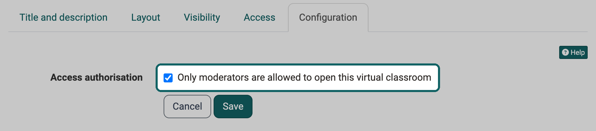
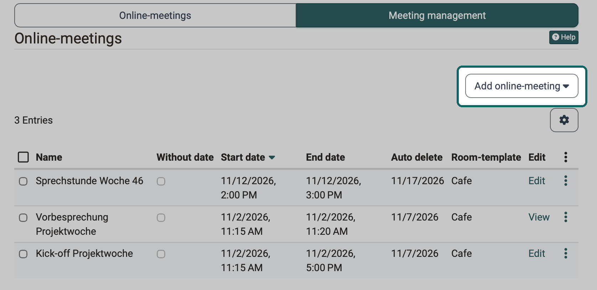
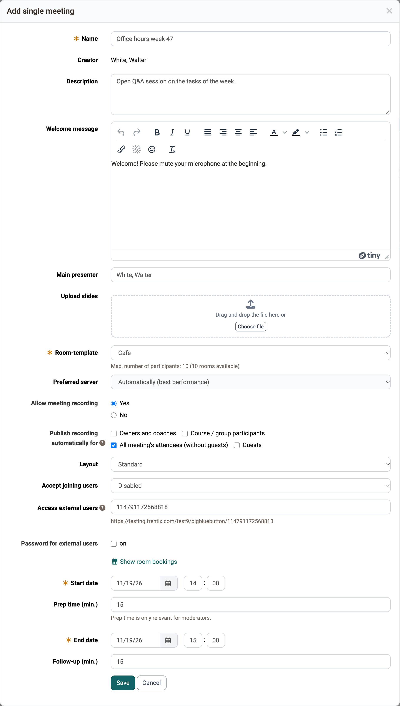
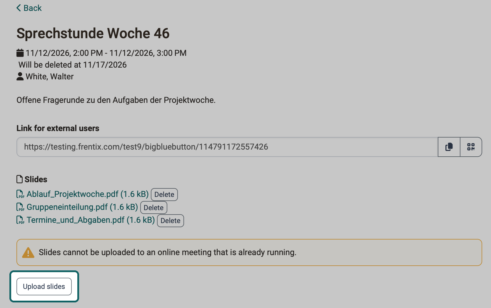
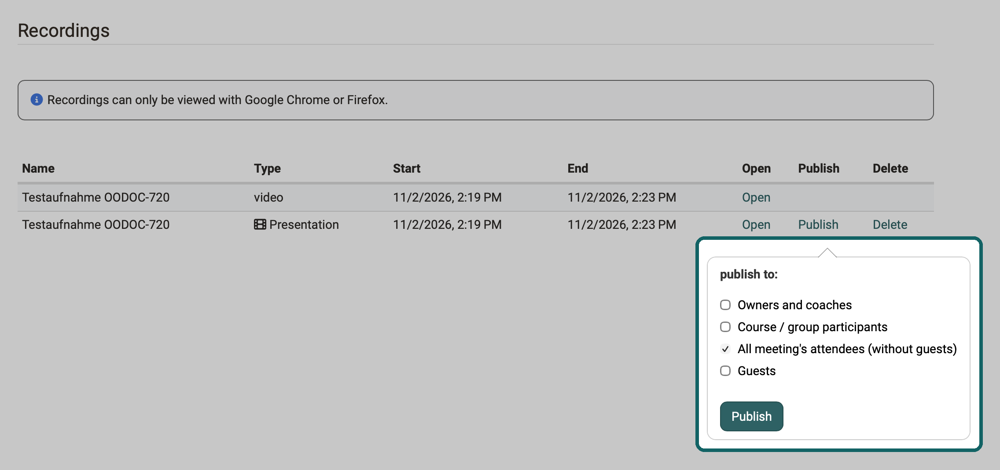
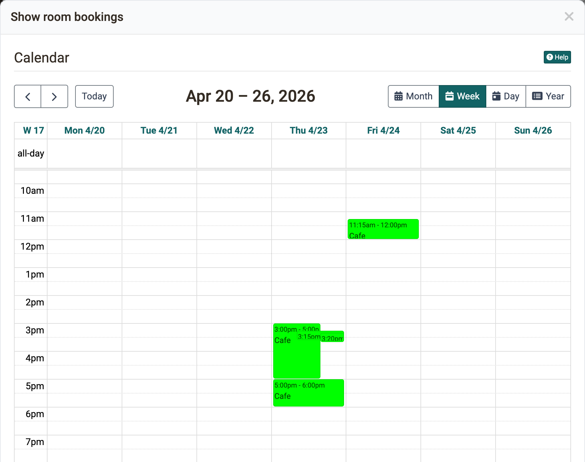
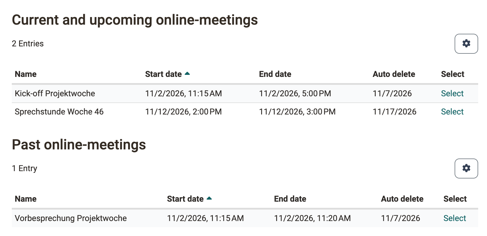
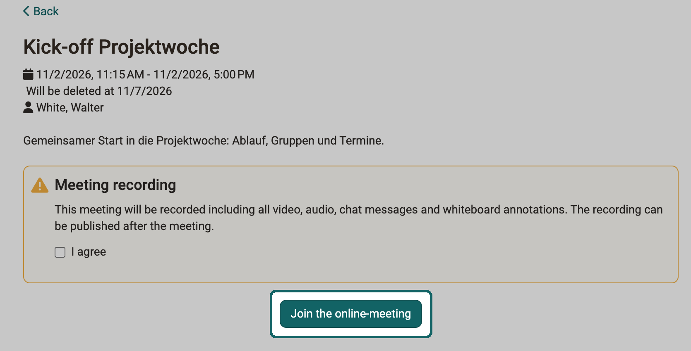
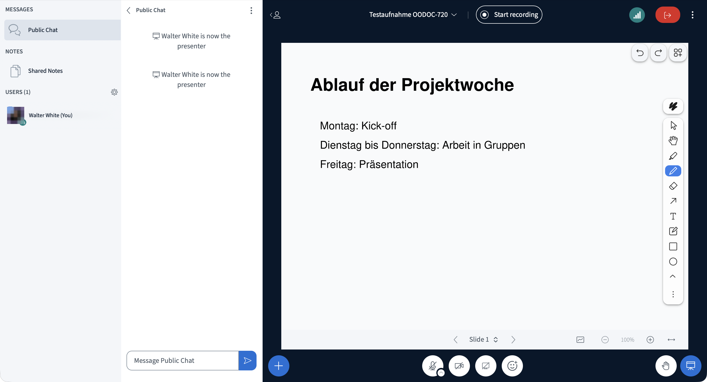
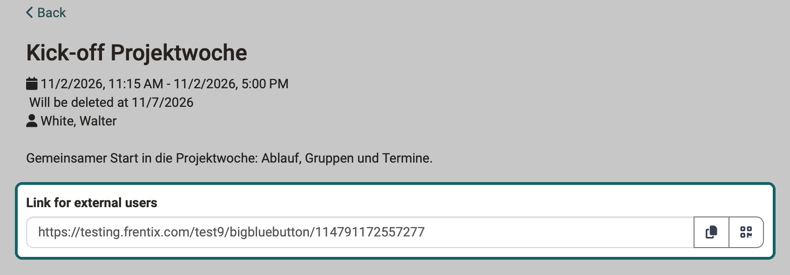

# Course Element "BigBlueButton" {: #bbb_course_element}

## Profile

Name | BigBlueButton
---------|----------
Icon | :o_icon_o_vc_icon:
Available since | Release 14.2.5 (2020)
Functional group | Communication and collaboration
Purpose | Integration of the BigBlueButton web conferencing software
Assessable | no
Specialty / Note | BigBlueButton is an open source software (LGPL license). To use the course element, a separate server hosting is required.

## General

!!! note "Note"

    BigBlueButton is an open source software (LGPL license). To use the course element, a separate server hosting is required. Provider website: <https://bigbluebutton.org/>

:octicons-device-camera-video-24: **Video introduction (German)**: [BigBlueButton](https://www.youtube.com/embed/yVZ4V4rXUJQ){:target="_blank"}

### System functions

BigBlueButton enables virtual classrooms with the following functionalities:

* Webcam and audio support
* Slide presentation, for example as PDF
* Screen sharing
* Multi-user whiteboard
* Survey functionality
* Group rooms, group chat
* Private chat
* Shared notes

### System requirements

BigBlueButton is a browser-based software solution and requires no additional plug-ins or installations. For full functionality (for coaches and participants) Google Chrome or Mozilla Firefox is recommended. On Windows, Edge with Chromium Engine can also be used. For sharing your own screen, **Google Chrome** is recommended.

## Configuration in the course editor

When integrating BigBlueButton into a course you can decide whether the online-meetings of the course element can be started by the moderators only or also by participants. Moderators are the owners and coaches of the course. If the option "Only moderators are allowed to open this virtual classroom" is set in the field "Access authorisation", participants can only enter the online-meeting once the moderation has started it. The option is located under: 
`Course > Administration > Course editor > Course element "BigBlueButton" > Tab "Configuration"`

{ class="shadow lightbox" title="Tab Configuration in the course editor · 2026.11.02" }

## Create, configure and enter rooms

You create online-meetings in the course element itself, with the course editor closed.

### Tab "Meeting management"

In the tab "Meeting management" the owners and coaches of the course create and configure new online-meetings. Online-meetings that already exist can also be copied or deleted here. The tab is missing as long as no enabled room template is released for their role. System administrators set the release in the room template in the field "Room-template activated for" ([BigBlueButton module](../../../manual_admin/administration/BigBlueButton_module.md#room_config)).

{ class="shadow lightbox" title="Tab Meeting management in the course element BigBlueButton · 2026.11.02" }

The list "Online-meetings" shows the name, start date, end date and room-template of each meeting. If OpenOlat deletes online-meetings automatically, the column "Auto delete" shows the date of deletion [:octicons-tag-16:{ title="from Release 17.1 (OO-5191)" }](https://track.frentix.com/issue/OO-5191){:target="_blank"}. With "Edit" you open a meeting. Once the meeting has started, the link reads "View", because its settings can no longer be changed.

The following variants can be created:

* **Add single meeting** 
  Useful if there is to be only one specific date for the course element.
* **Add permanent meeting room** 
  Suitable for a BigBlueButton room that is permanently available and used several times.
* **Add daily recurring meeting** 
  Creates daily meetings quickly.
* **Add weekly recurring meeting** 
  Creates weekly meetings quickly, for example for webinar series or a semester.

The variants only differ in the way the meetings are created. Separate online-meetings or reservations are created, which can then be edited individually. Depending on the configuration of the server, different options are available.

{ class="shadow lightbox" title="Dialog Add single meeting · 2026.11.02" }

The settings in detail:

**Configuration of an online-meeting**

* **Name**: Name of the meeting
* **Creator**: The name of the person who created the meeting is displayed automatically.
* **Description**: Description of the meeting. What is the content or the topic of the synchronous session?
* **Welcome message**: The text is displayed in the BigBlueButton room as a welcome message in the chat area for all participants.
* **Main presenter**: The name of a person can be entered here.
* **Upload slides**: Upload your slides before the meeting, by drag and drop or by selecting a file. Slides that have already been uploaded can also be deleted here.
* **Room-template**: Selection of the configured room templates. The room template determines the number of participants and various default settings in the online meeting. The details depend on the configuration of the BigBlueButton server.
* **Preferred server**: Set to "Automatically (best performance)". Only people with the role administrator can choose a specific server.
* **Allow meeting recording**: yes or no
* **Publish recording automatically for**: Select the roles to which OpenOlat provides the recording after the meeting: "Owners and coaches", "Course / group participants", "All meeting's attendees (without guests)" and "Guests". If no role is selected, OpenOlat does not publish the recording automatically. It can then be published manually after the meeting.
* **Layout**: standard or webcam meeting, depending on the configuration by the BigBlueButton administration
* **Accept joining users**: Determines whether people first land in a waiting room and do not enter the meeting room immediately. With "Disabled" all people enter the meeting room directly. With "All users" everybody lands in the waiting room. With "Only guests and external users" the participants of the course enter the meeting room directly, everybody else lands in the waiting room.
* **Guests**: With "allowed" you open the online-meeting for guests. The option only appears if the course itself has been activated for guests.
* **Access external users**: If the room template allows external users, enter an identifier for the online-meeting here, a unique word without special characters. OpenOlat suggests a number. Below the field you see the complete URL that you send to external people. The link then also appears for owners and coaches in the detail view of the online-meeting. Participants do not see the link.
* **Password for external users**: Enter a password here that guests, i.e. people without an OpenOlat account, must enter to access the room.
* **Show room bookings**: calendar view for checking occupied online-meetings

Only for scheduled rooms:

* **Start date**: Enter the starting date.
* **Prep time (min.)**: 0 to 30 minutes configurable prep time. During this time owners and coaches can already start the meeting, participants cannot. This allows a presentation to be prepared, for example.
* **End date**: End of the meeting. The maximum duration of a meeting depends on the selected room template.
* **Follow-up (min.)**: 0 to 30 minutes configurable follow-up time. After the end time is reached, the meeting is automatically extended by the follow-up time for all people. A display with the remaining conference time appears.

Only for recurring meetings:

* **Start recurring date**: 1st online-meeting. With weekly repetition this corresponds to the weekday of the series.
* **End recurring date**: End of the recurring meetings

For recurring meetings, the meetings can be edited, deleted or supplemented with free dates in the second process step "Dates" before creation.

!!! warning "Attention"

    Once a BigBlueButton meeting has been started, i.e. the online room has been opened, the settings of the online-meeting can no longer be edited.

### Tab "Online-meetings" [:octicons-tag-16:{ title="from Release 15.2 (OO-4818)" }](https://track.frentix.com/issue/OO-4818){:target="_blank"}

The tab "Online-meetings" gives you access to a specific online-meeting or room.

In the detail view, owners and coaches of the course see on which day OpenOlat deletes the online-meeting, the link for external users and the slides. They upload slides before the meeting so that they are ready at the start. The top document of the list is displayed directly. The button "Upload slides" and the "Delete" buttons for each slide are only available until the start time of the online-meeting, for a permanent meeting room at any time. Each upload takes one file.

{ class="shadow lightbox" title="Online-meeting detail view in the tab Online-meetings · 2026.11.02" }

#### Recordings

The recordings of a meeting can also be found in the tab "Online-meetings". Automatically published recordings are directly selectable here. If no role is selected under "Publish recording automatically for" in the online-meeting, only owners and coaches see the recordings at first and define under "Publish" for which target group the recording should be provided. Depending on the server configuration, a download of a recording is also available. Depending on the server configuration, a note above the list of recordings says that recordings can only be viewed with Google Chrome or Firefox.

!!! warning "Attention"

    The settings under "Publish" as well as under "Delete" apply to the recording as well as to the download. If you delete an entry, the whole recording is deleted.

{ class="shadow lightbox" title="Recordings in the detail view of an online-meeting · 2026.11.02" }

## Calendar view

If there is a calendar in the course, the BigBlueButton meetings also appear in the calendar.

When configuring a room, an overview of all booked BigBlueButton rooms of the instance can be viewed both during creation and later when editing, using the link "Show room bookings". This makes it easier to identify time bottlenecks or a high system load early on and to choose a different date if necessary.

In addition, the online-meetings created in BigBlueButton automatically appear in the course-specific calendar. From here, all course members can quickly reach the correspondingly linked BigBlueButton room.

{ class="shadow lightbox" title="Dialog Show room bookings · 2026.10.27" }

## View for participants

When participants call up a BigBlueButton course element, they see the list "Current and upcoming online-meetings" and, if available, the list "Past online-meetings". Both lists show the name, start date and end date of each meeting, and with automatic deletion also the date in the column "Auto delete". Permanent reservations appear without a date in the first list. A click on "Select" leads to the detail view of the respective online-meeting.

{ class="shadow lightbox" title="Course element BigBlueButton from the participants' view · 2026.11.02" }

You enter running online-meetings with "Join the online-meeting". This takes you into the BigBlueButton room. If the room template allows recordings, the notice "Meeting recording" appears above it: only with the checkbox "I agree" can you enter the meeting [:octicons-tag-16:{ title="from Release 15.3.2 (OO-5018)" }](https://track.frentix.com/issue/OO-5018){:target="_blank"}. If only moderators may open the room and nobody has started the meeting yet, the notice "The meeting has not yet been started by the coach. Participants are not able to enter the classroom." appears there.

{ class="shadow lightbox" title="Detail view of an online-meeting for participants · 2026.11.02" }

Past online-meetings can no longer be entered. The detail view still gives access to existing recordings of the meeting. Owners and coaches of the course can also delete recordings here.

## BigBlueButton Room

Before you enter, BigBlueButton asks whether you join with microphone or listen only.

{ class="shadow lightbox" title="BigBlueButton room · 2026.11.02" }

On the left of the room are the areas "Messages" with the public chat, "Notes" with the shared notes and "Users" with the people in the room. Next to them the selected area opens, for example the chat with the text input. On the right is the presentation area with the slides, with the whiteboard tools on the right-hand edge. The top bar carries the button "Start recording", the red button "Leave" and, behind the three dots, the options. The bottom bar controls microphone, webcam, screen sharing and reactions. On the left, the plus icon opens the "Actions", on the right is "Raise your hand".

Moderators find the gear icon "Manage users" next to the heading "Users". Its menu contains, among other things, "Lock viewers". What the options there mean is described in [Frequently asked questions - BigBlueButton](faq.md).

You set the welcome message in the chat in the online-meeting in the field "Welcome message". If people have stored a profile picture, this also appears in the list of people.

Depending on the room settings, different options are available in the room.

## BigBlueButton for guests and external users [:octicons-tag-16:{ title="from Release 15.1 (OO-4733)" }](https://track.frentix.com/issue/OO-4733){:target="_blank"}

If you want to invite people without an OpenOlat account to an online-meeting, there are two ways: the guest access of the course and the link for external users. You open the guest access in the online-meeting with the field "Guests", the link with the field "Access external users".

!!! note "Guest access"

    The prerequisite is a conventional course, not a learning path course, and the course itself must be activated for guests. Guests enter a name of their choice when dialling into the room. For more information see [guest access](../../basic_concepts/guest_access.md).

OpenOlat offers the link for external users if the room template has the option "Open for external users". Owners and coaches of the course see it in the detail view of the online-meeting in the block "Link for external users", with one button for copying and one for the QR code. With the field "Password for external users" in the online-meeting you additionally protect access with a password.

{ class="shadow lightbox" title="Detail view of an online-meeting for moderators · 2026.11.02" }

## Further information {: #further_information}

**Mentioned on this page** 
[BigBlueButton module >](../../../manual_admin/administration/BigBlueButton_module.md) 
[Frequently asked questions - BigBlueButton >](faq.md) 
[Roles and Rights: Guest access >](../../basic_concepts/guest_access.md)

**Further reading** 
[Virtual classrooms >](../../basic_concepts/Virtual_classrooms.md) 
[Using Group Tools >](../../groups/Using_Group_Tools.md) 
[Course Element "Appointment scheduling" >](../Course_Element_Appointment_Scheduling.md)

**youtube** 
[BigBlueButton](<https://www.youtube.com/embed/yVZ4V4rXUJQ>)

[To the top of the page ^](#bbb_course_element)
