# Lernressourcen {: #learning_resources}

Kurse, Tests, Wikis, Formulare und weitere Inhalte legen Sie in OpenOlat als [Lernressourcen](General_Functions_Concept.de.md) im [Autorenbereich](../area_modules/Authoring/index.de.md) an. Die meisten Lernressourcen binden Sie über einen [Kursbaustein](Course_Elements/index.de.md) in einen Kurs ein, Glossar und Ressourcenordner über die Kurseinstellungen. Viele Typen erstellen Sie direkt im Menü "Erstellen" des Autorenbereichs, [weitere Lernressourcen](#further_learningresources) laden Sie über "Datei importieren" hoch.

Die Abschnitte zu den einzelnen Typen zeigen unter dem Titel das Symbol des Typs. Mit demselben Symbol erscheint die Lernressource im Autorenbereich in der Spalte "Typ". Zeigen Sie mit der Maus auf das Symbol, nennt OpenOlat den Namen des Typs.

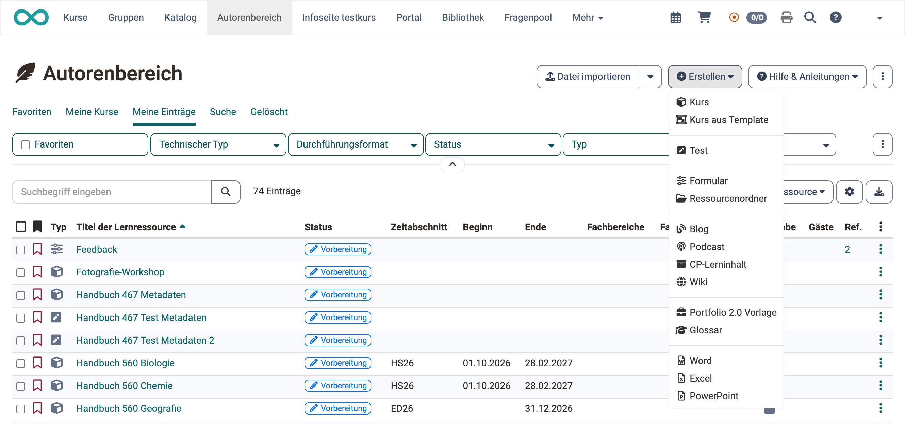{ class="shadow lightbox" title="Menü Erstellen im Autorenbereich · 2026.11.10" }

---

## Kurs {: #course}

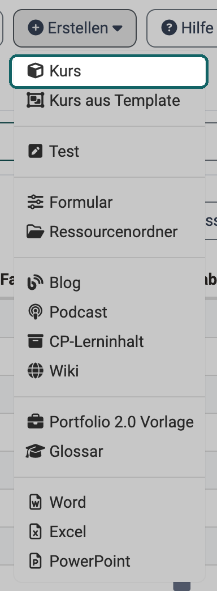{ width="192" class="aside-right lightbox" title="Menü Erstellen im Autorenbereich · 2026.11.10" }

:o_icon_o_CourseModule_icon:

Ein OpenOlat-Kurs dient als reiner Online-Kurs oder begleitet Vorlesungen, Seminare und andere Präsenzveranstaltungen. Er fasst beliebig viele Kursbausteine in einer Struktur zusammen. So setzen Sie verschiedene didaktische Konzepte um, etwa Webquests, Gruppenpuzzles, kooperative Online-Seminare, problembasiertes Lernen oder spielbasierte Ansätze.

Steckbrief und Kurszyklus vom Anlegen bis zum Löschen finden Sie auf der Seite [Allgemeines](General_Information/index.de.md) zum Kurs. Wie Sie Kurse erstellen, erfahren Sie im Kapitel ["Kurs erstellen"](Creating_Course.de.md). Details zu Kursbausteinen und dem Kurseditor erfahren Sie im Kapitel ["Kursbausteine im Überblick"](Course_Elements/index.de.md).

Haben Sie oder Ihre Organisation Templates vorbereitet, erstellen Sie daraus direkt einen neuen Kurs: mit dem Eintrag "Kurs aus Template" im Menü "Erstellen". Ein Template ist ein Kurs mit dem Verwendungszweck "Template". Ein Assistent führt Sie in zwei Schritten: Im Schritt "Template" wählen Sie das Template, im Schritt "Einstellungen" geben Sie dem neuen Kurs unter anderem Titel, Kennzeichen und Durchführungszeitraum. OpenOlat legt den Kurs als Kopie an, das Template selbst bleibt unverändert. Zur Auswahl stehen die Templates, die Sie besitzen oder verwalten, und Templates, die für Autor:innen zum Kopieren freigegeben sind. Mehr zum Verwendungszweck "Template" erfahren Sie im Kapitel ["Kurs erstellen"](Creating_Course.de.md#purpose). [:octicons-tag-16:{ title="ab Release 20.2 (OO-8897)" }](https://track.frentix.com/issue/OO-8897)

[Zum Seitenanfang ^](#learning_resources)

---

## Test {: #test}

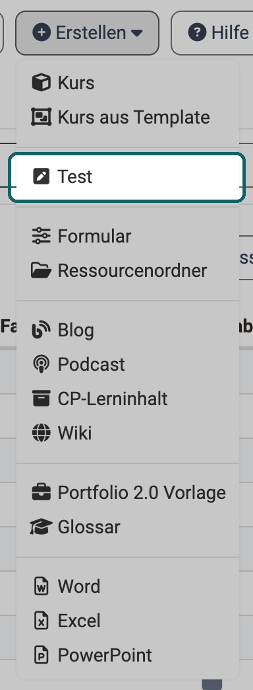{ width="192" class="aside-right lightbox" title="Menü Erstellen im Autorenbereich · 2026.11.10" }

:o_icon_o_FileResource-IMSQTI21_icon:

Tests setzen Sie für Prüfungen und zum Üben ein. Im Kursbaustein "Test" sehen Besitzer:innen und Betreuer:innen die Resultate der Teilnehmenden, im Kursbaustein "Selbsttest" speichert OpenOlat alle Eingaben anonym. Jeder Test liegt im standardisierten Format IMS QTI 2.1 vor.

Mehr Informationen zum Einsatz und zur Erstellung von Tests finden Sie im Kapitel ["Tests erstellen"](Test/index.de.md).

[Zum Seitenanfang ^](#learning_resources)

---

## CP-Lerninhalt {: #cp-content}

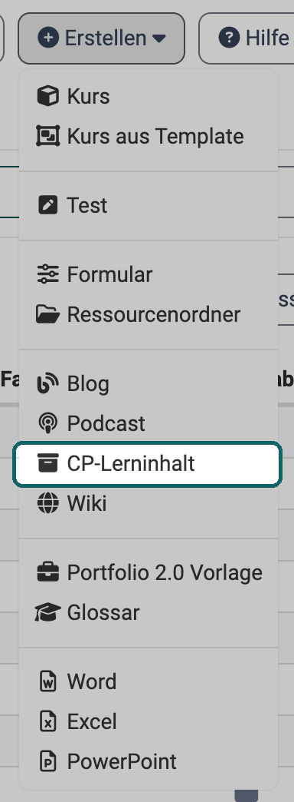{ width="192" class="aside-right lightbox" title="Menü Erstellen im Autorenbereich · 2026.11.10" }

:o_icon_o_FileResource-IMSCP_icon:

Ein Content-Packaging (kurz CP) ist ein Lerninhalt in einem standardisierten E-Learning-Format. Die Spezifikation dieses Datenformats stammt wie bei Tests vom [IMS bzw. 1EdTech Consortium](https://de.wikipedia.org/wiki/IMS_Content_Packaging "IMS bzw. 1EdTech Consortium"). OpenOlat unterstützt die IMS-CP Version 1.1.2. Einen CP-Lerninhalt verwenden Sie in OpenOlat-Kursen und ebenso in anderen LMS (Learning-Management-Systemen). In einen Kurs binden Sie ihn mit dem Kursbaustein "CP-Lerninhalt" ein. Wie Sie einen CP-Lerninhalt erstellen, beschreibt das Kapitel ["CP-Lerninhalt erstellen"](../learningresources/CP_Editor.de.md).

Im Autorenbereich zeigt OpenOlat CP-Lerninhalte mit dem Symbol eines Archivs. Dasselbe Symbol tragen [SCORM-Lerninhalte](#scorm). Welcher der beiden Typen es ist, zeigt der Name: Zeigen Sie in der Spalte "Typ" mit der Maus auf das Symbol, nennt OpenOlat "CP-Lerninhalt" oder "SCORM 1.2".

[Zum Seitenanfang ^](#learning_resources)

---

## Wiki {: #wiki}

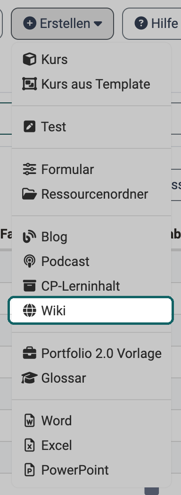{ width="192" class="aside-right lightbox" title="Menü Erstellen im Autorenbereich · 2026.11.10" }

:o_icon_o_FileResource-WIKI_icon:

In einem Wiki erstellen mehrere Personen gemeinsam Inhalte. Ein Wiki dient für Gruppenarbeiten, als Dokumentationswerkzeug oder als Wissensbasis für Studien- und Projektarbeiten.

Steckbrief und Erstellung des Wikis beschreibt die Seite ["Wiki"](../learningresources/Wiki.de.md). Wie Sie im Wiki Inhalte erstellen und sinnvoll arbeiten, erfahren Sie im Kapitel [Kursbaustein "Wiki"](../learningresources/Course_Element_Wiki.de.md).

[Zum Seitenanfang ^](#learning_resources)

---

## Podcast {: #podcast}

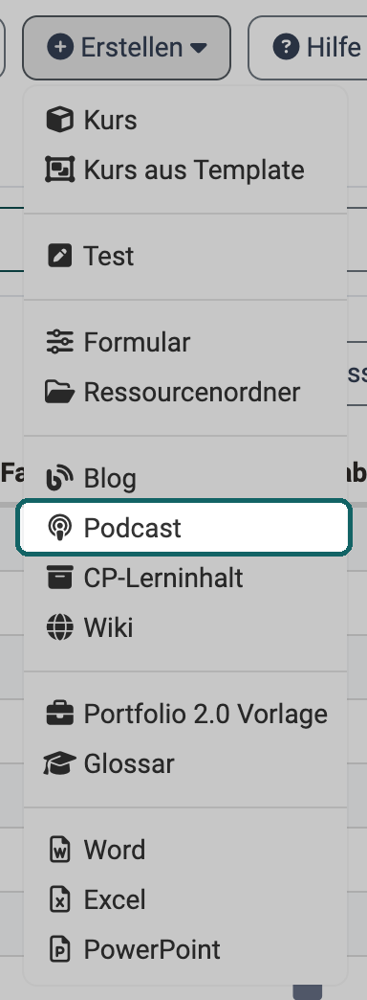{ width="192" class="aside-right lightbox" title="Menü Erstellen im Autorenbereich · 2026.11.10" }

:o_icon_o_FileResource-PODCAST_icon:

In einem Podcast stellen Sie Audio- und Videodateien als Episoden in OpenOlat bereit. Teilnehmende hören oder sehen die Episoden direkt in OpenOlat oder abonnieren den Podcast über Dienste wie iTunes und laden die Episoden auf mobile Geräte. Sind Bewertungen und Kommentare eingeschaltet, bewerten und kommentieren Teilnehmende die Episoden. In einen Kurs binden Sie einen Podcast mit dem Kursbaustein "Podcast" ein.

Weitere Informationen zum Thema Podcast finden Sie im Kapitel ["Podcast: Übersicht"](Podcast/index.de.md).

[Zum Seitenanfang ^](#learning_resources)

---

## Blog {: #blog}

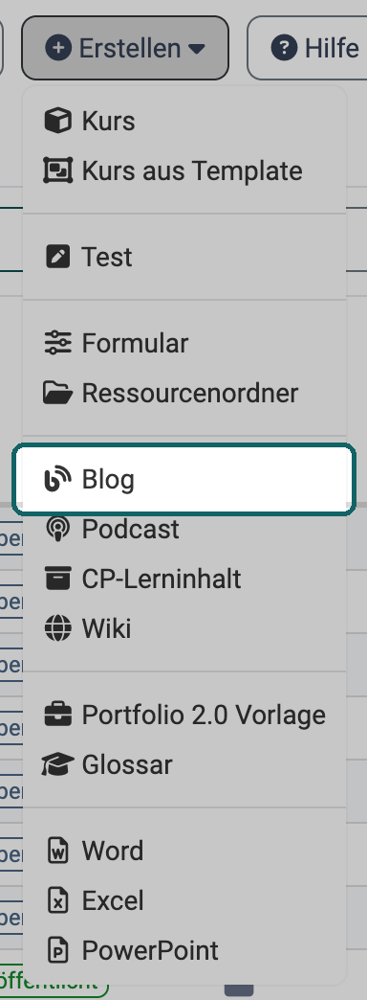{ width="192" class="aside-right lightbox" title="Menü Erstellen im Autorenbereich · 2026.10.27" }

:o_icon_o_FileResource-BLOG_icon:

In einem Blog veröffentlichen Sie fachbezogene oder persönliche Informationen in zeitlicher Folge, etwa als Online-Tagebuch oder Online-Journal. Sind Bewertungen und Kommentare eingeschaltet, bewerten und kommentieren Teilnehmende die Einträge.

Im Autorenbereich, im Kursmenü und in der Toolbar trägt der Blog ein eigenes Blog-Symbol. Das Megafon-Symbol gehört zu den [Mitteilungen](Course_Element_Notifications.de.md).

Steckbrief und Funktionen des Blogs beschreibt die Seite [Blog: Übersicht](Blog/index.de.md), den Kursbaustein die Seite [Kursbaustein "Blog"](../learningresources/Course_Element_Blog.de.md). Wie Sie einen Blog erstellen und in Ihren Kurs einbinden, zeigt die Anleitung [Wie erstelle ich einen Blog?](../../manual_how-to/blog/blog.de.md).

[Zum Seitenanfang ^](#learning_resources)

---

## Ressourcenordner {: #resource_folder}

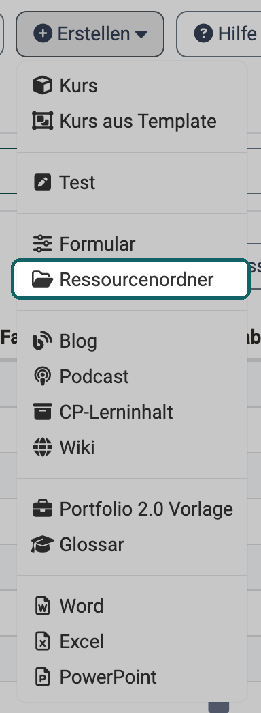{ width="192" class="aside-right lightbox" title="Menü Erstellen im Autorenbereich · 2026.11.10" }

:o_icon_o_FileResource-SHAREDFOLDER_icon:

Mit einem Ressourcenordner nutzen Sie dieselben Dateien, etwa Inhalte, Informationen oder Grafiken, in mehreren Kursen, ohne sie mehrfach anzulegen. Im verknüpften Kurs erscheint der Ressourcenordner im [Ablageordner](Storage_folder.de.md) des Kurses als Unterordner `_sharedfolder` mit allen Dateien darin. Ändern Sie eine Datei im Ressourcenordner, gilt die Änderung in allen verknüpften Kursen. Einen Ressourcenordner binden Sie in den Kurseinstellungen ein, einen je Kurs: 
`Kurs > Administration > Einstellungen > Tab "Optionen"`

Details beschreibt die Seite [Kurseinstellungen - Tab Optionen](Course_Settings_Options.de.md), den Steckbrief die Seite [Ressourcenordner](Resource_Folder.de.md).

[Zum Seitenanfang ^](#learning_resources)

---

## Formular {: #form}

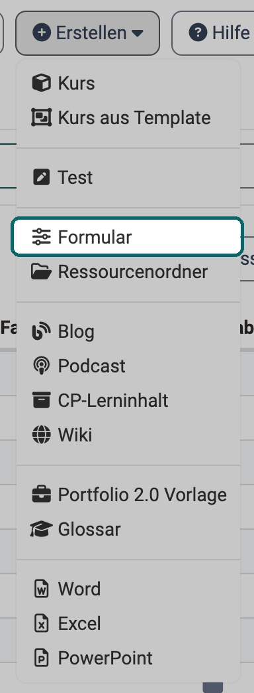{ width="192" class="aside-right lightbox" title="Menü Erstellen im Autorenbereich · 2026.11.10" }

:o_icon_o_FileResource-FORM_icon:

Formulare setzen Sie in OpenOlat zum Beispiel für Umfragen, Datenerhebungen, Selbsteinschätzungen, Fragebogen oder Rubrikbewertung ein. Zum Einsatz kommen sie im Kursbaustein "Formular", im Kursbaustein "Umfrage" oder als Rubrikbewertung im Kursbaustein "Bewertung" oder Kursbaustein "Aufgabe".

Mehr Informationen zum Einsatz und zur Erstellung von Formularen für Umfragen, Rubriks usw. finden Sie im Kapitel [Formulare erstellen](Form/index.de.md).

[Zum Seitenanfang ^](#learning_resources)

---

## Portfolio 2.0 Vorlage [:octicons-tag-16:{ title="ab Release 11.0 (OO-2304)" }](https://track.frentix.com/issue/OO-2304) {: #portfolio}

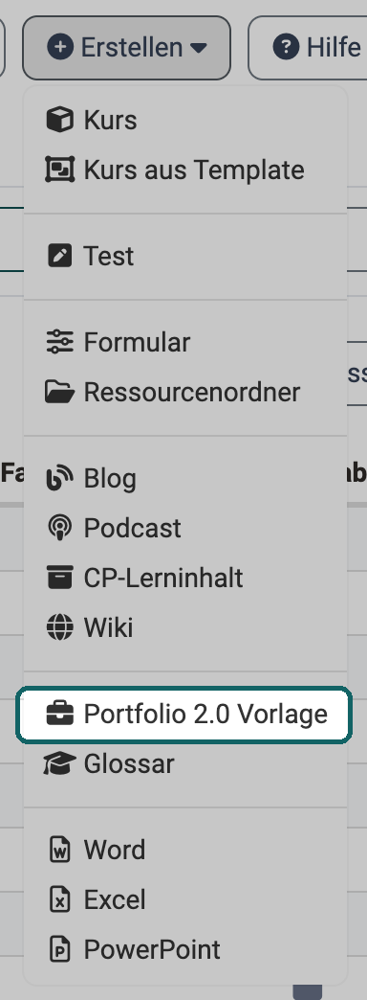{ width="192" class="aside-right lightbox" title="Menü Erstellen im Autorenbereich · 2026.11.10" }

:o_icon_o_BinderTemplate_icon:

Eine Portfolio 2.0 Vorlage enthält die Aufgaben für ein Portfolio-Assessment. Mit ihr gestalten Lehrende eine strukturierte Mappe. In einen Kurs binden Sie die Vorlage mit dem Kursbaustein "Portfolioaufgabe" ein. Dort holen die Teilnehmenden ihre Mappe mit "Portfolioaufgabe abholen" ab und bearbeiten sie. Wie Sie eine Vorlage erstellen, beschreibt die Seite [Portfoliovorlage: Erstellung](Portfolio_template_Creation.de.md).

[Zum Seitenanfang ^](#learning_resources)

---

## Glossar {: #glossary}

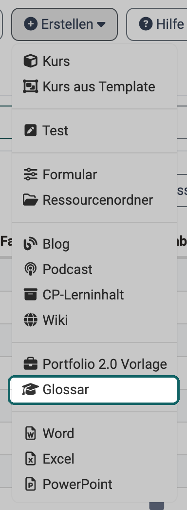{ width="192" class="aside-right lightbox" title="Menü Erstellen im Autorenbereich · 2026.11.10" }

:o_icon_o_FileResource-GLOSSARY_icon:

In einem Glossar sammeln Sie Begriffe mit ihren Definitionen, alphabetisch sortiert. Ist das Glossar in einen Kurs eingebunden, zeigt OpenOlat die Definition eines Begriffs direkt im Lerninhalt, zum Beispiel in den Kursbausteinen "Seite" und "HTML-Seite". Glossare lassen sich so konfigurieren, dass auch Teilnehmende Begriffe ergänzen.

Ein Glossar binden Sie in den Kurseinstellungen in zwei Schritten ein. Wählen Sie es zuerst mit "Glossar wählen" aus: 
`Kurs > Administration > Einstellungen > Tab "Optionen"` 
Schalten Sie danach die Checkbox "Glossar" ein, damit es in der Toolbar des Kurses erscheint: 
`Kurs > Administration > Einstellungen > Tab "Toolbar"`

Den Steckbrief finden Sie auf der Seite [Glossar](Glossary/index.de.md). Weitere Infos zur [Erstellung](../learningresources/Glossary_create.de.md) und [Verwendung](../learningresources/Glossary_usage.de.md) von Glossaren finden Sie in den entsprechenden Kapiteln.

[Zum Seitenanfang ^](#learning_resources)

---

## Weitere Lernressourcen {: #further_learningresources}

Die folgenden Lernressourcen bringen Sie meist über "Datei importieren" im Autorenbereich in OpenOlat.

### SCORM 1.2 {: #scorm}

:o_icon_o_FileResource-SCORMCP_icon:

OpenOlat unterstützt das standardisierte E-Learning-Format SCORM in der Version 1.2. SCORM steht für "Sharable Content Object Reference Model" und ist ein Referenzmodell für austauschbare elektronische Lerninhalte der ["Advanced Distributed Learning Initiative" (ADL)](http://www.adlnet.gov/). SCORM-Lerninhalte verwenden Sie in OpenOlat-Kursen und ebenso in anderen LMS.

Einen SCORM-Lerninhalt bringen Sie als Paket über "Datei importieren" in OpenOlat und binden ihn mit dem Kursbaustein "SCORM 1.2" in einen Kurs ein. Im Autorenbereich trägt er dasselbe Symbol wie ein [CP-Lerninhalt](#cp-content).

[Zum Seitenanfang ^](#learning_resources)

---

### Audio

:o_icon_o_FileResource-SOUND_icon:

Audiodateien bringen Sie über "Datei importieren" als Lernressource in OpenOlat. An einigen Stellen nehmen Sie Audio auch direkt in OpenOlat auf, siehe [Audio aufnehmen](../learningresources/Audio_Recording.de.md).

[Zum Seitenanfang ^](#learning_resources)

---

### Video [:octicons-tag-16:{ title="ab Release 10.5 (OO-725)" }](https://track.frentix.com/issue/OO-725)

:o_icon_o_FileResource-VIDEO_icon:

OpenOlat verwendet Video-Lerninhalt im MPEG-4-Format mit der Dateiendung MP4. Eine Lernressource Video fügen Sie über "Datei importieren" oder "Per URL einbinden" hinzu und konfigurieren sie danach weiter: Untertitel in mehreren Sprachen, Quiz, Anmerkungen und Kapitel. Generelle Informationen finden Sie im Kapitel [Lernressource: Video](../learningresources/Learning_resource_Video.de.md).

[Zum Seitenanfang ^](#learning_resources)

---

### Lernressourcen vom Typ Datei und andere Dateien

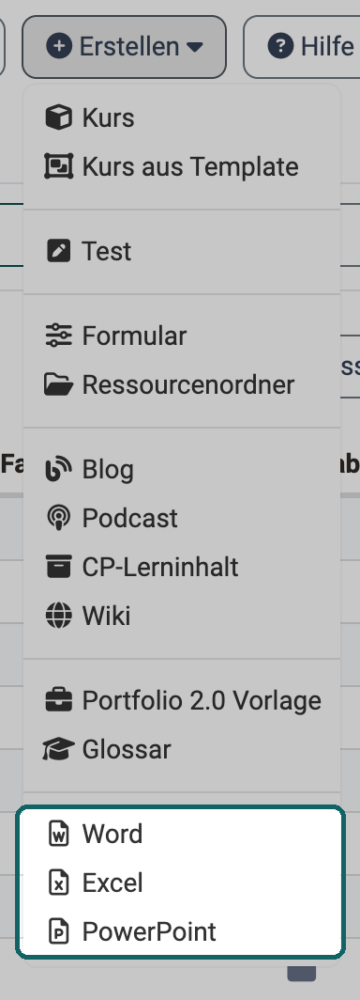{ width="192" class="aside-right lightbox" title="Menü Erstellen im Autorenbereich · 2026.11.10" }

Über "Datei importieren" bringen Sie weitere Dateitypen als Lernressource in OpenOlat, etwa PDF-, PowerPoint-, Excel- und Word-Dateien sowie Bilder, Musik und Animationen.

Ist ein Dokumenteneditor eingeschaltet, erstellen Sie Word-, Excel- oder PowerPoint-Dateien auch direkt in OpenOlat als Lernressource. Welche Dateitypen Sie mit Ihrer Konfiguration erstellen können, zeigt das Menü "Erstellen".

!!! info "Wichtig"

    Diagramm-Dateien (draw.io) lassen sich hier in der Regel nicht direkt erstellen. Nutzen Sie dafür z.B. das Media Center, einen Kurs oder den Bereich "Projekte".

[Zum Seitenanfang ^](#learning_resources)

---

## Weiterführende Informationen {: #further_information}

**Weiterführend** 
[Autorenbereich - Übersicht >](../area_modules/Authoring/index.de.md) 
[Detailansicht einer Lernressource >](Detailed_View_of_Learning_Resources.de.md) 
[Zugangskonfiguration / Freigabe >](Access_configuration.de.md)

[Zum Seitenanfang ^](#learning_resources)
