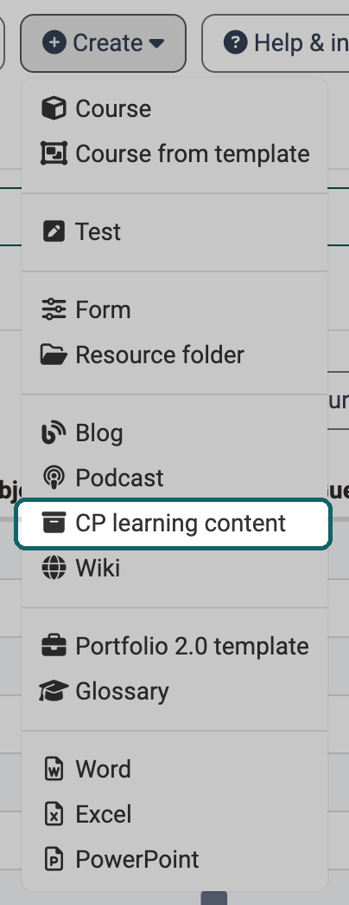
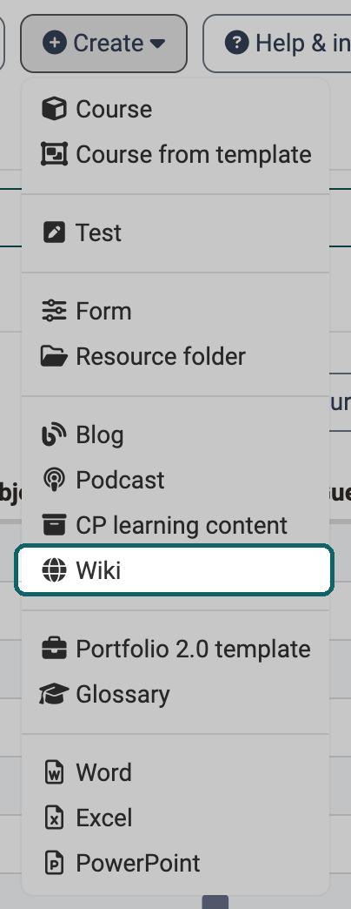
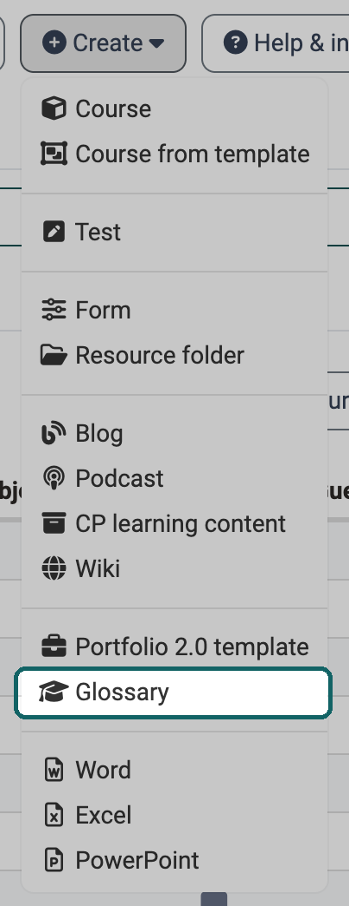
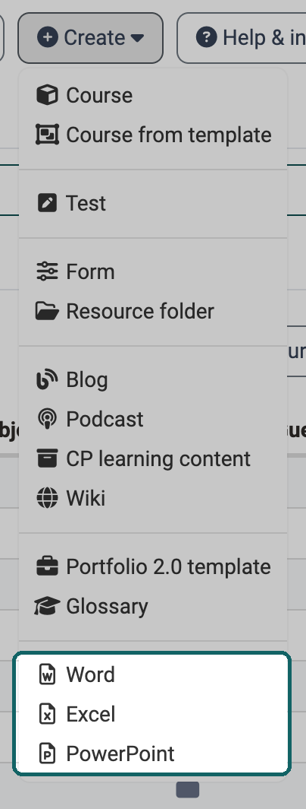

# Various Types of Learning Resources {: #learning_resources}

In OpenOlat, you create courses, tests, wikis, forms and other content as [learning resources](General_Functions_Concept.md) in the [authoring area](../area_modules/Authoring/index.md). You embed most learning resources in a course via a [course element](Course_Elements/index.md), the glossary and the resource folder via the course settings. You create many types directly in the "Create" menu of the authoring area, and you upload [further learning resources](#further_learningresources) via "Import file".

The sections on the individual types show the icon of the type below the title. The learning resource appears with the same icon in the "Type" column of the authoring area. If you point to the icon with the mouse, OpenOlat shows the name of the type.

{ class="shadow lightbox" title="Create menu in the authoring area · 2026.11.10" }

---

## Course {: #course}

{ width="202" class="aside-right lightbox" title="Create menu in the authoring area · 2026.11.10" }

:o_icon_o_CourseModule_icon:

An OpenOlat course serves as an online-only course or accompanies lectures, seminars and other face-to-face events. It combines any number of course elements in a structure. This way, you implement different didactic concepts, for example webquests, group puzzles, cooperative online seminars, problem-based learning or game-based approaches.

You find the profile and the course cycle from creation to deletion on the page [General Information](General_Information/index.md) about the course. How to create courses is explained in the chapter ["Creating Courses"](Creating_Course.md). Details on course elements and the course editor can be found in the chapter ["Course elements at a glance"](Course_Elements/index.md).

If you or your organisation have prepared templates, you can create a new course directly from one of them: with the entry "Course from template" in the "Create" menu. A template is a course with the usage "Template". A wizard guides you through two steps: in the step "Template" you select the template, in the step "Settings" you give the new course a title, a reference and an execution period, among other things. OpenOlat creates the course as a copy, the template itself remains unchanged. Available are the templates you own or manage and templates that are released to authors for copying. More about the usage "Template" can be found in the chapter ["Creating Courses"](Creating_Course.md#purpose). [:octicons-tag-16:{ title="from Release 20.2 (OO-8897)" }](https://track.frentix.com/issue/OO-8897)

[To the top of the page ^](#learning_resources)

---

## Test {: #test}

{ width="202" class="aside-right lightbox" title="Create menu in the authoring area · 2026.11.10" }

:o_icon_o_FileResource-IMSQTI21_icon:

You use tests for examinations and for practice. In the course element "Test", owners and coaches see the results of the participants; in the course element "Self-test", OpenOlat saves all entries anonymously. Each test is available in the standardized format IMS QTI 2.1.

More information on using and creating tests can be found in the chapter ["Creating Tests"](Test/index.md).

[To the top of the page ^](#learning_resources)

---

## CP Learning Content {: #cp-content}

{ width="202" class="aside-right lightbox" title="Create menu in the authoring area · 2026.11.10" }

:o_icon_o_FileResource-IMSCP_icon:

A Content Packaging (abbr.: CP) is learning content in a standardized e-learning format. As with tests, the specification of this data format comes from [IMS resp. 1EdTech Consortium](http://www.imsglobal.org/ "IMS resp. 1EdTech Consortium"). OpenOlat supports the IMS CP version 1.1.2. You use CP learning content in OpenOlat courses and also in other LMS (learning management systems). You embed it in a course with the course element "CP learning content". How to create CP learning content is described in the chapter ["Create CP learning content"](../learningresources/CP_Editor.md).

In the authoring area, OpenOlat shows CP learning content with the icon of an archive. [SCORM learning content](#scorm) has the same icon. The name tells you which of the two types it is: if you point to the icon in the "Type" column with the mouse, OpenOlat shows "CP learning content" or "SCORM 1.2".

[To the top of the page ^](#learning_resources)

---

## Wiki {: #wiki}

{ width="202" class="aside-right lightbox" title="Create menu in the authoring area · 2026.11.10" }

:o_icon_o_FileResource-WIKI_icon:

In a wiki, several people create content together. A wiki serves for group work, as a documentation tool or as a knowledge base for studies and projects.

The page ["Wiki"](../learningresources/Wiki.md) describes the profile of the wiki and how to create one. How to create content in a wiki and work with it efficiently is explained in the chapter [Course Element "Wiki"](../learningresources/Course_Element_Wiki.md).

[To the top of the page ^](#learning_resources)

---

## Podcast {: #podcast}

{ width="202" class="aside-right lightbox" title="Create menu in the authoring area · 2026.11.10" }

:o_icon_o_FileResource-PODCAST_icon:

In a podcast, you provide audio and video files as episodes in OpenOlat. Participants listen to or watch the episodes directly in OpenOlat or subscribe to the podcast via services such as iTunes and load the episodes onto mobile devices. If ratings and comments are switched on, participants rate and comment on the episodes. You embed a podcast in a course with the course element "Podcast".

Further information on podcasts can be found in the chapter ["Podcast: Overview"](Podcast/index.md).

[To the top of the page ^](#learning_resources)

---

## Blog {: #blog}

{ width="203" class="aside-right lightbox" title="Create menu in the authoring area · 2026.10.27" }

:o_icon_o_FileResource-BLOG_icon:

In a blog, you publish subject-related or personal information in chronological order, for example as an online diary or online journal. If ratings and comments are switched on, participants rate and comment on the entries.

In the authoring area, in the course menu and in the toolbar, the blog has its own blog icon. The megaphone icon belongs to the [info messages](Course_Element_Notifications.md).

The page [Blog: Overview](Blog/index.md) describes the profile and the functions of the blog, the page [Course Element "Blog"](../learningresources/Course_Element_Blog.md) the course element. How to create a blog and embed it in your course is shown in the guide [How do I create a blog?](../../manual_how-to/blog/blog.md).

[To the top of the page ^](#learning_resources)

---

## Resource Folder {: #resource_folder}

{ width="202" class="aside-right lightbox" title="Create menu in the authoring area · 2026.11.10" }

:o_icon_o_FileResource-SHAREDFOLDER_icon:

With a resource folder, you use the same files, for example content, information or graphics, in several courses without creating them several times. In the linked course, the resource folder appears in the [storage folder](Storage_folder.md) of the course as the subfolder `_sharedfolder` with all its files. If you change a file in the resource folder, the change applies in all linked courses. You embed a resource folder in the course settings, one per course: 
`Course > Administration > Settings > Tab "Options"`

The page [Course Settings - Tab Options](Course_Settings_Options.md) describes the details, the page [Resource folder](Resource_Folder.md) the profile.

[To the top of the page ^](#learning_resources)

---

## Form {: #form}

{ width="202" class="aside-right lightbox" title="Create menu in the authoring area · 2026.11.10" }

:o_icon_o_FileResource-FORM_icon:

You use forms in OpenOlat, for example, for surveys, data collection, self-assessments, questionnaires or rubric assessment. They are used in the course element "Form", in the course element "Survey" or as rubric assessment in the course element "Assessment" or course element "Task".

More information on the use and creation of forms for surveys, rubrics etc. can be found in the chapter [Creating forms](Form/index.md).

[To the top of the page ^](#learning_resources)

---

## Portfolio 2.0 Template [:octicons-tag-16:{ title="from Release 11.0 (OO-2304)" }](https://track.frentix.com/issue/OO-2304) {: #portfolio}

{ width="202" class="aside-right lightbox" title="Create menu in the authoring area · 2026.11.10" }

:o_icon_o_BinderTemplate_icon:

A Portfolio 2.0 template contains the assignments for a portfolio assessment. With it, lecturers design a structured binder. You embed the template in a course with the course element "Portfolio task". There, the participants collect their binder with "Collect portfolio task" and work on it. How to create a template is described on the page [Portfolio template: Creation](Portfolio_template_Creation.md).

[To the top of the page ^](#learning_resources)

---

## Glossary {: #glossary}

{ width="202" class="aside-right lightbox" title="Create menu in the authoring area · 2026.11.10" }

:o_icon_o_FileResource-GLOSSARY_icon:

In a glossary, you collect terms with their definitions, sorted alphabetically. If the glossary is embedded in a course, OpenOlat shows the definition of a term directly in the learning content, for example in the course elements "Page" and "HTML page". Glossaries can be configured so that participants can also add terms.

You embed a glossary in the course settings in two steps. First select it with "Select glossary": 
`Course > Administration > Settings > Tab "Options"` 
Then switch on the "Glossary" checkbox so that it appears in the toolbar of the course: 
`Course > Administration > Settings > Tab "Toolbar"`

You find the profile on the page [Glossary](Glossary/index.md). Further information on the [creation](../learningresources/Glossary_create.md) and [usage](../learningresources/Glossary_usage.md) of glossaries can be found in the corresponding chapters.

[To the top of the page ^](#learning_resources)

---

## Further learning resources {: #further_learningresources}

You usually bring the following learning resources into OpenOlat via "Import file" in the authoring area.

### SCORM 1.2 {: #scorm}

:o_icon_o_FileResource-SCORMCP_icon:

OpenOlat supports the standardized e-learning format SCORM in version 1.2. SCORM stands for "Sharable Content Object Reference Model" and is a reference model for exchangeable electronic learning content of the ["Advanced Distributed Learning Initiative" (ADL)](http://www.adlnet.gov/). You use SCORM learning content in OpenOlat courses and also in other LMS.

You bring SCORM learning content into OpenOlat as a package via "Import file" and embed it in a course with the course element "SCORM 1.2". In the authoring area, it has the same icon as [CP learning content](#cp-content).

[To the top of the page ^](#learning_resources)

---

### Audio

:o_icon_o_FileResource-SOUND_icon:

You bring audio files into OpenOlat as a learning resource via "Import file". In some places, you also record audio directly in OpenOlat, see [Audio recording](../learningresources/Audio_Recording.md).

[To the top of the page ^](#learning_resources)

---

### Video [:octicons-tag-16:{ title="from Release 10.5 (OO-725)" }](https://track.frentix.com/issue/OO-725)

:o_icon_o_FileResource-VIDEO_icon:

OpenOlat uses video learning content in the MPEG-4 format with the file extension MP4. You add a learning resource Video via "Import file" or "Embed via URL" and then configure it further: subtitles in several languages, quiz, annotations and chapters. General information can be found in the chapter [Learning resource: Video](../learningresources/Learning_resource_Video.md).

[To the top of the page ^](#learning_resources)

---

### Learning resources of the type file and other files

{ width="202" class="aside-right lightbox" title="Create menu in the authoring area · 2026.11.10" }

Via "Import file", you bring further file types into OpenOlat as a learning resource, for example PDF, PowerPoint, Excel and Word files as well as images, music and animations.

If a document editor is switched on, you also create Word, Excel or PowerPoint files directly in OpenOlat as a learning resource. The "Create" menu shows which file types you can create with your configuration.

!!! info "Important"

    Diagram files (draw.io) can usually not be created directly here. Use the Media Center, a course or the "Projects" area for this purpose.

[To the top of the page ^](#learning_resources)

---

## Further information {: #further_information}

**Further reading** 
[Authoring - Overview >](../area_modules/Authoring/index.md) 
[Detailed View of Learning Resources >](Detailed_View_of_Learning_Resources.md) 
[Access configuration >](Access_configuration.md)

[To the top of the page ^](#learning_resources)
