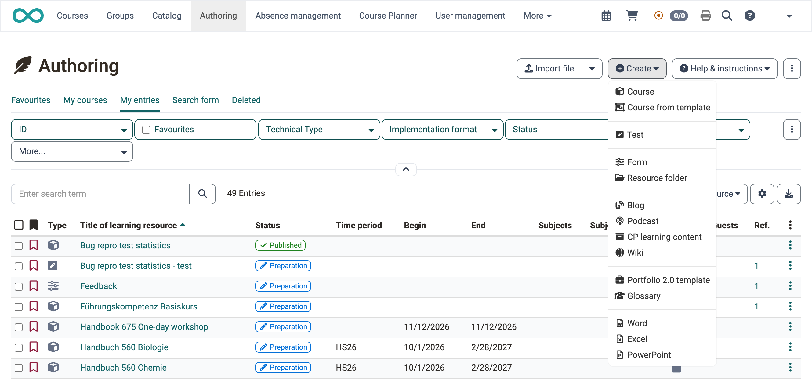
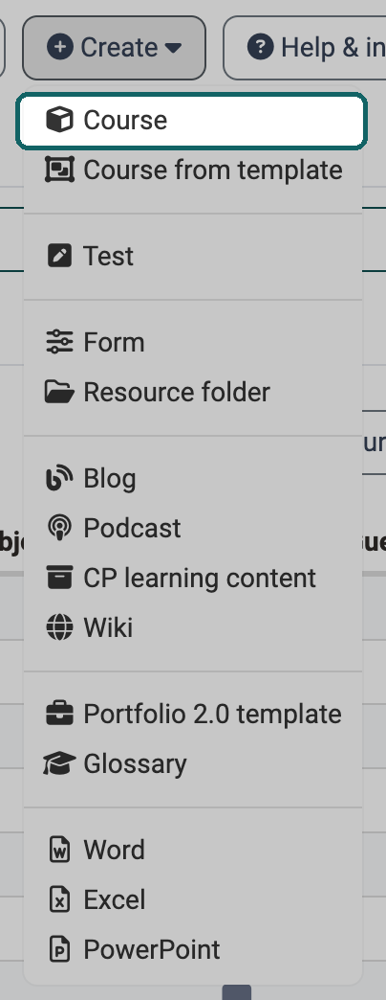
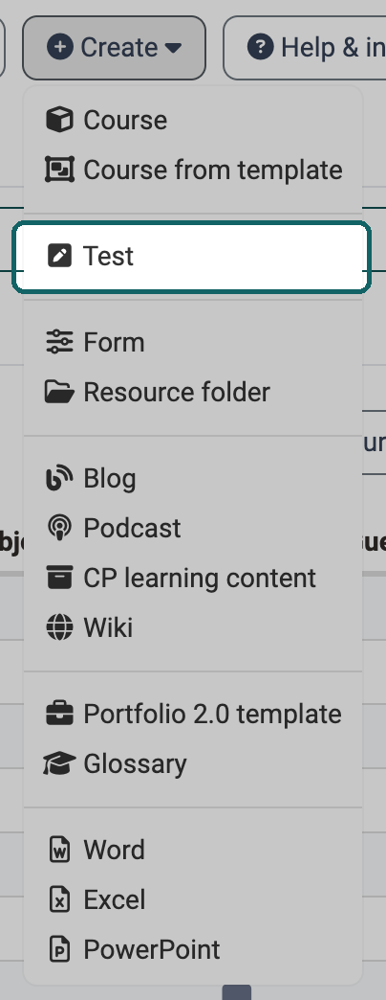
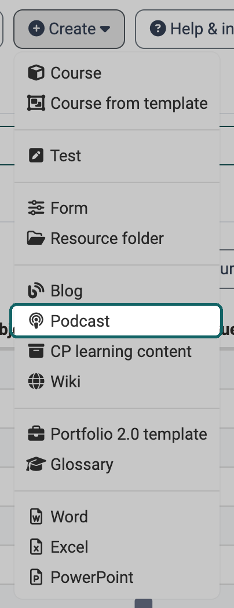
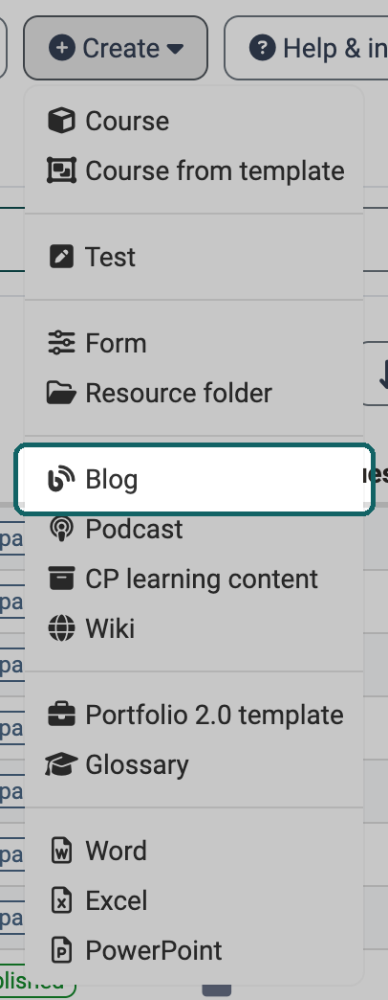
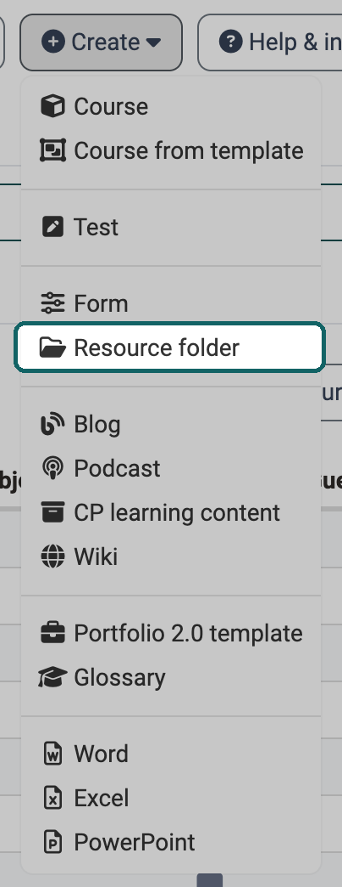
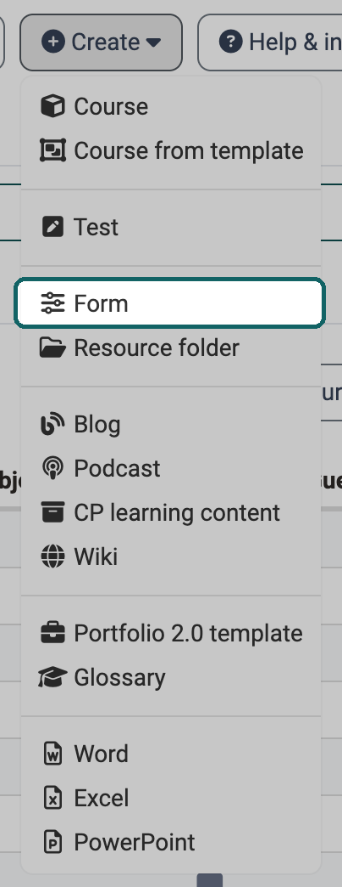
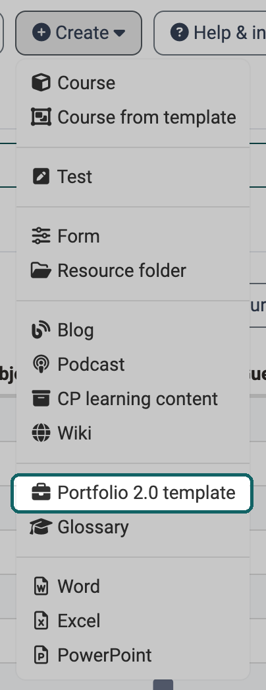

# Various Types of Learning Resources {: #learning_resources}

In OpenOlat, you create courses, tests, wikis, forms and other content as [learning resources](General_Functions_Concept.md) in the authoring area. You embed most learning resources in a course via a [course element](Course_Elements/index.md), the glossary and the resource folder via the course settings. You create many types directly in the "Create" menu of the authoring area, and you upload [further learning resources](#further_learningresources) via "Import file".

The sections on the individual types show the icon of the type below the title. The learning resource appears with the same icon in the "Type" column of the authoring area. If you point to the icon with the mouse, OpenOlat shows the name of the type.

{ class="shadow lightbox" title="Create menu in the authoring area · 2026.11.10" }

---

## Course {: #course}

{ width="202" class="aside-right lightbox" title="Create menu in the authoring area · 2026.11.10" }

:o_icon_o_CourseModule_icon:

An OpenOlat course can be used as an online-only course or accompany lectures, seminars or other face-to-face events. In an OpenOlat course, different didactic concepts like webquest, group puzzles, cooperative online seminars, problem-based learning, game-based approaches etc. can be implemented. A course combines any number of course elements in a structure.

You find the profile and the course cycle from creation to deletion on the page [General Information](General_Information/index.md) about the course. How to create courses is explained in the chapter ["Creating Courses"](Creating_Course.md). Details on course elements and the course editor can be found in the chapter ["Types of Course Elements"](Course_Elements/index.md).

If you or your organisation have prepared templates, you can create a new course directly from one of them: with the entry "Course from template" in the "Create" menu. A template is a course with the usage "Template". A wizard guides you through two steps: in the step "Template" you select the template, in the step "Settings" you give the new course a title, a reference and an execution period, among other things. OpenOlat creates the course as a copy, the template itself remains unchanged. Available are the templates you own or manage and templates that are released to authors for copying. More about the usage "Template" can be found in the chapter ["Creating Courses"](Creating_Course.md#purpose). [:octicons-tag-16:{ title="from Release 20.2 (OO-8897)" }](https://track.frentix.com/issue/OO-8897)

[To the top of the page ^](#learning_resources)

---

## Test {: #test}

{ width="202" class="aside-right lightbox" title="Create menu in the authoring area · 2026.11.10" }

:o_icon_o_FileResource-IMSQTI21_icon:

OpenOlat tests can be used for both examination and practice purposes. In the first case, the course authors can view the test results and assign them to the participants; in the second case, the results are stored anonymously. Each test is available in the standardized format IMS QTI 2.1.

More information on using and creating tests can be found in the chapter ["Creating Tests"](Test/index.md).

[To the top of the page ^](#learning_resources)

---

## CP Learning Content {: #cp-content}

{ width="202" class="aside-right lightbox" title="Create menu in the authoring area · 2026.11.10" }

:o_icon_o_FileResource-IMSCP_icon:

A Content Packaging (abbr.: CP) is learning content in a standardized e-learning format. The specification of this data format also comes from [IMS resp. 1EdTech Consortium](http://www.imsglobal.org/ "IMS resp. 1EdTech Consortium"). OpenOlat supports the IMS CP version 1.1.2. CPs are suitable for use in OpenOlat courses or outside of OpenOlat. OpenOlat supports this format so that learning content can be used not only in OpenOlat but in other LMS (learning management systems) as well. You embed CP learning content in a course with the course element "CP learning content". More information on creating Content Packagings can be found in the chapter ["CP Editor"](../learningresources/CP_Editor.md).

In the authoring area, OpenOlat shows CP learning content with the icon of an archive. [SCORM learning content](#scorm) has the same icon. The name tells you which of the two types it is: if you point to the icon in the "Type" column with the mouse, OpenOlat shows "CP learning content" or "SCORM 1.2".

[To the top of the page ^](#learning_resources)

---

## Wiki {: #wiki}

{ width="202" class="aside-right lightbox" title="Create menu in the authoring area · 2026.11.10" }

:o_icon_o_FileResource-WIKI_icon:

Wikis make it easy to create content jointly. A wiki can be used for group work, as a documentation tool or as a knowledge base for studies and projects.

More information on creating wikis can be found in the chapter ["Creating Wikis"](../learningresources/Wiki.md). How to create content in a wiki and work with it efficiently is explained in the chapter [Course Element "Wiki"](../learningresources/Course_Element_Wiki.md).

[To the top of the page ^](#learning_resources)

---

## Podcast {: #podcast}

{ width="202" class="aside-right lightbox" title="Create menu in the authoring area · 2026.11.10" }

:o_icon_o_FileResource-PODCAST_icon:

A podcast allows you to upload audio or video files that can then be made available in OpenOlat. Podcasts can either be listened to or watched directly in OpenOlat, or they can be subscribed to in portals such as iTunes in order to copy single episodes to mobile devices later on. Participants can easily rate and comment on episodes.

Further information on podcasts can be found in the chapter ["Podcast: Overview"](Podcast/index.md).

[To the top of the page ^](#learning_resources)

---

## Blog {: #blog}

{ width="203" class="aside-right lightbox" title="Create menu in the authoring area · 2026.10.27" }

:o_icon_o_FileResource-BLOG_icon:

In a blog, subject-related or personal information can be published and commented on in a time-structured manner. Blogs are often used as an online diary or online journal. Blogs embedded in courses can also be rated and commented on easily by participants.

The page [Blog: Overview](Blog/index.md) describes the profile and the functions of the blog. Here you can find more information about the [course element blog](../learningresources/Course_Element_Blog.md). Information on how to create a blog and embed it in your course can be found in the ["How to section"](../../manual_how-to/blog/blog.md).

[To the top of the page ^](#learning_resources)

---

## Resource Folder {: #resource_folder}

{ width="202" class="aside-right lightbox" title="Create menu in the authoring area · 2026.11.10" }

:o_icon_o_FileResource-SHAREDFOLDER_icon:

With the help of the resource folder, files (content, information, graphics, etc.) can be used in multiple courses. The files are referenced from the resource folder and therefore do not need to be created multiple times. The linked resource folder is displayed in the files of the linked course under `_sharedfolder`, and all files stored in the resource folder can be accessed. Changes to the files in the resource folder then apply to all linked courses. You embed a resource folder in the course settings, one per course: 
`Course > Administration > Settings > Tab "Options"`

The page [Course Settings - Tab Options](Course_Settings_Options.md) describes the details, the page [Resource folder](Resource_Folder.md) the profile.

[To the top of the page ^](#learning_resources)

---

## Form {: #form}

{ width="202" class="aside-right lightbox" title="Create menu in the authoring area · 2026.11.10" }

:o_icon_o_FileResource-FORM_icon:

Forms can be used in OpenOlat for a variety of purposes and in different places. They are suitable, for example, for surveys, data collection, self-assessments, questionnaires or rubric assessment. They are used in the course element "Form", in the course element "Survey" or as rubric assessment in the course element "Assessment" or course element "Task".

More information on the use and creation of forms for surveys, rubrics etc. can be found in the chapter [Creating forms](Form/index.md).

[To the top of the page ^](#learning_resources)

---

## Portfolio 2.0 Template [:octicons-tag-16:{ title="from Release 11.0 (OO-2304)" }](https://track.frentix.com/issue/OO-2304) {: #portfolio}

{ width="202" class="aside-right lightbox" title="Create menu in the authoring area · 2026.11.10" }

:o_icon_o_BinderTemplate_icon:

A Portfolio 2.0 template contains assignments that can be used as part of a portfolio assessment and embedded in an OpenOlat course as a portfolio task. With the help of a Portfolio 2.0 template, lecturers can design a structured portfolio binder that learners can collect and edit. Further information on the [Portfolio 2.0 template](Portfolio_template_Creation.md) can be found in the corresponding chapter.

[To the top of the page ^](#learning_resources)

---

## Glossary {: #glossary}

{ width="202" class="aside-right lightbox" title="Create menu in the authoring area · 2026.11.10" }

:o_icon_o_FileResource-GLOSSARY_icon:

A glossary can be used to store terms and definitions and make them accessible in alphabetical order. If a glossary is embedded in an OpenOlat course, the terms can also be displayed directly for explanation in embedded HTML files. Furthermore, glossaries can be configured so that learners can also add content to a glossary.

You embed a glossary in the course settings: 
`Course > Administration > Settings > Tab "Options"`

You find the profile on the page [Glossary](Glossary/index.md). Further information on the [creation](../learningresources/Glossary_create.md) and [usage](../learningresources/Glossary_usage.md) of glossaries can be found in the corresponding chapters.

[To the top of the page ^](#learning_resources)

---

## Further learning resources {: #further_learningresources}

You usually bring the following learning resources into OpenOlat via "Import file" in the authoring area.

### SCORM 1.2 {: #scorm}

:o_icon_o_FileResource-SCORMCP_icon:

Another standardized e-learning format supported by OpenOlat is the SCORM format (version 1.2). SCORM stands for "Sharable Content Object Reference Model" and is a reference model for exchangeable electronic learning content of the ["Advanced Distributed Learning Initiative" (ADL)](http://www.adlnet.gov/). SCORM learning content is suitable for use in OpenOlat courses or outside of OpenOlat. OpenOlat supports this format so that you can use your learning content not only in OpenOlat but also in other LMS.

You bring SCORM learning content into OpenOlat as a package via "Import file" and embed it in a course with the course element "SCORM 1.2". In the authoring area, it has the same icon as [CP learning content](#cp-content).

[To the top of the page ^](#learning_resources)

---

### Audio

:o_icon_o_FileResource-SOUND_icon:

Audio files can be uploaded to OpenOlat and, in some places, can also be [recorded directly in OpenOlat](../learningresources/Audio_Recording.md).

[To the top of the page ^](#learning_resources)

---

### Video [:octicons-tag-16:{ title="from Release 10.5 (OO-725)" }](https://track.frentix.com/issue/OO-725)

:o_icon_o_FileResource-VIDEO_icon:

OpenOlat uses video learning content in the MPEG-4 format with the file extension MP4. The learning resource video can be added in OpenOlat via "Import file" or "Embed via URL" and then further configured. OpenOlat supports the display of subtitles in multiple languages, integrated quizzes, annotations and jump labels. General information can be found in the chapter [Learning resource: Video](../learningresources/Learning_resource_Video.md).

[To the top of the page ^](#learning_resources)

---

### Learning resources of the type file and other files

{ width="202" class="aside-right lightbox" title="Create menu in the authoring area · 2026.11.10" }

Apart from the above-mentioned learning resources, you can import a number of other file types into OpenOlat. Among these are PDF, PowerPoint, Excel and Word files as well as images, music and animations.

In addition, if a corresponding document editor is activated, you can create Word, Excel or PowerPoint files directly in OpenOlat as a learning resource. Which files can be created with your configuration is shown in the "Create" list.

!!! info "Important"

    Diagram files (draw.io) can usually not be created directly here. Use the Media Center, a course or the "Projects" area for this purpose.

[To the top of the page ^](#learning_resources)

---

## Further information {: #further_information}

**Further reading** 
[Authoring - Overview >](../area_modules/Authoring/index.md) 
[Detailed View of Learning Resources >](Detailed_View_of_Learning_Resources.md) 
[Access configuration >](Access_configuration.md)

[To the top of the page ^](#learning_resources)
